

# 🚀 trader.lifestyle — Free MT4 / MT5 Tools

### Expert Advisors & indicators built for the Forex Factory community — free, no lock, no expiry.

     

[**Forex Factory thread**](https://www.forexfactory.com/thread/1428808-free-eas-indicators-strategies-mt4) · [**YouTube**](https://www.youtube.com/@traderlifestyle) · [**WhatsApp**](https://wa.me/18585003724)

---

## 💡 What is this?

Every tool here started as a request or idea from traders on **Forex Factory** — a strategy from a thread, a video, an old indicator that needed fixing.
Each one was rebuilt from scratch, extended with a modern animated dashboard and released **for free**.

- 🟦 **Compiled builds only** (`.ex4` / `.ex5`) — ready to drop into MetaTrader
- 🟨 **No account lock, no expiry, no paid upsell**
- 🖥️ **Modern canvas dashboards** — draggable, collapsible, dark cyan/gold style
- 🌍 **English UI**, tooltips on every input

## ⚙️ Installation (all tools)

1. Open the tool folder below and download the `.ex5` (MT5) or `.ex4` (MT4) file.
2. MetaTrader → **File → Open Data Folder** → `MQL5/Experts` (EAs) or `MQL5/Indicators` (indicators). MT4: `MQL4/...`
3. Right-click the Navigator → **Refresh**, drag the tool onto a chart.
4. Tick **Allow DLL imports** if you want the YouTube / WhatsApp / Forex Factory buttons to open your browser.

## 🤖 Expert Advisors (56)

| | Tool | Platforms | What it does |
|:---:|---|:---:|---|
|  | **[TL ATM Machine Pro](projects/TL-ATM-Machine-Pro)** v1.00 | MT5 | nkpoette's 3-CCI "ATM Machine" from Forex Factory as one MT5 EA — stop-and-reverse on CCI 140/100/42, all three CCI windows built into the panel. |
| 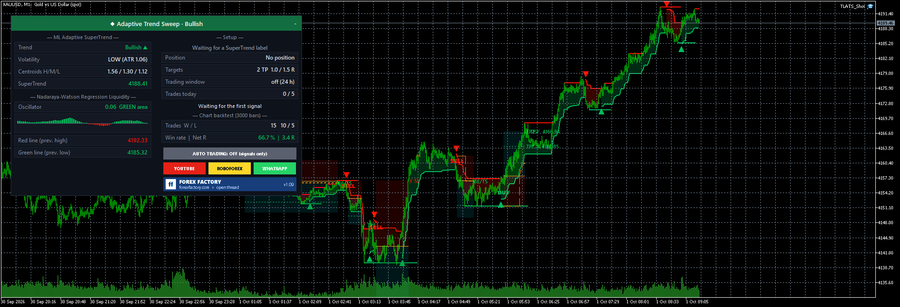 | **[TL Adaptive Trend Sweep Pro](projects/TL-Adaptive-Trend-Sweep-Pro)** v1.09 | MT4 MT5 | Machine-learning adaptive SuperTrend + Nadaraya-Watson liquidity sweeps, automated as an EA with live signal dashboard. |
| 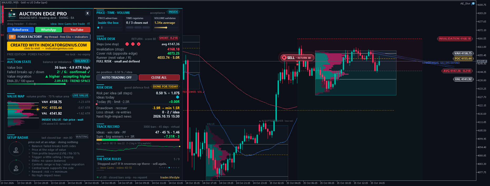 | **[TL Auction Edge Pro](projects/TL-Auction-Edge-Pro)** v1.00 | MT5 | Auction market theory EA for MT5: value area, POC and LVN, scored edge setups and R-based risk on an animated trading desk. |
| 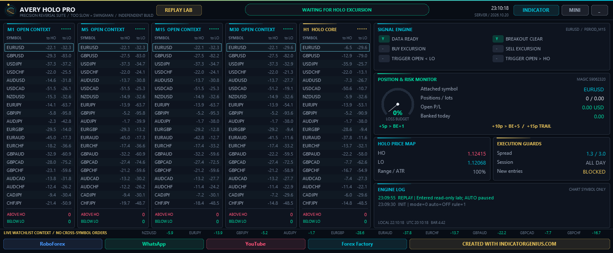 | **[TL Avery Holo Pro](projects/TL-Avery-Holo-Pro)** v1.00 | MT4 MT5 | HOLO reversal workspace with selectable EA/indicator operation, a separate pure indicator and read-only historical replay with a speed slider. |
| 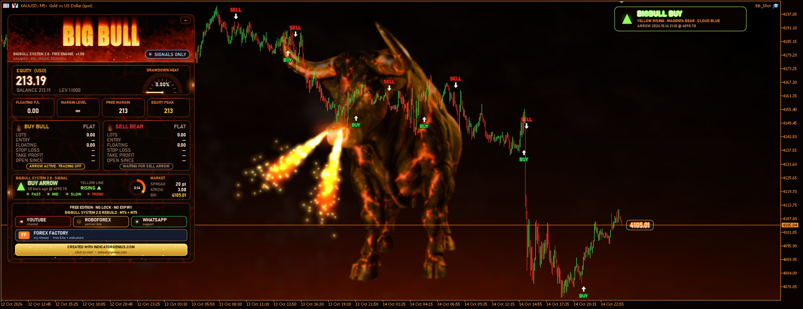 | **[TL Big Bull Fire EA](projects/TL-Big-Bull-Fire-EA)** v1.00 | MT4 MT5 | The BigBull System 2.0 automated: trades the signal-line arrows with a trend filter, ATR risk tools, news filter and an animated fire-bull chart. |
| 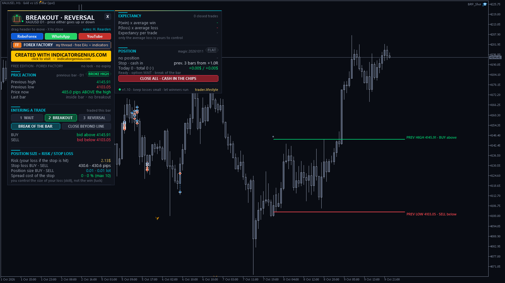 | **[TL Breakout Reversal Pro](projects/TL-Breakout-Reversal-Pro)** v1.10 | MT4 MT5 | "All you need to know about trading" as an EA — small losses, running winners, position size = risk / stop. |
| 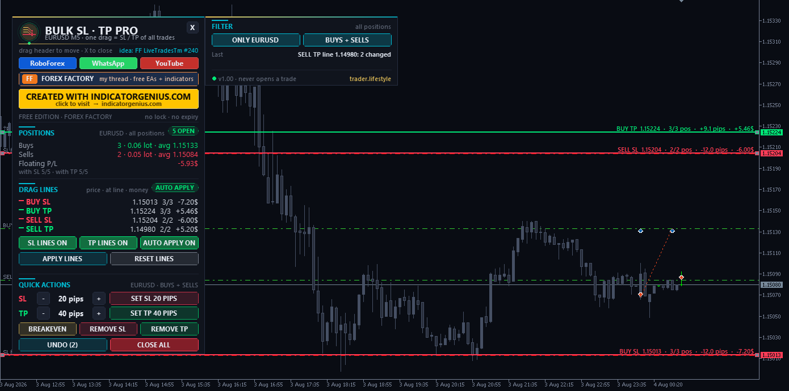 | **[TL Bulk SL TP Pro](projects/TL-Bulk-SL-TP-Pro)** v1.00 | MT5 | Drag ONE line and every open position gets the same stop loss or take profit — without closing anything. |
| 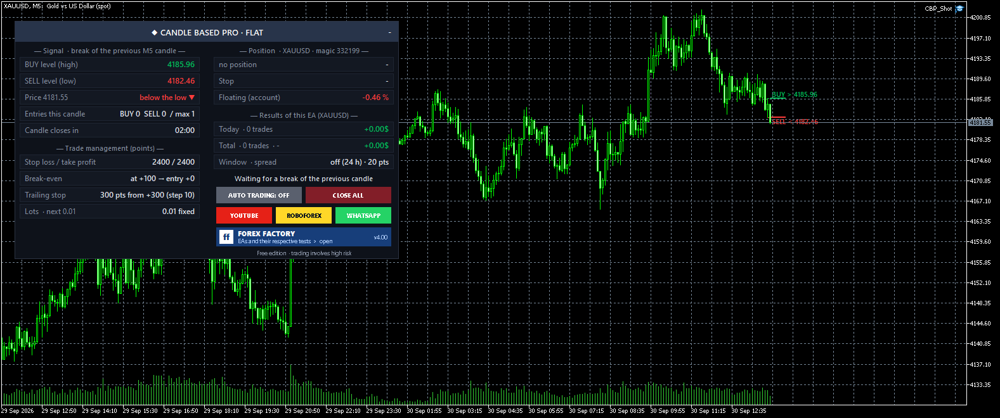 | **[TL Candle Based Pro](projects/TL-Candle-Based-Pro)** v4.00 | MT4 MT5 | Casper C.'s classic previous-candle breakout EA, rebuilt from scratch so every input works on forex, JPY pairs, metals and indices. |
|  | **[TL Candle Trigger Pro](projects/TL-Candle-Trigger-Pro)** v1.00 | MT4 MT5 | The big candle decides the direction, the trigger candle times the entry — a simple price-action EA. |
|  | **[TL Close All Pro](projects/TL-Close-All-Pro)** v1.10 | MT4 MT5 | One button closes every position of the chart symbol. Full panel, small pill or a tiny pixel-sized button. |
| 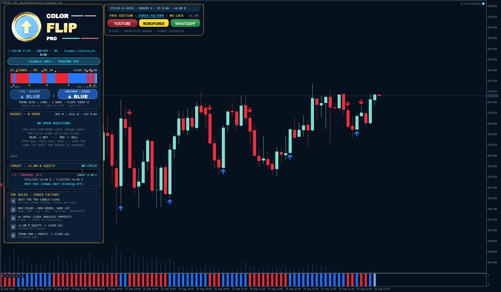 | **[TL Color Flip Pro](projects/TL-Color-Flip-Pro)** v1.00 | MT5 | The GJ "Holygrail" colour-flip system as a one-file MT5 EA: alternating basket, equity-target close and an animated 3D coin panel. |
| 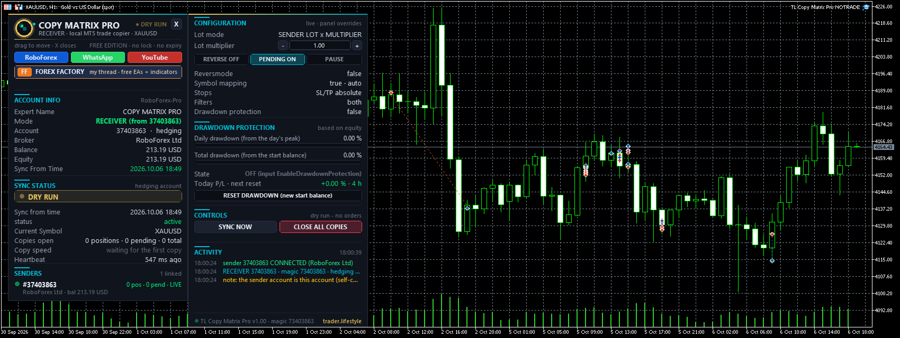 | **[TL Copy Matrix Pro](projects/TL-Copy-Matrix-Pro)** v1.00 | MT5 | Local trade copier — one EA for sender and receiver, no DLL or server, smart lot sizing, symbol mapping and live copy-speed dashboard. |
|  | **[TL Cross Pullback Pro](projects/TL-Cross-Pullback-Pro)** v1.10 | MT4 MT5 | AlistairC's 8/21 EMA cross-and-pullback method, automated with a clean signal and trade panel. |
| 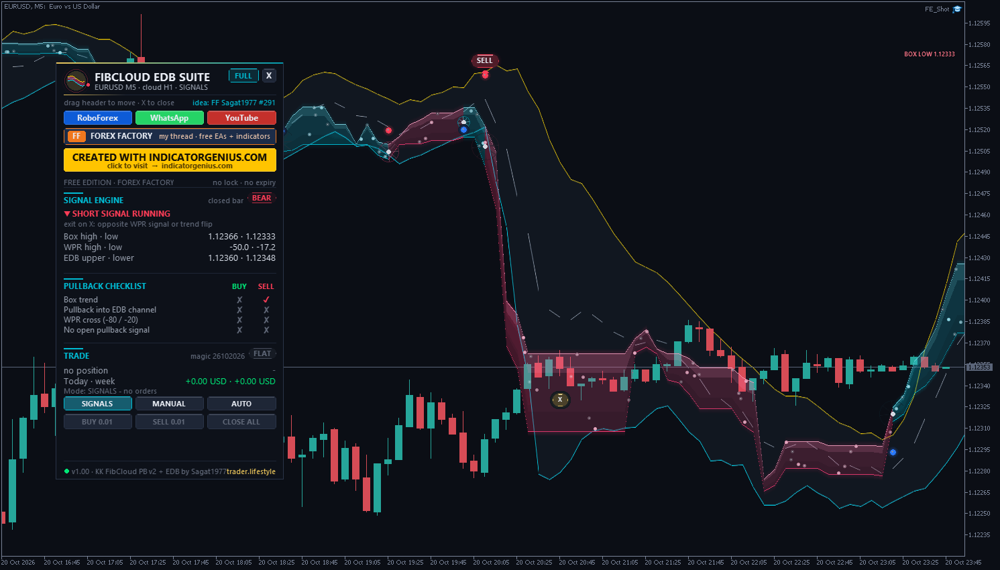 | **[TL FibCloud EDB Suite](projects/TL-FibCloud-EDB-Suite)** v1.00 | MT4 MT5 | Sagat1977's KK FibCloud PB v2 + EDB channel pullback strategy as one EA: box trend, plasma Fib cloud, WPR trigger, X exit, SIGNALS / MANUAL / AUTO and a full-chart 11-symbol x 5-timeframe scanner suite. |
| 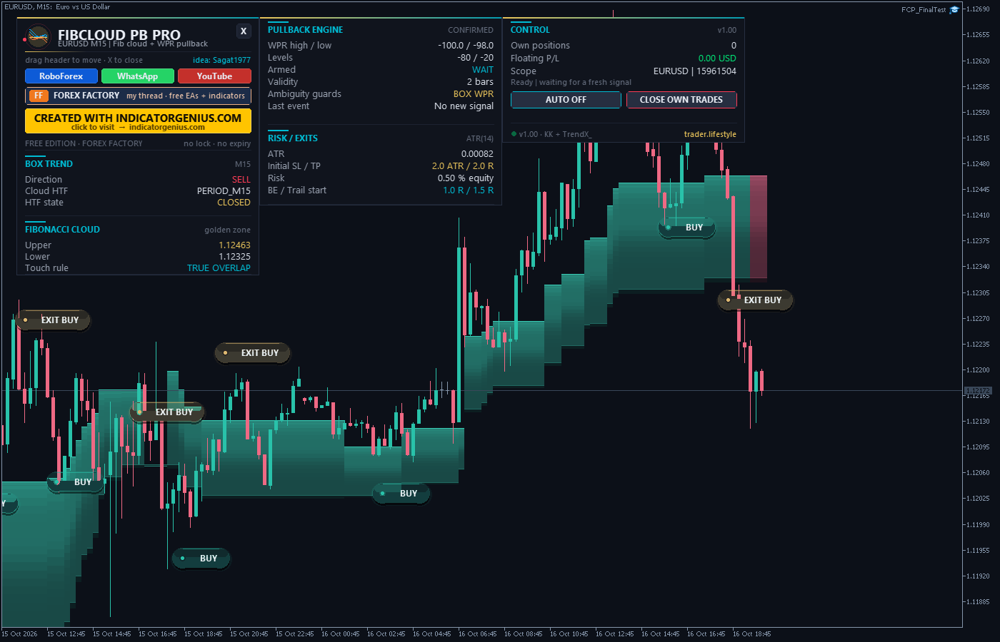 | **[TL FibCloud PB Pro](projects/TL-FibCloud-PB-Pro)** v1.00 | MT4 MT5 | Automated Fibonacci-cloud pullbacks — EA + indicator with cloud-touch and ambiguity filters. |
| 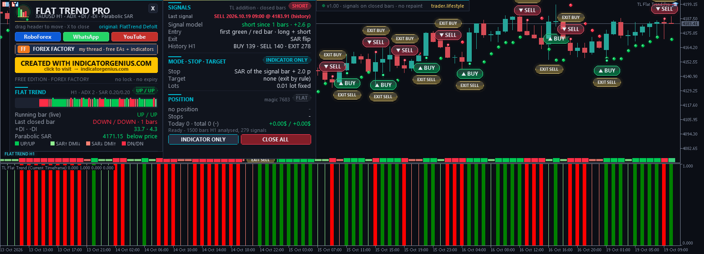 | **[TL Flat Trend Pro](projects/TL-Flat-Trend-Pro)** v1.00 | MT4 MT5 | FlatTrend Defolt rebuilt 1:1 for MT4/MT5 — the four-colour ADX + Parabolic SAR histogram — as an EA with BUY/SELL pills, SAR-flip exit and an optional Autotrade mode. |
| 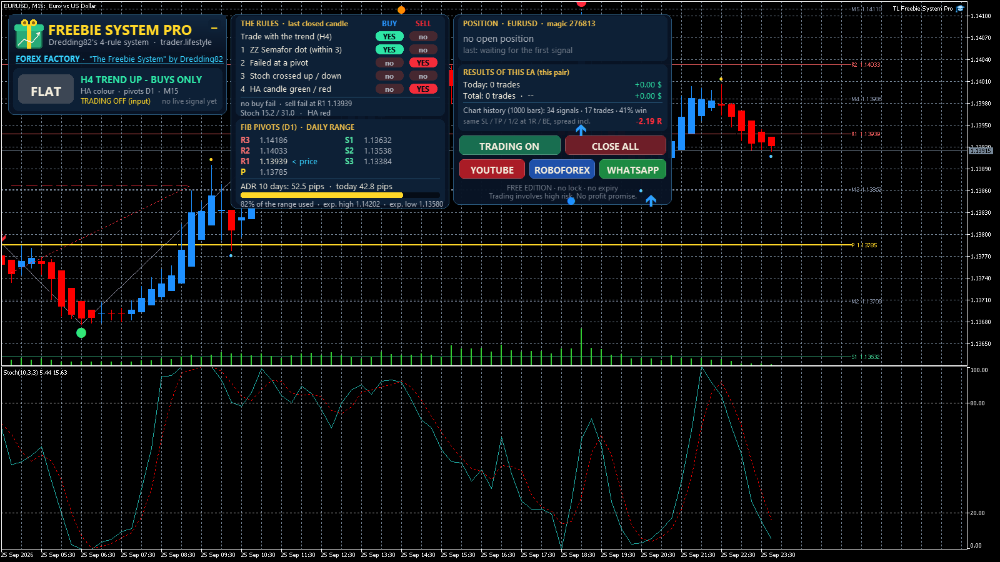 | **[TL Freebie System Pro](projects/TL-Freebie-System-Pro)** v1.00 | MT5 | Dredding82's Freebie system: Semafor + pivot fail + Stochastic + Heikin Ashi in one EA. |
|  | **[TL GAP Matrix Pro](projects/TL-GAP-Matrix-Pro)** v1.00 | MT4 MT5 | 28 pairs × 5 timeframes trend matrix plus GAP buyers / sellers strength on one full-chart dashboard. |
| 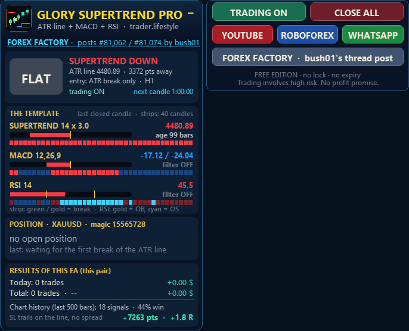 | **[TL Glory SuperTrend Pro](projects/TL-Glory-SuperTrend-Pro)** v1.00 | MT5 | bush01's SuperTrend break EA — stop trails on the ATR line, optional MACD and RSI filters. |
|  | **[TL Gold Arsenal Quant](projects/TL-Gold-Arsenal-Quant)** v1.00 | MT4 MT5 | 106 XAUUSD tools in one animated dashboard — levels, SMC, quant, macro, news and risk — each switchable on or off; nothing trades automatically. |
| 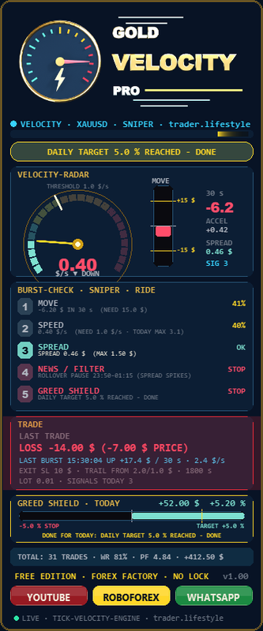 | **[TL Gold Velocity Pro](projects/TL-Gold-Velocity-Pro)** v1.00 | MT5 | Tick-by-tick gold burst detector — ride the move or trade the rebound, with tick-precise trailing, a Greed Shield and a news/DXY bias score. |
| 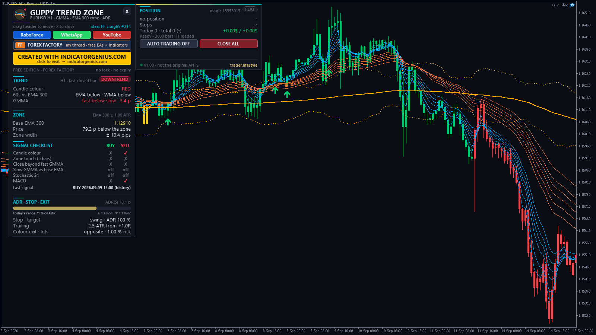 | **[TL Guppy Trend Zone Pro](projects/TL-Guppy-Trend-Zone-Pro)** v1.00 | MT4 MT5 | Daryl Guppy's GMMA as EA + indicator: trend-coloured candles, pullback entries into the 300 EMA zone, ADR targets and ATR trailing. |
| 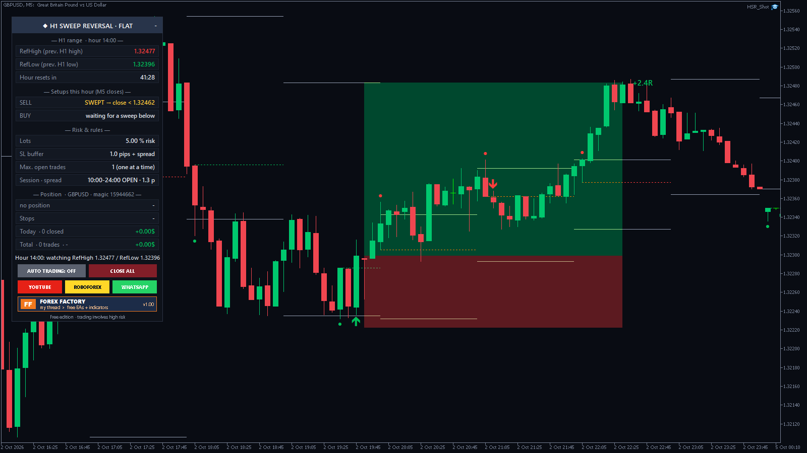 | **[TL H1 Sweep Reversal Pro](projects/TL-H1-Sweep-Reversal-Pro)** v1.00 | MT4 MT5 | H1 liquidity sweep followed by an M5 reversal entry — Silkysilv's method automated. |
| 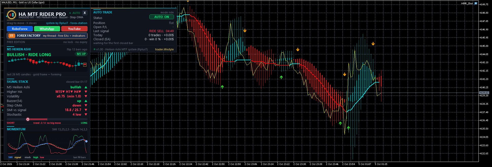 | **[TL HA MTF Rider Pro](projects/TL-HA-MTF-Rider-Pro)** v1.00 | MT4 MT5 | RplusT's multi-timeframe Heikin Ashi system rebuilt as one EA — no extra indicators needed. |
| 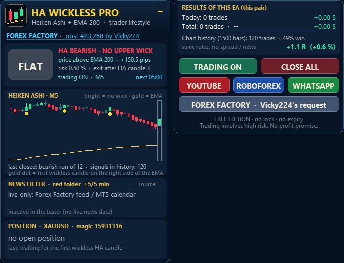 | **[TL HA Wickless Pro](projects/TL-HA-Wickless-Pro)** v1.00 | MT4 MT5 | Wickless Heikin Ashi candles + EMA 200 on M5, with Forex Factory red-folder news filter. |
|  | **[TL HFT Swing Quant](projects/TL-HFT-Swing-Quant)** v1.00 | MT5 | The fxDreema box-breakout video as an EA: 12-bar / 30-pip box, signal line cross, fixed SL / TP — with quant panel. |
| 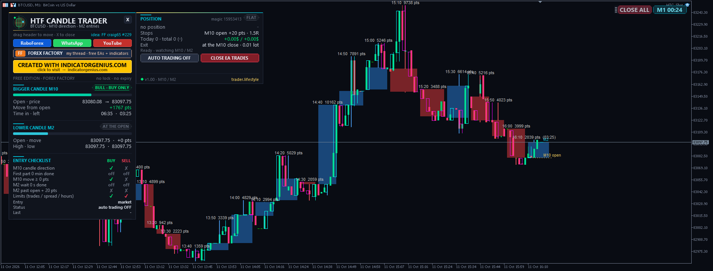 | **[TL HTF Candle Trader Pro](projects/TL-HTF-Candle-Trader-Pro)** v1.00 | MT5 | Trades the lower timeframe inside the structure of the higher-timeframe candle. |
| 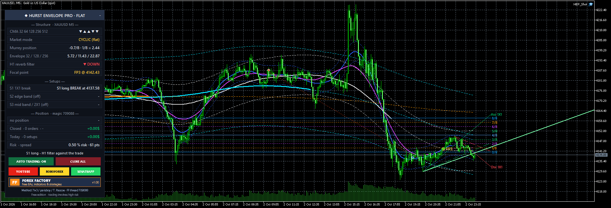 | **[TL Hurst Envelope Pro](projects/TL-Hurst-Envelope-Pro)** v1.00 | MT4 MT5 | 7iv3's Hurst cycle method as an EA: centred-MA envelopes, Murrey math and Gann angles, using closed bars only (no lookahead). |
|  | **[TL KenneDyne DRIVE EA](projects/TL-KenneDyne-DRIVE-EA)** v1.00 | MT5 | KenneDyne's D.R.I.V.E. framework with Engulfing Killer Order Block entries at the POI, built from the channel's own posts. Made for gold. |
|  | **[TL Liquidity Reaper Pro](projects/TL-Liquidity-Reaper-Pro)** v1.00 | MT5 | Independent MetaTrader implementation of the published Liquidity Reaper [JOAT] rules — requested on Forex Factory. |
| 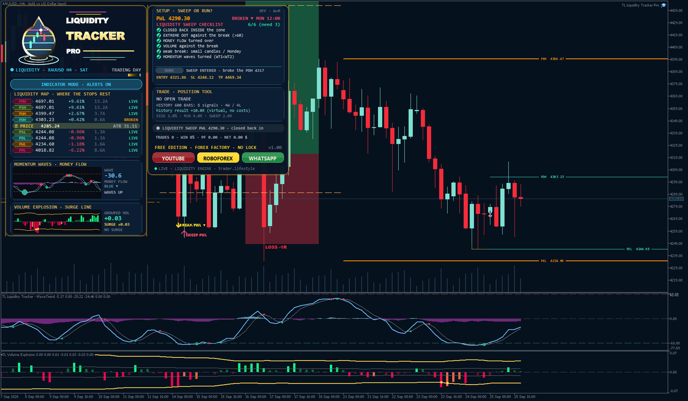 | **[TL Liquidity Tracker Pro](projects/TL-Liquidity-Tracker-Pro)** v1.00 | MT5 | Maps monthly, weekly, daily, swing and session liquidity and trades the video's Sweep and Run setups with WaveTrend and volume checks. |
| 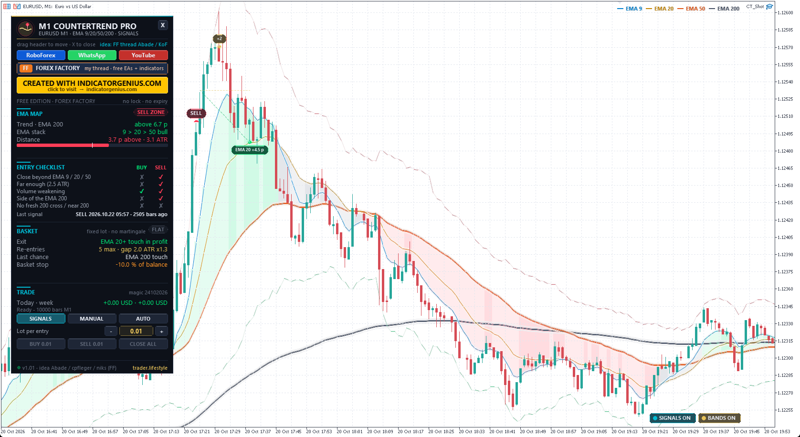 | **[TL M1 Countertrend Pro](projects/TL-M1-Countertrend-Pro)** v1.01 | MT4 MT5 | The M1 Countertrend Scalping Strategy (FF thread 1190104, Abade / King of Forex EMA method) as one EA: fade overextensions beyond the 9/20/50 EMA, 9 EMA re-entries with a fixed lot, exit at the EMA touch, basket stop and SIGNALS / MANUAL / AUTO. |
|  | **[TL News Arsenal Quant](projects/TL-News-Arsenal-Quant)** v1.00 | MT4 MT5 | A complete news-trading cockpit — calendar, spike, surprise, macro, headlines and risk tools in one animated panel. Never auto-trades. |
| 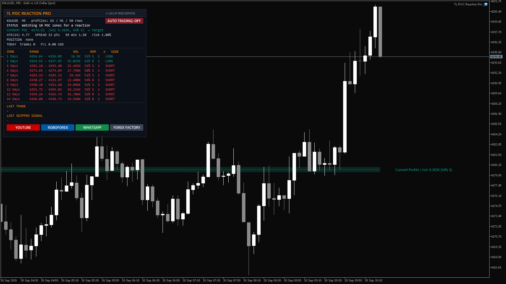 | **[TL POC Reaction Pro](projects/TL-POC-Reaction-Pro)** v1.00 | MT5 | Trades closed reaction candles at confluent daily POC zones and targets today's POC — never enters a zone blindly. |
|  | **[TL POC Retest Pro](projects/TL-POC-Retest-Pro)** v1.00 | MT4 MT5 | What it is An EA that trades the "accumulation -> volume profile POC -> retest" pattern shown in two short videos that were posted as a request on Forex Fact… |
| 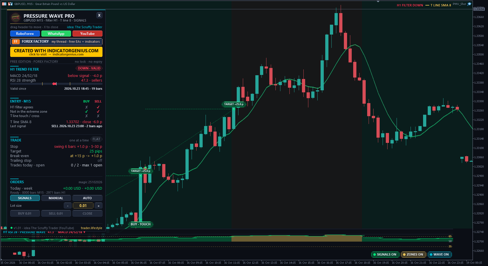 | **[TL Pressure Wave Pro](projects/TL-Pressure-Wave-Pro)** v1.00 | MT4 MT5 | The Scruffy Trader's entry system as one EA: hourly MACD 24/52/18 + RSI 28 trend filter ('pressure wave'), entry on M15 / M5 at the touch or cross of the 8 'T line', 25-pip target, swing stop, break-even. Created with IndicatorGenius.com. |
| 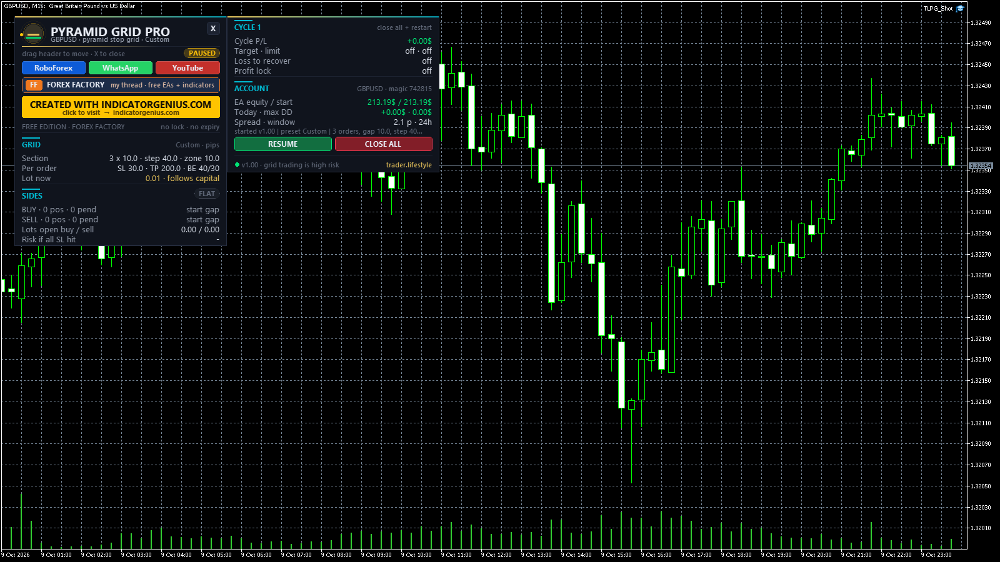 | **[TL Pyramid Grid Pro](projects/TL-Pyramid-Grid-Pro)** v1.00 | MT4 MT5 | Pyramid grid with stop orders on both sides — adds only while the market runs in that direction (anti-martingale). |
| 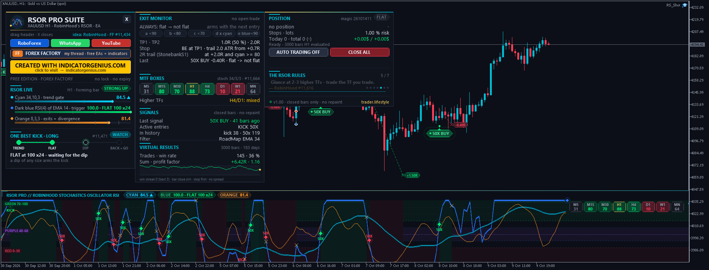 | **[TL RSOR Pro](projects/TL-RSOR-Pro)** v1.00 | MT4 MT5 | RobinHood's RSOR from "Trading Made Simple(r)": EA plus indicator with KICK / 50X / Star entries and a full exit toolkit. |
| 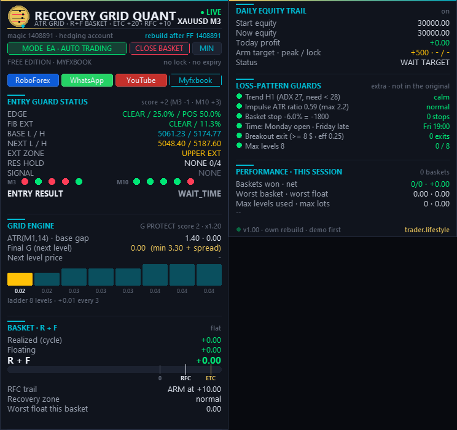 | **[TL Recovery Grid Quant](projects/TL-Recovery-Grid-Quant)** v1.00 | MT5 | Grid and recovery basket EA for XAUUSD M3 with breakout-exit, trend and impulse guards, a daily equity trail and a full quant panel. |
| 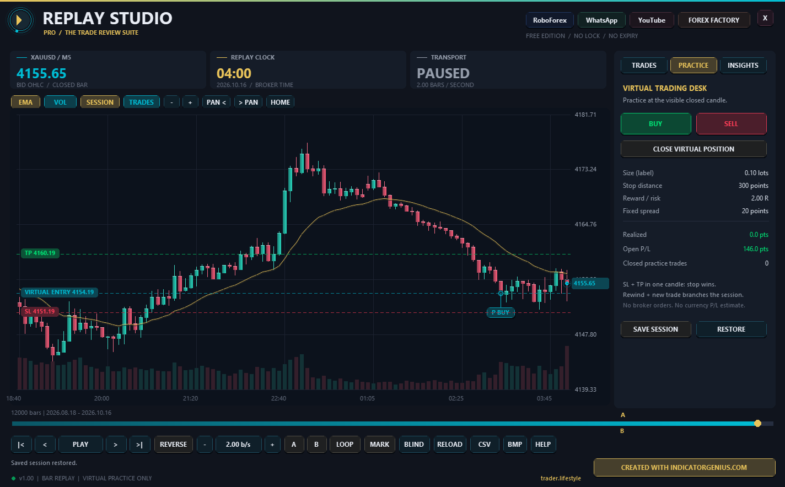 | **[TL Replay Studio Pro](projects/TL-Replay-Studio-Pro)** v1.00 | MT4 MT5 | Replay your closed trades candle by candle, or practise with virtual positions on a dedicated replay chart — it never touches broker orders. |
|  | **[TL Resonance Engine Pro](projects/TL-Resonance-Engine-Pro)** v1.00 | MT5 | One engine, one 0–100 resonance score: SuperTrend trend, smoothed RSI momentum, estimated buy/sell volume and more — momentum-coloured candles. |
| 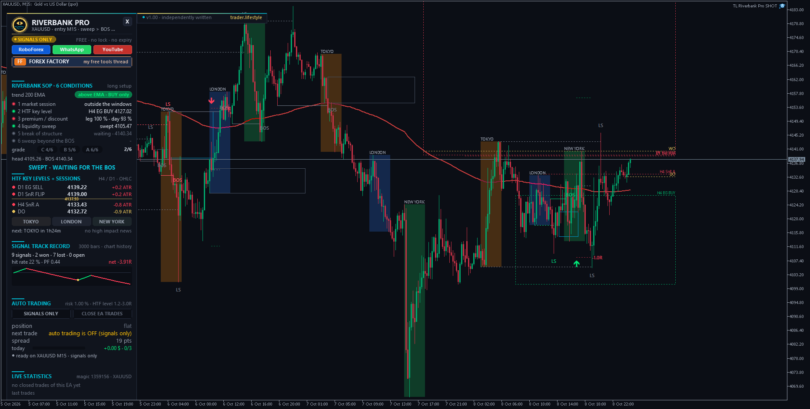 | **[TL Riverbank Pro](projects/TL-Riverbank-Pro)** v1.00 | MT4 MT5 | Inthebox's "Waiting at the Riverbank" gold method — session, HTF level, sweep, BOS and engulf entry. |
| 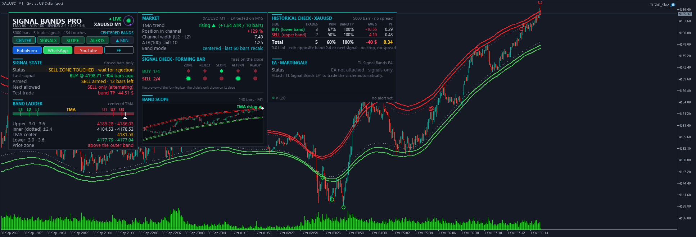 | **[TL Signal Bands Pro](projects/TL-Signal-Bands-Pro)** v1.10 | MT5 | Triangular MA ATR bands with closed-bar rejection signals, plus a companion EA that trades every circle (optional martingale). |
| 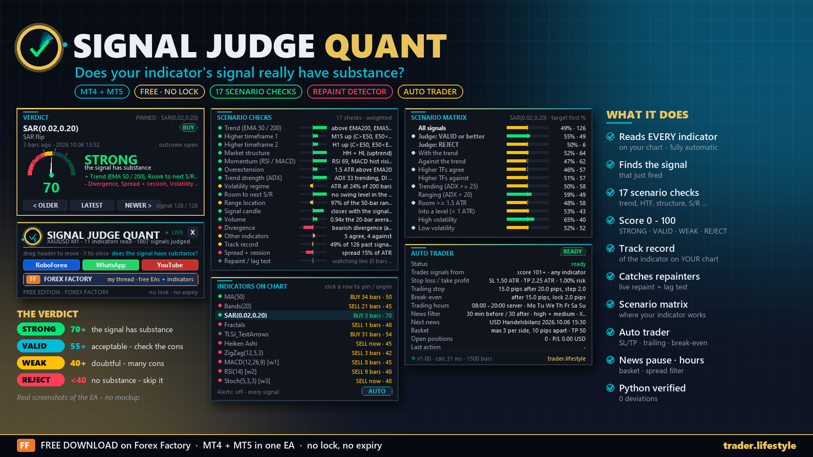 | **[TL Signal Judge Quant](projects/TL-Signal-Judge-Quant)** v1.04 | MT4 MT5 | Reads every indicator, arrow and level on your chart and scores each new signal 0–100 with 17 scenario checks. |
| 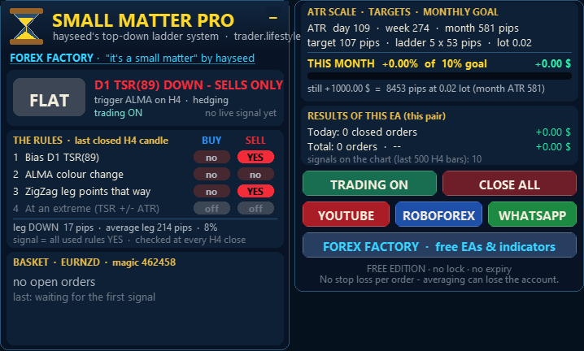 | **[TL Small Matter Pro](projects/TL-Small-Matter-Pro)** v1.00 | MT5 | hayseed's top-down ladder system: weekly TSR bias, H4 ALMA trigger with zigzag confirmation, and a managed limit-order basket. |
| 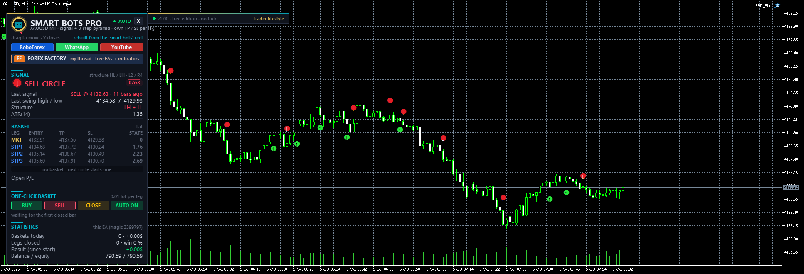 | **[TL Smart Bots Pro](projects/TL-Smart-Bots-Pro)** v1.00 | MT4 MT5 | Rebuild of the "smart bots" reel, read frame by frame: signal circle on XAUUSD M1, then market order + 3 stop orders pyramiding with momentum. |
| 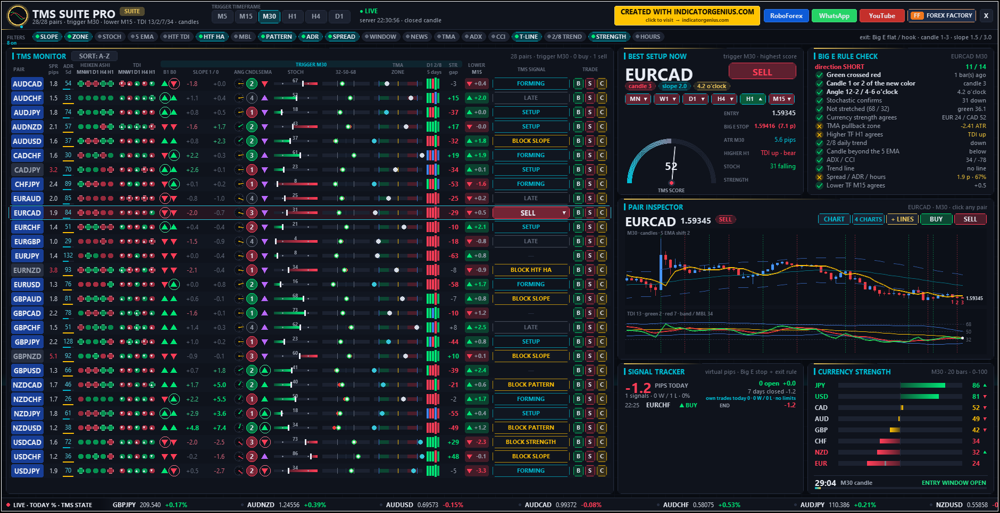 | **[TL TMS Suite Pro](projects/TL-TMS-Suite-Pro)** v1.10 | MT4 MT5 | Trading Made Simple suite — Big E's 5-method, arbinka's monitor and Seller9 tools on one screen. |
| 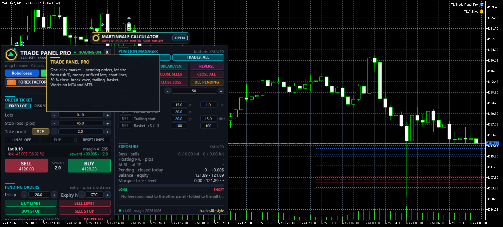 | **[TL Trade Panel Pro](projects/TL-Trade-Panel-Pro)** v1.00 | MT4 MT5 | One-click order panel: risk-based lots, draggable entry/SL/TP lines, pending orders, partial closes and auto break-even/trailing. |
| 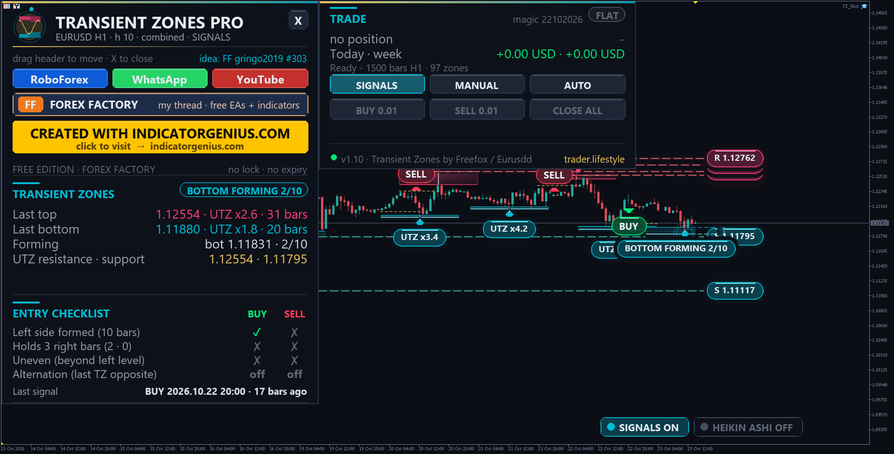 | **[TL Transient Zones Pro](projects/TL-Transient-Zones-Pro)** v1.11 | MT4 MT5 | Freefox's Transient Zones rebuilt 1:1 plus Vlady1974's Uneven Transient Zones 'present price' entry as one EA: 3D zones with UTZ ratio, live forming zone, UTZ support / resistance and SIGNALS / MANUAL / AUTO. |
| 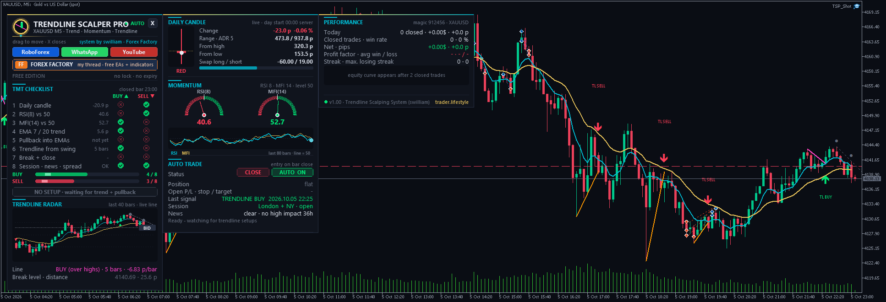 | **[TL Trendline Scalper Pro](projects/TL-Trendline-Scalper-Pro)** v1.00 | MT4 MT5 | swilliam's TMT trendline system, fully automatic: auto-drawn swing trendlines, the used-line rule and every option from the thread. |
| 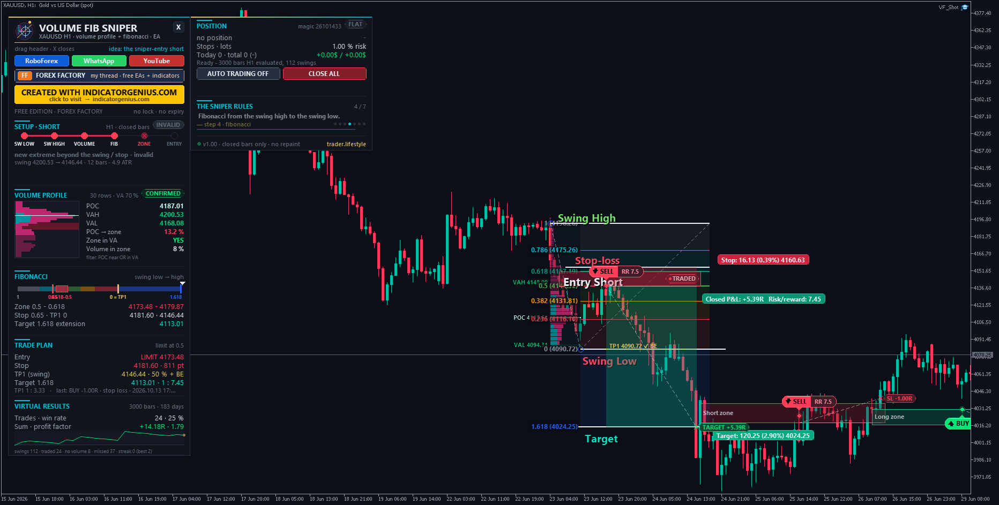 | **[TL Volume Fib Sniper Pro](projects/TL-Volume-Fib-Sniper-Pro)** v1.00 | MT4 MT5 | Volume profile + Fibonacci sniper entry automated: impulse profile, 0.5–0.618 entry zone with volume, target at the 1.618 extension. |
|  | **[TL Volume Pulse Pro](projects/TL-Volume-Pulse-Pro)** v1.10 | MT4 MT5 | Own volume-pulse oscillator EA: SMA 200 bias, entry on the second closed pulse bar after a zero cross. |
| 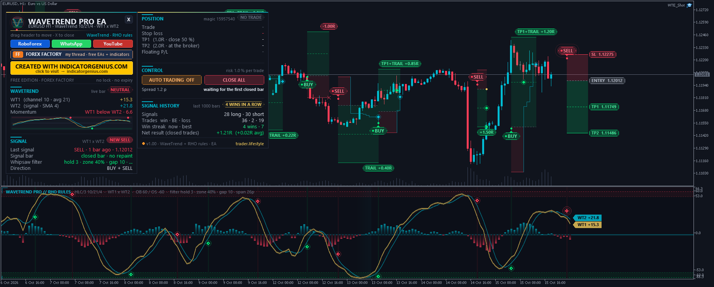 | **[TL WaveTrend Pro](projects/TL-WaveTrend-Pro)** v1.00 | MT4 MT5 | WaveTrend oscillator with RHO Pro rules: closed-bar signals, whipsaw filter, TP1/TP2, break-even and trailing — as indicator and EA. |
| 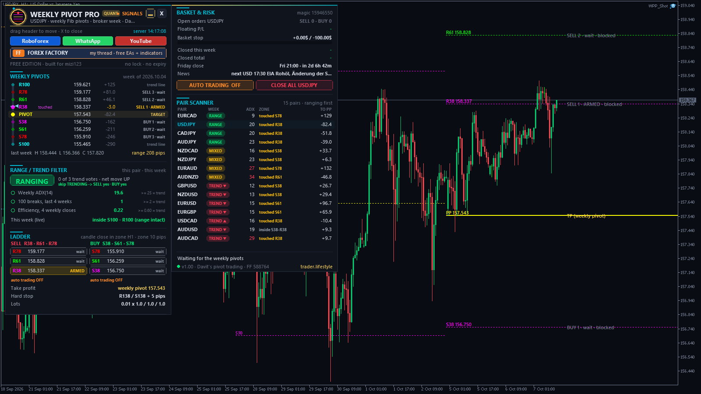 | **[TL Weekly Pivot Pro](projects/TL-Weekly-Pivot-Pro)** v1.00 | MT4 MT5 | Davit's weekly Fibonacci pivots as an EA — 38 / 61 / 78 ladder, PP target and basket stop. |
| 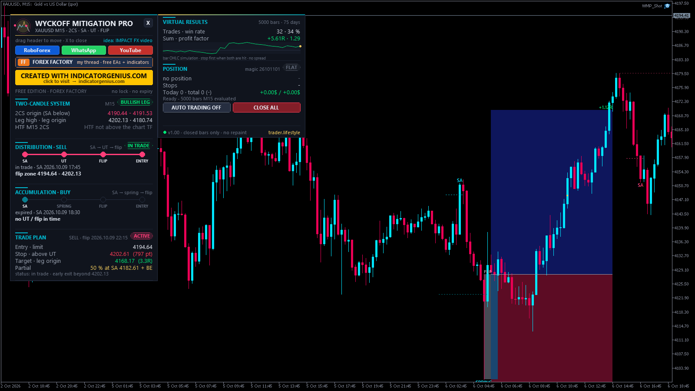 | **[TL Wyckoff Mitigation Pro](projects/TL-Wyckoff-Mitigation-Pro)** v1.00 | MT4 MT5 | Wyckoff distribution schematic + two-candle system: SA → UT / spring → flip → entry, with a phase tracker. Comes as an EA and as a pure indicator. |
| 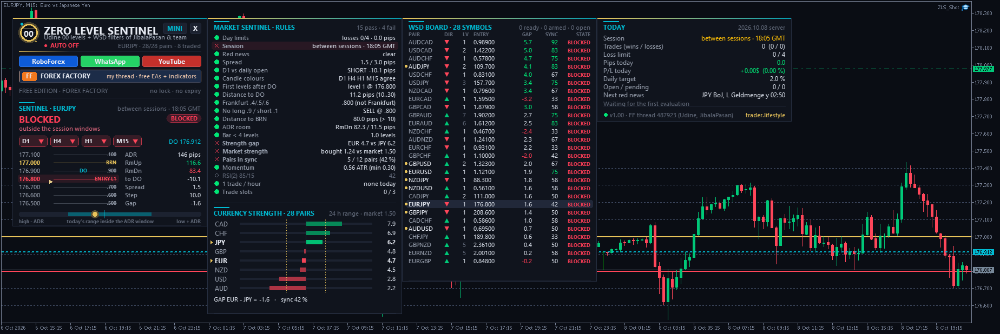 | **[TL Zero Level Sentinel Pro](projects/TL-Zero-Level-Sentinel-Pro)** v1.00 | MT4 MT5 | Udine's "00 level trading" from Forex Factory plus the WSD / Market Sentinel filters from the thread, rebuilt as a 28-pair EA with a live rules checklist. |

## 📈 Indicators & utilities (31)

| | Tool | Platforms | What it does |
|:---:|---|:---:|---|
| 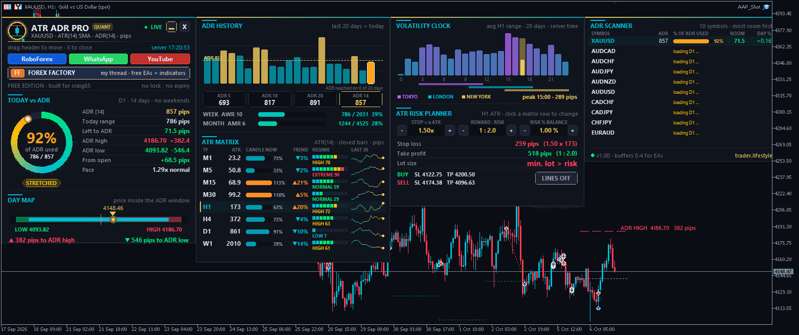 | **[TL ATR ADR Pro](projects/TL-ATR-ADR-Pro)** v1.00 | MT4 MT5 | ATR matrix across every timeframe plus ADR / AWR / AMR, session clock, trade planner and multi-symbol scanner in one dashboard. |
| 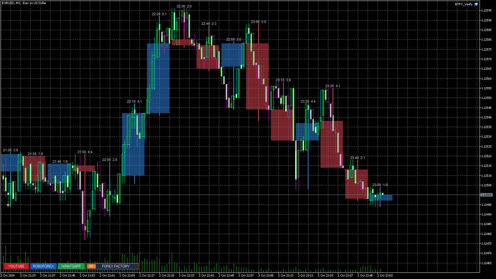 | **[TL Bigger TF Candles Pro](projects/TL-Bigger-TF-Candles-Pro)** v1.00 | MT5 | Draws two layers of higher-timeframe candles on your chart — with weekday/time labels, range, countdown and OHLC on hover. |
| 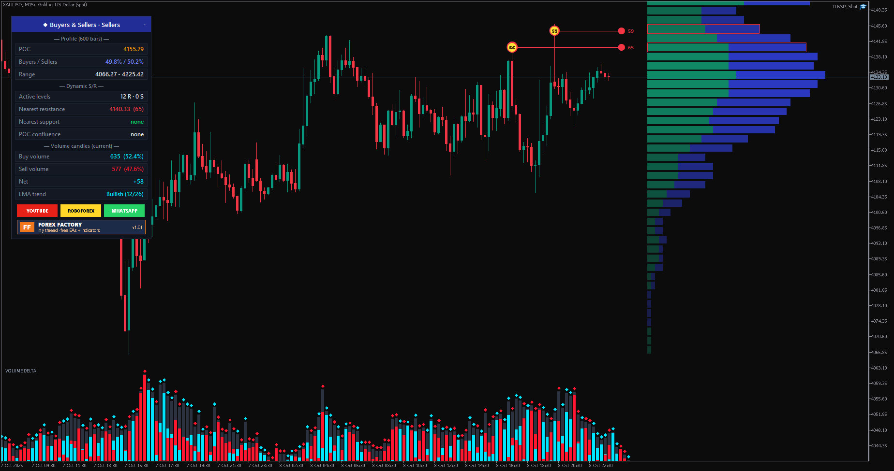 | **[TL Buyers Sellers Profile Pro](projects/TL-Buyers-Sellers-Profile-Pro)** v1.01 | MT4 MT5 | Volume profile split into estimated buyers vs sellers, with volume-backed support & resistance, POC confluence zones and delta columns. |
| 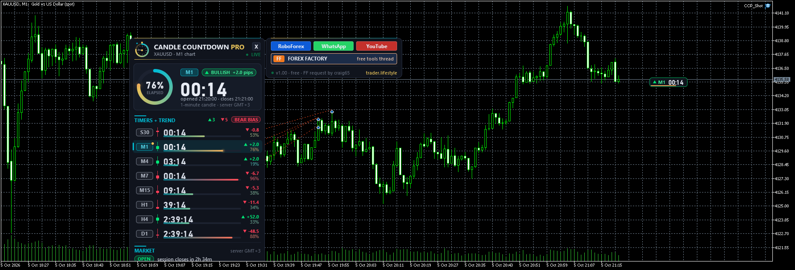 | **[TL Candle Countdown Pro](projects/TL-Candle-Countdown-Pro)** v1.00 | MT5 | Candle countdown for any timeframe list — including custom M4 / M7 / S30 — with trend state per candle. |
|  | **[TL Cluster Footprint](projects/TL-Cluster-Footprint)** v1.00 | MT4 MT5 | Footprint window for MT4/MT5: bid × ask volume per price level, delta, bar POC, imbalances and a volume profile — from your broker's data. |
| 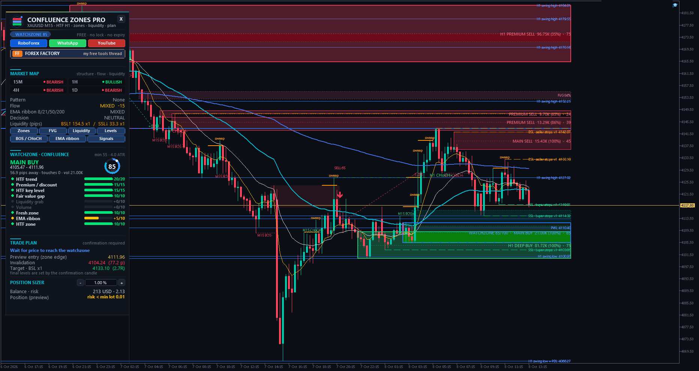 | **[TL Confluence Zones Pro](projects/TL-Confluence-Zones-Pro)** v1.00 | MT4 MT5 | Smart-money zones that are scored, not just painted: 9 confluence factors → 0–100 score, plan only after confirmation. |
| 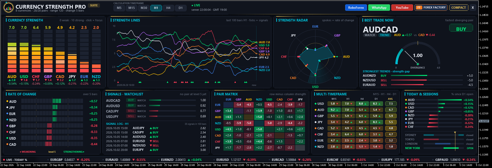 | **[TL Currency Strength Pro](projects/TL-Currency-Strength-Pro)** v1.01 | MT4 MT5 | Full-chart currency strength suite: strength, rate of change and divergence across all majors. |
| 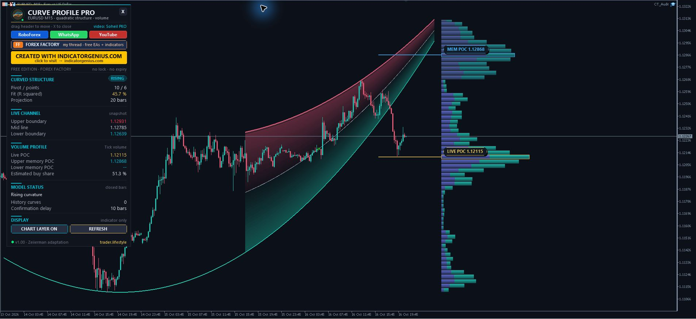 | **[TL Curve Profile Pro](projects/TL-Curve-Profile-Pro)** v1.00 | MT4 MT5 | Zeiierman's Curved Trendlines for MetaTrader: quadratic curved support and resistance with live and memory volume profiles and POCs. |
|  | **[TL Delta Profile 3D Pro](projects/TL-Delta-Profile-3D-Pro)** v1.12 | MT4 MT5 | LuxAlgo's 3D delta volume profile, native on MT4/MT5: POC, value area, high-volume beams and POC break/retest signals. |
|  | **[TL Drawing Suite Pro](projects/TL-Drawing-Suite-Pro)** v1.00 | MT4 MT5 | A drawing toolbar for MetaTrader — 30 tools, undo / redo, works on every symbol and timeframe. |
|  | **[TL Entropy Heatmap Pro](projects/TL-Entropy-Heatmap-Pro)** v1.00 | MT5 | LuxAlgo's Precision Market Entropy Heatmap for MT5: intrabar volume heatmap with live support/resistance POC zones and buy/sell labels. |
|  | **[TL Equilibrium Pro](projects/TL-Equilibrium-Pro)** v1.00 | MT5 | Hedge-cycle basket EA: one buy plus two sell-stop hedges per cycle, one shared basket money target, and bigger follow-up cycles by distance. |
|  | **[TL Fibo Compass Pro](projects/TL-Fibo-Compass-Pro)** v1.00 | MT4 MT5 | Daily Fibonacci compass from the previous D1 range: breakout, retrace, target and stop-trading levels with lasting arrows and a live dashboard. |
|  | **[TL Fibonacci Cloud Pro](projects/TL-Fibonacci-Cloud-Pro)** v1.00 | MT4 MT5 | Multi-timeframe Fibonacci cloud (port of TrendX_'s TradingView script) for MT4 and MT5. |
|  | **[TL Gold Levels Liquidity Pro](projects/TL-Gold-Levels-Liquidity-Pro)** v1.00 | MT4 MT5 | Gold levels from the GLD options market, a bond (ZN) direction filter, a live spread-liquidity monitor and sweep entries. |
|  | **[TL Liquidity Sweep Pro](projects/TL-Liquidity-Sweep-Pro)** v1.00 | MT4 MT5 | Maps BSL/SSL and EQH/EQL liquidity, grades every sweep 0–100 and confirms with CHoCH — stop, TP1–TP3 and break-even included. Never repaints. |
|  | **[TL MTF Six MA Pro](projects/TL-MTF-Six-MA-Pro)** v1.00 | MT4 MT5 | Six moving averages across multiple timeframes — trend alignment at a glance. |
|  | **[TL Martingale Calculator Pro](projects/TL-Martingale-Calculator-Pro)** v1.00 | MT4 MT5 | Plan a martingale or grid before you trade it — lots, break-even, margin per level and the stop-out price your account survives to. |
|  | **[TL News Marker Pro](projects/TL-News-Marker-Pro)** v1.00 | MT5 | MT5 calendar news on the chart: actual / forecast / previous with better/worse colours, upcoming events, filters, panel and alerts. |
|  | **[TL RHO Pro](projects/TL-RHO-Pro)** v7.00 | MT4 MT5 | Dual-MACD RHO indicator rebuilt: closed-bar zero-cross signals, whipsaw filters, and trade levels with two targets and break-even. |
|  | **[TL Ranked Zones Pro](projects/TL-Ranked-Zones-Pro)** v1.00 | MT4 MT5 | Order blocks, fair value gaps and support / resistance in one indicator, ranked by strength — based on Zeiierman's ranked-zone algorithms. |
|  | **[TL Real Time Price Analyzer Pro](projects/TL-Real-Time-Price-Analyzer-Pro)** v1.00 | MT4 MT5 | TheRumpledOne's Real Time Price Analyzer rewritten: 16 levels of the forming bar and how often past bars touched them. |
|  | **[TL Renko Range Bars Pro](projects/TL-Renko-Range-Bars-Pro)** v1.00 | MT4 MT5 | Real Renko and range-bar charts for MT4 and MT5 that open as normal charts and are fed live tick by tick, so indicators and EAs run on them. |
|  | **[TL Seconds Chart Pro](projects/TL-Seconds-Chart-Pro)** v1.00 | MT4 MT5 | Real seconds charts (S1–S3600) for MT4 and MT5, built from live ticks, with one-click trading and full indicator/EA support. |
|  | **[TL SuperSlope Confluence Pro](projects/TL-SuperSlope-Confluence-Pro)** v3.0 | MT4 | Baluda SuperSlope v2.2 with the repaint fixed: closed-bar arrows only when a confluence score of switchable filters agrees. |
|  | **[TL Three Star Pullback Pro](projects/TL-Three-Star-Pullback-Pro)** v1.00 | MT4 MT5 | Smart-money pullbacks from the ComLucro Trader video: BOS by close, FVG and 38.2 % depth rated with 1-3 stars, NOISE vs REAL PULLBACK on the chart and a structure-only view. Indicator only. |
|  | **[TL Trap Arsenal Quant](projects/TL-Trap-Arsenal-Quant)** v1.00 | MT4 MT5 | Trap trading in one animated dashboard — 58 trap detectors, liquidity maps, scanner and risk tools, plus an optional trend-only gold auto trader. |
|  | **[TL Trendline Bounce Pro](projects/TL-Trendline-Bounce-Pro)** v1.00 | MT4 MT5 | Tori Trades' trendline bounce setup automated: top-down trendlines, trend-only bounce entries, line-based stops and trailing. |
|  | **[TL Triple Confluence Gold M5 Lab](projects/TL-Triple-Confluence-Gold-M5-Lab)** v1.20 | MT4 MT5 | Trend-pullback analysis for gold M5: EMA 25/75/140 structure, ATR-based stops and clear signal pills. Indicator only. |
|  | **[TL Triple Confluence Pro](projects/TL-Triple-Confluence-Pro)** v1.00 | MT4 MT5 | EMA / RSI / Stochastic confluence indicator with a large canvas dashboard, sculpted EMA ribbon and BUY / SELL pills. Never trades. |
|  | **[TL Watchlist Radar Pro](projects/TL-Watchlist-Radar-Pro)** v1.00 | MT4 MT5 | Multi-symbol, multi-timeframe scanner with seven rule families, documented scoring, heatmap and alerts. Scanner only, no trading. |

---

**Built by [trader.lifestyle](https://www.youtube.com/@traderlifestyle)** · [Forex Factory thread](https://www.forexfactory.com/thread/1428808-free-eas-indicators-strategies-mt4) · [YouTube](https://www.youtube.com/@traderlifestyle) · [WhatsApp](https://wa.me/18585003724)

### ✨ CREATED WITH [INDICATORGENIUS.COM](https://indicatorgenius.com) ✨

Trading involves substantial risk. This tool is provided free and as-is for education. Test on a demo account first. Past behaviour is no guarantee of future results.

