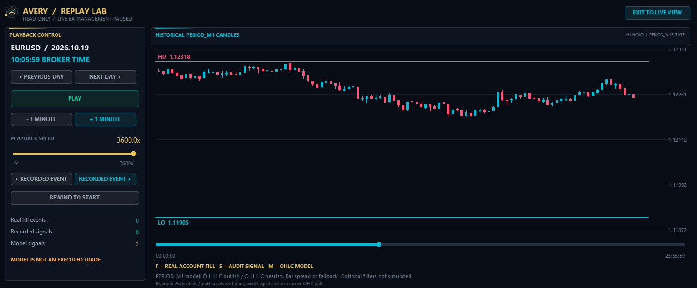
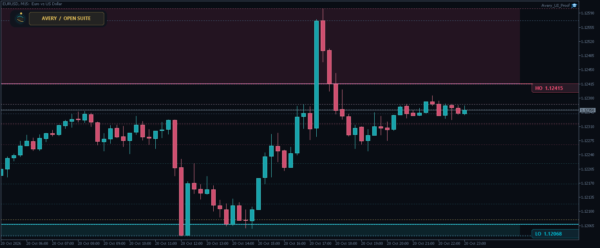

# Avery Holo Pro

**Highest Open / Lowest Open — a complete reversal workspace and historical Replay Lab**

   

## 📥 Download

| Platform | Expert Advisor | Pure indicator |
|---|---|---|
| MT4 | [Avery Holo Pro.ex4](MT4/Avery%20Holo%20Pro.ex4) | [Avery Holo Pro Indicator.ex4](MT4/Avery%20Holo%20Pro%20Indicator.ex4) |
| MT5 | [Avery Holo Pro.ex5](MT5/Avery%20Holo%20Pro.ex5) | [Avery Holo Pro Indicator.ex5](MT5/Avery%20Holo%20Pro%20Indicator.ex5) |

Compiled files only. Free, without an account lock, expiry or activation key.

## The method

Credit to **TooSlow** for HOLO and **SwingMan** for the supplied `smHiLoOpen Lines v1.2` visual reference. This is an independent implementation; no author endorsement is implied. [Original strategy discussion](https://www.forexfactory.com/thread/590623-highest-open-lowest-open-trade).

The highest and lowest **H1 OPEN** of the current broker day form HO and LO, including the current hour. A buy excursion below LO must, by default, be accompanied by a current trigger candle that opened below LO; Ask then returns upward to LO intrabar. The sell sequence is the reverse, using Bid at HO. M15 is the default trigger, with M1/M5/M30 alternatives. A selectable Bid-at-LO convention is explicitly separate from the PDF's Ask baseline.

The default breakout guard waits until the H1 candle creating a daily extreme ends. Levels/day changes reset the excursion; attachment cannot retrospectively create an entry. Default entry-gap tolerance is zero, with numerical tolerance only, so a logged return may be rejected as a late quote.

## What the suite adds

- A dense dark Canvas with five open-context watchlist matrices, signal state, risk instrumentation, HOLO price map, execution guards, engine log and ticker.
- Full-chart, MINI and draggable folded views, animation, hover help, Canvas rebuilding and chart-theme healing.
- A separate pure indicator with no trading engine, as well as selectable Indicator Only / EA operation in the EA build.
- Equity/fixed sizing, downward volume rounding, margin/stop/spread checks and symbol-plus-magic ownership. The watchlist does not execute basket trades.
- Daily entry locks, cooldown, restart-aware entry history, known-cost BE valuation and optional partial close / R target.
- Explicit optional H4, ATR/range, RAT, prior-day-breakout and broker-hour session refinements, disabled by default.

Default protection uses a daily-extreme stop plus one pip, then +5 net pips to BE+1, +10 to BE+5 and +15 to a five-pip trail. Equity sizing defaults to 0.5%; broker slippage, fees and stop execution can alter the realized risk. Discretionary thread advice has not been presented as an invented deterministic algorithm.

## Replay Lab

Play/pause, select a historical broker day, rewind, step by a minute, jump between recorded events or drag the timeline. The logarithmic speed slider spans **1x–3600x**.

| Marker | Meaning |
|---|---|
| **F / cyan** | Actual accessible account fill, exit or MT5 reversal |
| **S / green** | An Avery signal saved in this terminal's audit CSV |
| **M / gold** | A reconstructed OHLC core-signal scenario |

The model uses completed M1 source bars where available, with explicitly labelled optional M5/M15 fallback. It assumes O-L-H-C for bullish bars and O-H-L-C for bearish bars and uses bar spread or the configured fallback. It reveals candles as playback advances. OHLC cannot restore the real tick sequence or historical Ask execution; optional context/risk filters and hypothetical exit/profit results are not modeled. Missing account/audit records cannot be recreated as facts.

**Replay pauses all live EA entry and management actions.** Broker-held SL/TP remain active. Exiting restores client management in EA mode while AUTO stays OFF until explicitly enabled. Ordinary AUTO OFF pauses entries while protection continues; Indicator Only disables EA management.

## Installation and operating notes

1. MetaTrader → File → Open Data Folder.
2. Put the EA in `MQL4/Experts` or `MQL5/Experts`; put the pure indicator in the matching `Indicators` folder.
3. Refresh Navigator and attach one Avery build per chart. Enable **Allow DLL imports**: the build imports Windows `shell32.dll` for clicked browser links, so MetaTrader requires the permission at startup. Links never open automatically; calculations and trading logic use native MetaTrader functions.
4. The EA defaults to **Indicator Only / AUTO OFF**. Select EXPERT_ADVISOR and enable AUTO and terminal trading permissions deliberately when ready.

Use a large chart for the full desk; Replay requires at least 850 × 550 pixels. Confirm `PipSizeOverride` for metals/indices. Broker-time sessions do not automatically convert New York DST. Complete account history is needed for history-based statistics; MT4 partial-ticket consolidation follows broker `from #` / `to #` links. Local logs and event arrays are bounded; see the release instructions for details.

## Platform status and source coverage

Both platforms have native compiled builds and native calculation, pure-indicator, simulated-trading and Replay checks. These screenshots show the actual **MT5** Canvas. **MT4 graphical validation is pending**: the graphical lab stalled before EA initialization, while the nonvisual runs completed. No claim of a separately verified MT4 graphical session is made.

All publicly visible unique post-body text across the original thread was reviewed, together with the HOLO PDF and supplied MQ4. Forum-hidden posts are unavailable. This does not claim that every attached image, video and external page was inspected. Research completeness is not evidence of profitability.

## More views

---

**Built by [trader.lifestyle](https://www.youtube.com/@traderlifestyle)** · [Forex Factory free-tools thread](https://www.forexfactory.com/thread/1428808-free-eas-indicators-strategies-mt4) · [YouTube](https://www.youtube.com/@traderlifestyle) · [WhatsApp](https://wa.me/18585003724)

### ✨ CREATED WITH [INDICATORGENIUS.COM](https://indicatorgenius.com) ✨

Trading involves risk. Test on a demo account before enabling automation. No promise of returns is made.
