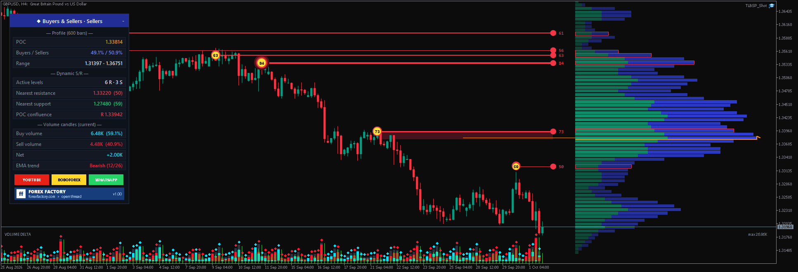

# ⚡ TL Buyers Sellers Profile Pro

**Buyers / sellers volume profile, dynamic support & resistance and volume delta — all-in-one, 1:1 look of the original.**

     

## 📥 Download

| Platform | File |
|---|---|
| **MT4** | [`TL Buyers Sellers Profile Pro.ex4`](MT4/TL%20Buyers%20Sellers%20Profile%20Pro.ex4) |
| **MT5** | [`TL Buyers Sellers Profile Pro.ex5`](MT5/TL%20Buyers%20Sellers%20Profile%20Pro.ex5) |

> Compiled build only — source code is not published.

## ✨ Highlights

- **Buyers vs sellers profile.** A large rolling volume profile on the right side of the chart, every row split into estimated buying and selling volume.
- **Volume-backed support & resistance.** Swing pivots only count when the profile confirms them.
- **POC confluence zones.** Levels sitting close to the POC are shaded as key turning / target zones.
- **Volume delta columns.** Total, buying and selling volume per bar at the bottom of the chart.
- **Live dashboard.** POC, buyers vs sellers, nearest levels, confluence and the current candle's buy / sell / net at a glance.
- **MT4 + MT5**, with EA-readable buffers for your own automation.

## 🧠 How it works

**Volume profile.** By default the profile covers the last 600 bars in 72 rows. Each row shows estimated **buying volume (green, left)** and **selling volume (blue, right)**. Low-volume rows fade into the background; the **POC** (the row with the highest volume) is framed in orange.

**Dynamic support / resistance.** A swing pivot is only accepted as a level when the volume profile backs it up — node strength, local peak, buyer / seller bias, distance and absorption around the pivot are all scored.

| Element | Meaning |
|---|---|
| Red line | Resistance |
| Green line | Support |
| Thicker line / bigger circle | Higher level score (glow from a score of 80) |
| Framed profile row | The row holds an active level (framed in the level colour) |
| Shaded zone | Active level close to the POC — a confluence zone |

**Volume delta columns** (bottom of the chart): grey = total, cyan = buying, red = selling. The dominant side is drawn behind, the smaller one in front, and a diamond marks the dominant side.

**Optional extras** (switch on in the inputs):
- Candles coloured by dominant volume.
- Volume-weighted EMA 12/26 band.
- Crossover arrows confirmed by the buy / sell volume of the last 6 bars.

## 🖥️ Dashboard & chart

The dashboard shows the POC, buyers vs sellers, the nearest levels, confluence, and the current candle's buy / sell / net volume. The indicator applies a dark chart theme and chart shift — both are restored when you remove it.

## 🔌 EA buffers

| Buffer | Content |
|---|---|
| 16 | Bullish cross |
| 17 | Bearish cross |
| 19 | Nearest resistance |
| 20 | Nearest support |
| 21 | Strongest level score |

## 🛠️ Installation

1. In your terminal open **File → Open Data Folder**.
2. **MT4:** copy `TL Buyers Sellers Profile Pro.ex4` to `MQL4 → Indicators`. **MT5:** copy `TL Buyers Sellers Profile Pro.ex5` to `MQL5 → Indicators`.
3. Refresh the Navigator and drag the indicator onto a chart.
4. Optional: enable **"Allow DLL imports"** only if you want the link buttons to open in your browser — the indicator works fine without it.

## ⚠️ Notes

- Buy / sell volume is **estimated** from candle data: `buy = volume × (close − low) / (high − low)`. It is not real bid / ask order flow. Tick volume is used (MT5: real volume optional).
- Levels are calculated on closed bars only.
- Educational tool — no investment advice.

## 📝 Changelog

- **v1.01 (08.10.2026)** — MT4 fix: the indicator stopped right after switching the chart to the dark theme (MT4 passes an empty real-volume array → "array out of range"). Profile, levels, volume panel and dashboard work on MT4 again.

## 🖼️ More screenshots

---

**Built by [trader.lifestyle](https://www.youtube.com/@traderlifestyle)** · [Forex Factory thread](https://www.forexfactory.com/thread/1428808-free-eas-indicators-strategies-mt4) · [YouTube](https://www.youtube.com/@traderlifestyle) · [WhatsApp](https://wa.me/18585003724)

### ✨ CREATED WITH [INDICATORGENIUS.COM](https://indicatorgenius.com) ✨

Trading involves substantial risk. This tool is provided free and as-is for education. Test on a demo account first. Past behaviour is no guarantee of future results.

