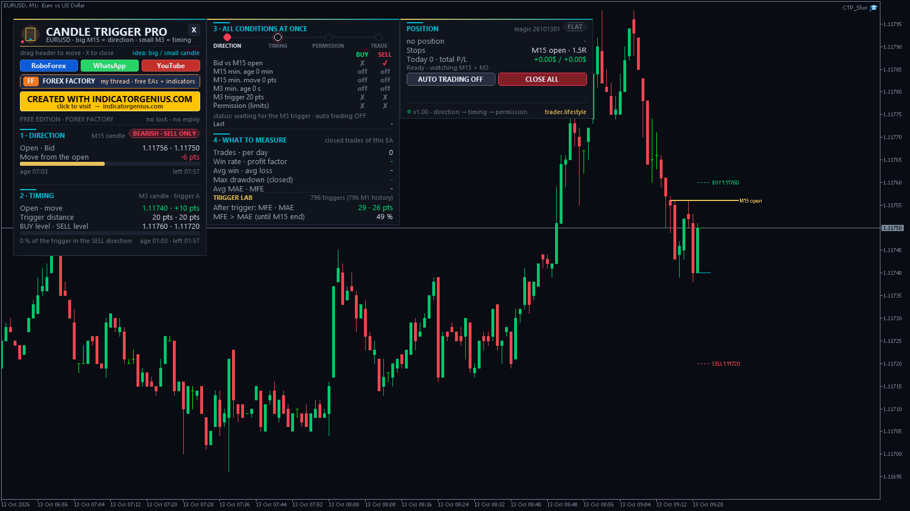

<!-- auto-generated: remove this line after hand-editing so publish keeps your text -->

# ⚡ TL Candle Trigger Pro

**The big candle decides the direction, the trigger candle times the entry — a simple price-action EA.**

     

## 📥 Download

| Platform | File |
|---|---|
| **MT4** | [`TL Candle Trigger Pro.ex4`](MT4/TL%20Candle%20Trigger%20Pro.ex4) |
| **MT5** | [`TL Candle Trigger Pro.ex5`](MT5/TL%20Candle%20Trigger%20Pro.ex5) |

> Compiled build only — source code is not published.

## Overview

The idea in one sentence The big candle decides which way we are allowed to trade, the small candle tells us when that direction has gained enough momentum to enter, and the trade limits decide whether we are allowed to take the trade.

- **DIRECTION** — ->  TIMING  ->  PERMISSION  ->  TRADE

The rules (BUY - SELL is the exact mirror)
- DIRECTION   Bid is ABOVE the open of the running big candle = bullish, only BUY is allowed. Bid below the open = bearish, only SELL. Bid exactly at the open = neither. Optional: big candle minimum age (minutes) and minimum movement from its open (points, measured as Bid - open for BUY, open - Bid for SELL).
- TIMING      The running small candle reaches the trigger distance from ITS OWN open in the same direction as the big candle. Optional: small candle minimum age (seconds). Trigger approaches: A  fixed points (simple baseline, e.g. 20 points) B  % of the small candle range (average of the last N closed small candles - the running candle is still developing) C  x ATR of the small timeframe (adapts to volatility, start with 0.10 - 0.20)
- PERMISSION  Applied AFTER direction + trigger: max. spread, trading hours, max. trades per big candle, max. trades per day, max. open trades, one trade per small candle, broker trading session.
- TRADE       Market order only when ALL conditions are true at the same moment. Everything is re-checked on every tick - an earlier condition never "stays" true. If Bid falls back through the big candle open before the entry, the BUY setup is gone.

Timeframe combinations (input "Big + small candle") M5+M1, M10+M2, M15+M3 (default), M15+M5, M30+M5, M30+M10, H1+M5, H1+M15, H4+M15 or CUSTOM minutes. The candles are built from M1 bars, so M2 / M3 / M10 ... work on MT4 too. Attach the EA to any chart (M1 recommended to see the levels). MT4 strategy tester: test on the M1 chart.

Exits (inputs)
- **Stop loss** — big candle open (= direction reversal) / small candle open (+ buffer), x ATR, fixed points or none Take profit  R multiple (default 1.5R), fixed points, x ATR or none Big candle   close the trade when the big candle ends (default on) Flip         optional: close when Bid crosses back through the big candle open Break even   optional: stop to entry + X points after +Y points

Dashboard (drag the header, X closes it to a pill, hover any line for an explanation)
- **1 DIRECTION** — big candle open, Bid, movement, age / time left (gold mark = minimum age) 2 TIMING      small candle open + move, trigger distance, BUY / SELL trigger levels, progress 3 ALL CONDITIONS AT ONCE   DIRECTION -> TIMING -> PERMISSION -> TRADE stepper + BUY / SELL checklist of every rule + why the EA is waiting MAE / MFE of the EA trades + TRIGGER LAB: best / worst move after every first trigger until the big candle ends (live + M1 history) POSITION      open trade, stops, P/L, AUTO TRADING on / off, CLOSE ALL Buttons       RoboForex, WhatsApp, YouTube, Forex Factory thread The dashboard moves out of the way of other trader.lifestyle panels on the same chart.

On the chart gold line = big candle open, cyan line = small candle open, green / red dotted lines = BUY / SELL trigger levels of the running small candle.

How to test it (the concept itself says so) Keep the entry logic the same and change ONE thing at a time: first the timeframe combination, then the trigger distance (5 / 10 / 15 / 20 / 25 / 30 / 40 points) or the trigger approach. MAE / MFE and how sensitive the result is to spread and slippage. Small trigger distances and tight stops are very sensitive to the spread of your broker.

Installation MT5: MT5\Experts\TL Candle Trigger Pro.ex5 -> File > Open Data Folder > MQL5\Experts MT4: MT4\Experts\TL Candle Trigger Pro.ex4 -> File > Open Data Folder > MQL4\Experts Refresh the Navigator, drag the EA onto a chart, enable Algo / Auto Trading. "Allow DLL imports" is only needed for the link buttons.

Risk warning: no profit promise - trading involves high risk. Test on a demo account first.

trader.lifestyle - free tools thread on Forex Factory: <https://www.forexfactory.com/thread/1428808-free-eas-indicators-strategies-mt4>

---

**Built by [trader.lifestyle](https://www.youtube.com/@traderlifestyle)** · [Forex Factory thread](https://www.forexfactory.com/thread/1428808-free-eas-indicators-strategies-mt4) · [YouTube](https://www.youtube.com/@traderlifestyle) · [WhatsApp](https://wa.me/18585003724)

### ✨ CREATED WITH [INDICATORGENIUS.COM](https://indicatorgenius.com) ✨

Trading involves substantial risk. This tool is provided free and as-is for education. Test on a demo account first. Past behaviour is no guarantee of future results.

