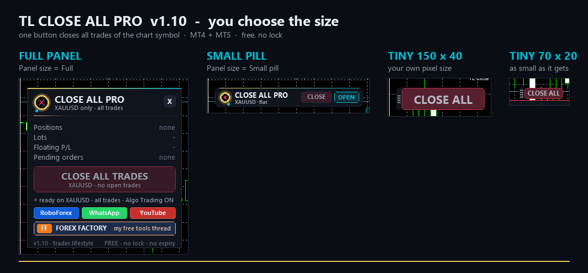

# ⚡ TL Close All Pro

**One button closes every position of the chart symbol. Full panel, small pill or a tiny pixel-sized button.**

     

## 📥 Download

| Platform | File |
|---|---|
| **MT4** | [`TL Close All Pro.ex4`](MT4/TL%20Close%20All%20Pro.ex4) |
| **MT5** | [`TL Close All Pro.ex5`](MT5/TL%20Close%20All%20Pro.ex5) |

> Compiled build only — source code is not published.

## One Button: "Close All Trades" - closes every position of the Current Chart Symbol

(buys and sells together). Other symbols are never touched.

NEW IN v1.10
- Input "Panel size": Full panel / Small pill / TINY = only the CLOSE ALL button.
- Tiny button size in pixels: you choose width and height (e.g. 60 x 18 or 150 x 40).
- Fixed: "start as the small pill" did not work when the panel had been open before. The size input now wins every time the EA is loaded or its inputs are changed.
- The pill / tiny button can be dragged by the button itself. Moving it never closes anything - only a click without moving closes the trades.

## Install

- **MT5: copy MT5/TL Close All Pro.ex5 into** — File > Open Data Folder > MQL5 > Experts MT4: copy MT4/TL Close All Pro.ex4 into  File > Open Data Folder > MQL4 > Experts Restart the terminal or right-click "Expert Advisors" in the Navigator > Refresh. Drag the EA onto the chart of the symbol you want to close. Algo Trading / AutoTrading must be ON, otherwise the button cannot close trades. Optional: tick "Allow DLL imports" so the link buttons (YouTube, WhatsApp ...) open your browser.

- USE
- Click CLOSE ALL TRADES -> all positions of the chart symbol are closed at market.
- The full panel shows positions, buy / sell count, lots, floating P/L and pending orders.
- X folds the panel to the small pill (or to the tiny button). Both keep a working CLOSE button.
- Tiny button: drag it by the grip (dots on the left) or by the button. Click the grip to open the full panel, X on the panel brings the tiny button back. It shows the number of open trades.
- The position is remembered per chart.
- If another trader.lifestyle panel is on the chart, the panel moves next to it.

## Inputs

- **Magic number filter** — -1 = ALL trades of the symbol (default) 0 = only manual trades any other number = only trades of that EA Also delete the pending orders  false (default) = pending orders stay 2-click confirmation            false (default) = one click closes everything true = click, then click CONFIRM within 3 seconds Max. slippage (points)          30 Close attempts per trade        3 (requotes / busy server get another try) Panel size                      Full panel / Small pill / Tiny button Tiny button width / height      90 x 22 pixels (40-400 x 14-80) Tiny button: show trade count   true Show tooltips / Panel X / Panel Y / Sound

## Notes

- Works on hedging and netting accounts, any broker, any symbol.
- The EA never opens trades.
- Free tools + coding help: <https://www.forexfactory.com/thread/1428808-free-eas-indicators-strategies-mt4>

---

**Built by [trader.lifestyle](https://www.youtube.com/@traderlifestyle)** · [Forex Factory thread](https://www.forexfactory.com/thread/1428808-free-eas-indicators-strategies-mt4) · [YouTube](https://www.youtube.com/@traderlifestyle) · [WhatsApp](https://wa.me/18585003724)

### ✨ CREATED WITH [INDICATORGENIUS.COM](https://indicatorgenius.com) ✨

Trading involves substantial risk. This tool is provided free and as-is for education. Test on a demo account first. Past behaviour is no guarantee of future results.

