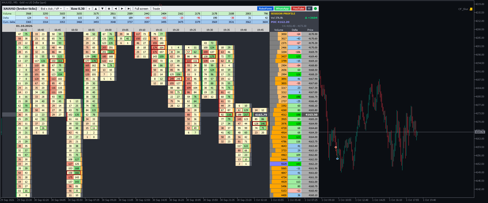

# ⚡ TL Cluster Footprint

**Cluster / footprint chart for MetaTrader: bid × ask volume per price level inside every candle.**

     

## 📥 Download

| Platform | File |
|---|---|
| **MT4** | [`TL_Cluster_Footprint.ex4`](MT4/TL_Cluster_Footprint.ex4) |
| **MT5** | [`TL_Cluster_Footprint.ex5`](MT5/TL_Cluster_Footprint.ex5) |

> Compiled build only — source code is not published.

## Overview

What it is
- A footprint (cluster) window like ClusterDelta: Bid x Ask volume per price row for every bar, bar volume / delta / cumulative delta in the header, bar POC (red frame), diagonal imbalances (green / red boxes, ratio and min volume adjustable) and a session or visible volume profile with Volume, Delta and Price columns, POC and value area.
- NOT ClusterDelta itself. ClusterDelta is a commercial product with CME futures data - get it at clusterdelta.com. This indicator uses your broker's data: MT5: the broker's real tick history (buy/sell split by the bid tick rule; exchange symbols with trade flags use real trade volume). MT4: MT4 has no tick history, so older bars are approximated from M1 bars; every bar that forms while the indicator runs is built from live ticks. Forex / CFD volume is tick volume, not central exchange volume.

Install
- MT5: copy TL_Cluster_Footprint.ex5 to  MQL5\Indicators\   (File > Open Data Folder)
- MT4: copy TL_Cluster_Footprint.ex4 to  MQL4\Indicators\
- Restart or refresh the Navigator, drag it onto a chart (M1 - H1 works best).

Window controls
- "Bid x Ask / VP"  switches cells: Bid x Ask / Volume / Delta
- "-" / "+"         row size (multiples of the base step)
- up / down         scroll rows (MT5 also mouse wheel), the dot button re-centres on price
- < / > / >|        scroll through history / back to the live bar
- "Full screen"     footprint over the whole chart and back (key F does the same)
- "Trade"           shows / hides MetaTrader's one-click trading panel (SELL | lot | BUY); the window keeps that corner free. (Indicators cannot send orders themselves.)
- click a price row marks that level.
- The link buttons open the browser only with "Allow DLL imports"; otherwise the URL is shown.

---

**Built by [trader.lifestyle](https://www.youtube.com/@traderlifestyle)** · [Forex Factory thread](https://www.forexfactory.com/thread/1428808-free-eas-indicators-strategies-mt4) · [YouTube](https://www.youtube.com/@traderlifestyle) · [WhatsApp](https://wa.me/18585003724)

### ✨ CREATED WITH [INDICATORGENIUS.COM](https://indicatorgenius.com) ✨

Trading involves substantial risk. This tool is provided free and as-is for education. Test on a demo account first. Past behaviour is no guarantee of future results.

