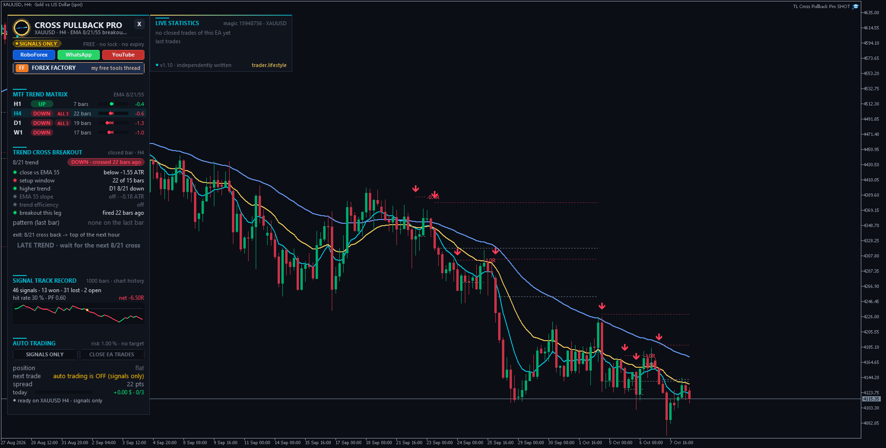

<!-- auto-generated: remove this line after hand-editing so publish keeps your text -->

# ⚡ TL Cross Pullback Pro

**AlistairC's 8/21 EMA cross-and-pullback method, automated with a clean signal and trade panel.**

     

## 📥 Download

| Platform | File |
|---|---|
| **MT4** | [`TL Cross Pullback Pro.ex4`](MT4/TL%20Cross%20Pullback%20Pro.ex4) |
| **MT5** | [`TL Cross Pullback Pro.ex5`](MT5/TL%20Cross%20Pullback%20Pro.ex5) |

> Compiled build only — source code is not published.

## Independently Written

Written from scratch by trader.lifestyle - own code. The trading rules follow AlistairC's EMA 8 / 21 / 55 approach ("Trend Cross Breakout" + inside bar and 2-bar pullback setups) from his Forex Factory thread "MA Crossover System that works for me" - big thanks to him for sharing.

WHAT'S NEW IN v1.10 (closer to the original system)
- EMA 8 / 21 / 55 instead of 8 / 21 only
- Entry 1 "Trend Cross Breakout": the 8/21 cross primes a new trend, the FIRST candle that closes beyond EMA 55 is the entry (at its close)
- Entry 2: inside bar (mother candle + 1 or more candles fully inside it) and 2-bar pullback (lower high AND lower low in an uptrend) within 15 bars of the cross, max 1.5 ATR, stop order beyond the box, stop on the other side
- Higher timeframe EMA 8/21 filter (D1 by default)
- Exit like the original: when EMA 8 crosses back over EMA 21 the trade is closed at the top of the next hour (not waiting for the H4 close), plus a fixed stop from the entry. No fixed target by default (ride the trend).
- No order traffic during the broker's daily break (gold 00:00-01:05).

## 1. Trend Cross Breakout

EMA 8 crosses EMA 21 -> primed. First close beyond EMA 55 in the same direction -> enter at the close. Stop beyond the swing of the last 10 bars + ATR buffer. Option: the signal candle must really cross EMA 55, skip explosive signal candles, signal only within N bars of the cross.

## 2. Inside Bar / 2-Bar Pullback

Within 15 bars of the 8/21 cross: STOP order beyond the setup box, stop on the other side of the box. A new inside bar of the same mother keeps the order, it expires after N bars or when the trend flips. Price already beyond the trigger: market entry up to X ATR, else skipped.

## Filters

- Higher timeframe EMA 8/21 must agree (closed bars of that timeframe)
- Optional: EMA 55 slope with the trend, anti-chop efficiency ratio, long/short only

## Exit

- 8/21 cross back -> close at the top of the next hour (or at once)
- optional: close when a candle closes on the wrong side of EMA 21
- fixed stop from the entry, optional target in R, break even, partial close, ATR or EMA trailing

## The Panel

- MTF trend matrix (H1 / H4 / D1 / W1): 8/21 trend, "ALL 3" when 8/21/55 are fully aligned, bars since the cross, stretch from EMA 21 in ATR
- Trend Cross Breakout block: every condition as a traffic light, pattern on the last bar, armed order with SL, exit status, phase (PRIMED / BREAKOUT SIGNAL / ARMED / ORDER WAITING / IN TRADE)
- Signal track record on your chart history (bar based, no costs)
- Auto trading ON / signals only, close EA trades, daily guard, statistics
- Chart: EMA 8 / 21 / 55, setup box + trigger / SL lines, entry arrows, R result tags

## Install

- MT5: copy "TL Cross Pullback Pro.ex5" to  File > Open Data Folder > MQL5\Experts
- MT4: copy "TL Cross Pullback Pro.ex4" to  File > Open Data Folder > MQL4\Experts Refresh the Navigator, drag the EA on a chart, allow Algo Trading.
- Made for H4 (higher TF = D1). On H1 set the higher timeframe to H4.
- "Allow DLL imports" is only needed for the link buttons in the panel.

## Important

No performance promises. Trading is risky - test on a demo account first. The original system also relies on the trader's eye (clean EMA fan, no trading into S/R, safety checklist) - use "signals only" and judge yourself.

Forex Factory: <https://www.forexfactory.com/thread/1428808-free-eas-indicators-strategies-mt4> YouTube: <https://www.youtube.com/@traderlifestyle>

## 🖼️ More screenshots

---

**Built by [trader.lifestyle](https://www.youtube.com/@traderlifestyle)** · [Forex Factory thread](https://www.forexfactory.com/thread/1428808-free-eas-indicators-strategies-mt4) · [YouTube](https://www.youtube.com/@traderlifestyle) · [WhatsApp](https://wa.me/18585003724)

### ✨ CREATED WITH [INDICATORGENIUS.COM](https://indicatorgenius.com) ✨

Trading involves substantial risk. This tool is provided free and as-is for education. Test on a demo account first. Past behaviour is no guarantee of future results.

