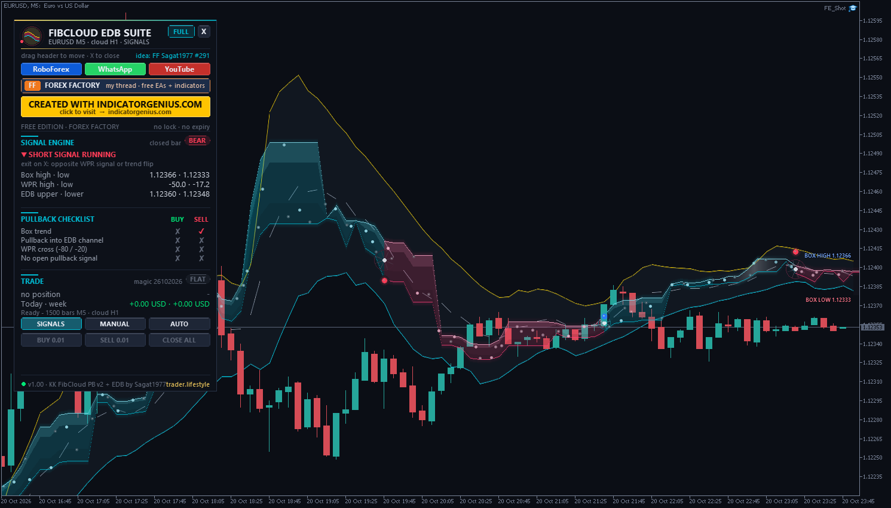
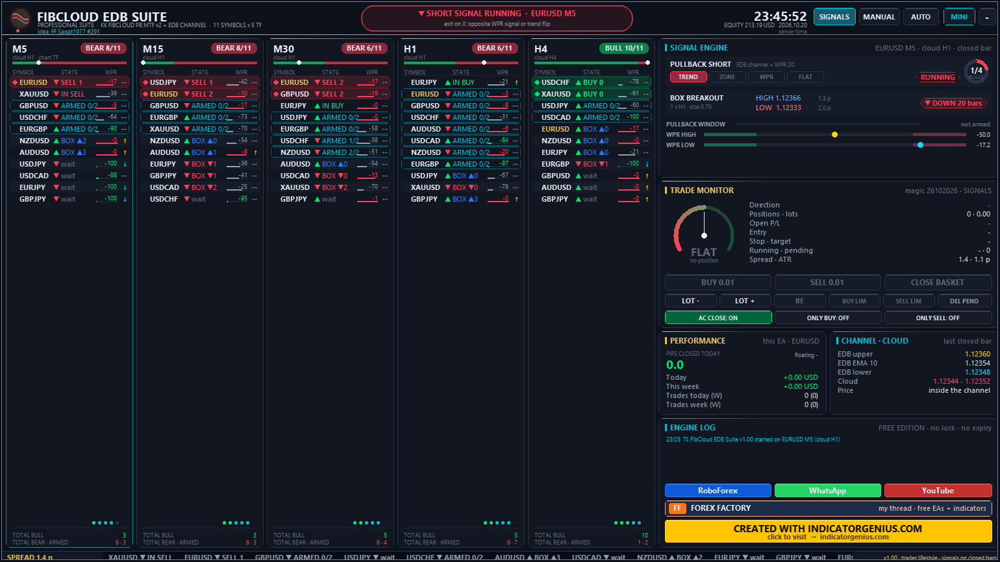

<!-- auto-generated: remove this line after hand-editing so publish keeps your text -->

# ⚡ TL FibCloud EDB Suite

**Sagat1977's KK FibCloud PB v2 + EDB channel pullback strategy as one EA: box trend, plasma Fib cloud, WPR trigger, X exit, SIGNALS / MANUAL / AUTO and a full-chart 11-symbol x 5-timeframe scanner suite.**

     

## 📥 Download

| Platform | File |
|---|---|
| **MT4** | [`TL FibCloud EDB Suite.ex4`](MT4/TL%20FibCloud%20EDB%20Suite.ex4) |
| **MT5** | [`TL FibCloud EDB Suite.ex5`](MT5/TL%20FibCloud%20EDB%20Suite.ex5) |

> Compiled build only — source code is not published.

## Overview

What it is One Expert Advisor for MetaTrader 4 and MetaTrader 5 that runs the "KK_FibCloud & KK_edb channel PB strategy" posted by Sagat1977 on Forex Factory (thread "Free EAs, Indicators & Strategies", posts #291 and #293, October 2026):
- KK_FibCloud_PB_MTF_v2_Ind.mq5 (Fibonacci cloud MTF + box breakout + pullback system, cloud idea after TrendX_) Both indicators are rebuilt 1:1 (same formulas, same order of the conditions) and combined with a full-chart dashboard, a 5-timeframe scanner and an optional trading mode. All credit for the indicators and the strategy idea goes to Sagat1977 (KK).

The original rules (unchanged)
- **Trend (box)** — Box = highest high / lowest low of the previous "Fibonacci length" candles of the cloud timeframe (default H1, 1 candle), scaled around its middle by the box size (default 0.7 = 70 %, v2 input). A HIGH above the box = up dot, a LOW below the box = down dot. The last dot is the box trend. "1 buy - 1 sell": only trend changes are marked. Fib cloud     0.382 / 0.618 Fibonacci bands of the same range with a Supertrend-like ratchet, calculated on the cloud timeframe (developing or closed HTF candle). Cloud colour = box trend (input "Trend by box", default on). Pullback      1. the candle reaches into the pullback zone in trend direction -> ARMED
  - within 2 bars the Williams %R (20) calculated on the HIGH series crosses up through -80 (BUY) / on the LOW series crosses down through -20 (SELL)
  - no pullback signal is open -> BUY / SELL arrow. Exit (X)      opposite WPR signal, or the trend flips (input). EDB channel   EMA 10 of the OPEN price +/- 1.0 x exponentially weighted standard deviation.

What I added (TL)
- Pullback zone input: Fib cloud (original), EDB channel (default - "FibCloud & EDB channel PB"), cloud OR channel, cloud AND channel. EDB touch level: middle EMA (default), channel edge or the opposite band.
- Closed bars only. The EA acts on the bar that just closed and enters at the next open. No repaint: the values are the ones the original shows after a fresh reload. (On a running chart the original recalculates the last chart bar of every cloud-timeframe candle when the next candle opens, using only that bar's high / low - the EA does not copy this.)
- Trading modes on the dashboard: SIGNALS (no orders), MANUAL (buttons + AC CLOSE on X), AUTO (entries and exits automatically). Start mode = input, default SIGNALS.
- Entry signal: pullback arrows (default) or box dots (stop and reverse).
- Risk: fixed lots or % of equity, max lots, stop (ATR / beyond the EDB band / beyond the cloud / none), optional target in R, break-even, ATR trailing, spread limit, session filter, ONLY BUY / ONLY SELL, magic number. Only its own trades (symbol + magic).
- Manual panel: BUY, SELL, CLOSE BASKET, LOT -/+, BE, BUY LIMIT at the lower EDB band, SELL LIMIT at the upper band, DELETE PENDING.
- Scanner: 11 symbols x 5 timeframes (M5, M15, M30, H1, H4), same rules as the chart, sorted by fresh signals, running signals, armed setups and box dots. Click a row to open that symbol / timeframe on the chart. Broker suffixes are added automatically.
- Chart: 3D Fib cloud ribbon (behind the candles), EDB channel with glow, current box high / low, box dots, BUY / SELL / X pills, ARMED marker, dark theme (restored on removal).
- Dashboard views: FULL (whole chart, like a trading terminal), MINI (small draggable panel, the chart stays visible) and PILL (collapsed). One click switches. The mini panel moves away from other TL panels automatically. Explanation boxes on hover (can be turned off).

Dashboard (FULL)
- **Header** — status of the chart engine (trend, armed, signal, running), clock, equity, SIGNALS / MANUAL / AUTO, MINI and collapse buttons Scanner      one column per timeframe: symbol, trend arrow, state (BUY n / SELL n = fresh signal n bars ago, IN BUY / IN SELL, ARMED age/window, BOX dot, wait), WPR gauge, close vs channel (above / inside / below) Signal engine  4 rule chips (TREND, ZONE, WPR, FLAT) with a ring counter, box high / low, pullback window, WPR(HIGH) and WPR(LOW) gauges Trade monitor  P/L gauge, position, stop / target, all trade buttons Performance / channel / engine log / links

Inputs (most important) Cloud / box timeframe H1, Fibonacci length 1, box size 0.7, HTF mode developing Pullback zone EDB channel, touch level middle EMA, WPR 20 / -20 / -80, window 2 bars EDB: EMA 10, open price, deviation 1.0 Start mode SIGNALS, AC CLOSE on, lots 0.01, stop 2 x ATR(14), no target (exit on X), break-even at 1R, max spread 0.5 x ATR Start view FULL

Installation
- **MT5: copy "TL FibCloud EDB Suite.ex5" to** — <data folder>\MQL5\Experts\ MT4: copy "TL FibCloud EDB Suite.ex4" to  <data folder>\MQL4\Experts\ (File -> Open Data Folder). Restart or refresh the Navigator, drag the EA onto a chart. Enable "Allow DLL imports" - it is only used to open the link buttons in your browser (shell32.dll ShellExecuteW). For AUTO / MANUAL trading enable Algo Trading / live trading. One EA per chart. Settings (view, mode, lots, toggles) are kept per chart.

Package MT4/Experts/TL FibCloud EDB Suite.ex4 MT5/Experts/TL FibCloud EDB Suite.ex5 README_EN.txt

Risk notice Trading leveraged products involves a high risk of loss. This EA is a tool, not a promise of profit. Test it on a demo account first and use your own risk management.

trader.lifestyle - YouTube @traderlifestyle - free tools on Forex Factory, thread 1428808

## 🖼️ More screenshots

---

**Built by [trader.lifestyle](https://www.youtube.com/@traderlifestyle)** · [Forex Factory thread](https://www.forexfactory.com/thread/1428808-free-eas-indicators-strategies-mt4) · [YouTube](https://www.youtube.com/@traderlifestyle) · [WhatsApp](https://wa.me/18585003724)

### ✨ CREATED WITH [INDICATORGENIUS.COM](https://indicatorgenius.com) ✨

Trading involves substantial risk. This tool is provided free and as-is for education. Test on a demo account first. Past behaviour is no guarantee of future results.

