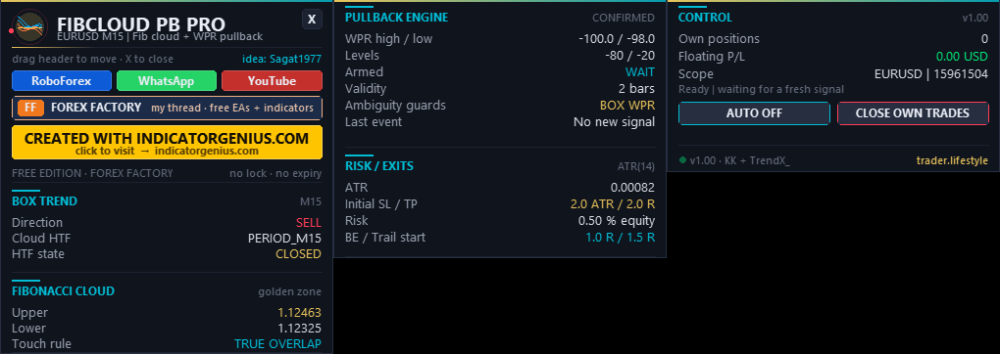

<!-- auto-generated: remove this line after hand-editing so publish keeps your text -->

# ⚡ TL FibCloud PB Pro

**Automated Fibonacci-cloud pullbacks — EA + indicator with cloud-touch and ambiguity filters.**

     

## 📥 Download

| Platform | File |
|---|---|
| **MT4** | [`TL FibCloud PB Pro EA.ex4`](MT4/TL%20FibCloud%20PB%20Pro%20EA.ex4) |
| **MT4** | [`TL FibCloud PB Pro Indicator.ex4`](MT4/TL%20FibCloud%20PB%20Pro%20Indicator.ex4) |
| **MT5** | [`TL FibCloud PB Pro EA.ex5`](MT5/TL%20FibCloud%20PB%20Pro%20EA.ex5) |
| **MT5** | [`TL FibCloud PB Pro Indicator.ex5`](MT5/TL%20FibCloud%20PB%20Pro%20Indicator.ex5) |

> Compiled build only — source code is not published.

## Overview

Free Forex Factory edition: no account lock, no expiry.

IMPORTANT: MT4 binaries are compile-only; MT4 runtime validation is still open. The optional indicator wrappers were compiled but not independently runtime-tested. Read VALIDATION_STATUS.txt before use.

## What This Package Does

- The EA automates the pullback entry and exit state machine shared by KK / Sagat1977 in Forex Factory post 15961504. Its cloud calculation originates from TrendX_'s Fibonacci Cloud MTF. The EA draws its own cloud and signals; the companion indicator is optional and never places orders.

## Source And Credits

<https://www.forexfactory.com/thread/post/15961504#post15961504> Original: KK_FibCloud_PB_MTF_Ind.mq5, version 1.85. Credit to KK / Sagat1977 and TrendX_. Adaptation, automation, Canvas interface and the additions below: trader.lifestyle.

## Files And Installation

- MT5/Experts/TL FibCloud PB Pro EA.ex5 -> MQL5/Experts MT5/Indicators/TL FibCloud PB Pro Indicator.ex5 -> MQL5/Indicators MT4_COMPILE_ONLY/Experts/TL FibCloud PB Pro EA.ex4 -> MQL4/Experts MT4_COMPILE_ONLY/Indicators/TL FibCloud PB Pro Indicator.ex4 -> MQL4/Indicators

- In your terminal choose File > Open Data Folder.
- Copy the appropriate files to the folders listed above.
- Refresh Navigator, then attach the EA to the symbol/timeframe to trade.
- Choose the cloud timeframe in InpTF. PERIOD_CURRENT follows the chart. A lower cloud timeframe is promoted to the chart timeframe.
- For automatic trading, enable terminal Algo Trading / AutoTrading and the EA's trading permission, then set InpAutoTrade=true or use AUTO ON. The default is AUTO OFF. This still displays the strategy.
- DLL imports are needed for the external website buttons (shell32.dll). The engine and chart functions do not call that DLL. If your terminal blocks initialization because DLL imports are disabled, enable them for this tool. No additional DLL file needs to be installed.

- Use one EA instance per chart. Give every independently managed instance a different Magic number. InpInstance separates chart objects and panel state when multiple tools are used. The EA does not need the companion indicator.
- If both are attached, turn off one panel/cloud to avoid duplicate drawings.

## Strategy, Step By Step

- Build the high/low range of Fib Length HTF bars (default 50). The 0.382 and 0.618 levels pass through the original Supertrend-style ratchet. The displayed cloud is therefore not merely two unfiltered Fib lines.
- Box trend uses the previous 50 completed HTF bars, excluding the current HTF candle. A chart candle's high above the box sets the bullish trend; its low below the box sets the bearish trend. Box dots are trend markers, NOT automatic order instructions by themselves.
- Arm a pullback in the trend direction when price reaches the cloud.
- Within Pullback validity (default 2 bars after touch), wait for the WPR cross in that direction. Another valid touch refreshes the window.
- BUY: HIGH-series WPR crosses above -80 in an uptrend. SELL: LOW-series WPR crosses below -20 in a downtrend. WPR is calculated separately on each series, with period 20 / slowing 1. This is NOT the standard close-price iWPR calculation.
- Close a virtual or real long on the opposite WPR signal; close a short on the opposite signal. A trend flip also exits by default. No new pullback entry occurs on the same signal-processing bar as an exit.

## Default Timing

Cloud HTF mode: CLOSED. Signal mode: CLOSED CANDLE -> NEXT OPEN. The previous closed chart candle is evaluated when the next candle starts. The marker's logical entry price is that next candle's open; a real order fills at the available bid/ask, with spread and possible slippage.

Developing HTF and live HIGH/LOW modes are available. They are provisional: the cloud, touch condition and combined signal can change before close. There is no blanket non-repaint guarantee for live mode. Closed history can also change after broker history corrections or a changed calculation window.

## What Was Added / Changed

- MT4 and MT5 EA automation, using the same calculation source as the indicator.
- Closed HTF and next-open execution are the defaults for reproducibility.
- Strict cloud touch (default ON): candle HIGH >= cloud lower edge AND candle LOW <= cloud upper edge. A candle wholly beyond the cloud does not qualify. Turn InpStrictTouch off for the original one-sided touch test.
- Double-sided box guard (ON): a bar breaking both box edges keeps the prior box direction and cannot generate a pullback entry. With the guard off, high-break/BUY has deterministic priority; the original transient latch based on which tick arrived first is not reproduced.
- Dual WPR guard (ON): simultaneous BUY and SELL crossings cannot enter. Existing positions can still exit on their opposite WPR signal.
- Developing HTF recalculation begins at the affected HTF period boundary.
- Broker-held stop and optional target, equity-based risk sizing, lot cap, spread/ATR entry gate, break-even and closed-bar-based ATR trailing.
- No old entries on attachment, no delayed entry retry after a rejected bar, one own position per symbol/magic, and a netting-position occupancy guard.
- Standard animated Canvas panel, collapse/reopen, drag, hover help, symbol/time anchored cloud/labels, object rebuilding and dark-theme healing.

## Risk And Order Management

Default initial SL: 2 x ATR(14), enlarged when broker stop/freeze distance and spread require it. ATR here is the simple average of 14 true ranges. Prices are aligned to the symbol's trade tick size. Default target: 2 x the INITIAL risk distance. InpRR=0 disables the target; the broker SL and strategy exits remain active. There are no partial exits. Default risk: 0.5% of equity, maximum 1 lot. Set InpRiskPct=0 for fixed lots (InpLots=0.01 by default). Lots round DOWN to the broker step. A lot smaller than the broker minimum is skipped rather than rounded up over the budget. Risk estimation does not include future commission, gaps or slippage.

Break-even begins at +1 initial R by default (price break-even, not a commission-inclusive guarantee). ATR trailing is considered from +1.5 R, using the last CLOSED candle's close +/- 2 ATR. Stops only tighten. Thresholds are checked on ticks; the trailing reference changes on bar close. Set the corresponding BE or trailing distance input to 0 to disable it. The original risk is saved by account and ticket so a terminal/EA restart does not reinterpret an already trailed stop as the original risk. If that saved value is unavailable, strategy exits and the broker stop remain active, but R-based break-even/trailing are not reconstructed from a modified stop.

The spread limit is 0.15 ATR by default; 0 disables it. Session checks, margin checks and trade permission checks precede order placement. AUTO OFF blocks NEW orders. Existing own trades remain managed. CLOSE OWN TRADES asks for confirmation and closes this symbol/magic only. On MT5 netting accounts, any pre-existing position in the symbol blocks a new entry. Do not mix multiple strategies on one netting-symbol position.

The indicator's virtual state follows its WPR/trend exits. It does not simulate the EA's SL, TP, BE or trailing; real trades can therefore close earlier. The EA still waits for the next valid indicator entry event.

## Panel

BOX TREND: confirmed trend, cloud timeframe, closed/developing mode. FIBONACCI CLOUD: last closed chart bar's edges and the touch rule. PULLBACK ENGINE: HIGH/LOW WPR values, levels, armed side, validity and guards. RISK / EXITS: ATR, SL/TP settings, equity risk and BE/trailing thresholds. CONTROL: own position count, floating P/L, symbol/magic, order status, AUTO ON/OFF and CLOSE OWN TRADES. The indicator shows a no-orders status. Drag the header to move it. X folds it into a pill; click the pill to reopen. Hover the blocks for explanations. Link buttons: RoboForex, WhatsApp, YouTube, Forex Factory and CREATED WITH INDICATORGENIUS.COM. In narrow charts the panel can occupy multiple columns; collapse it when you need more chart space. Objects rebuild periodically while the program is attached; a template that removes the program cannot be self-recovered.

## Indicator Buffers (New Mapping, Not Kk's Original Buffer Numbers)

0 PB BUY price; 1 PB SELL price; 2 exit BUY; 3 exit SELL. 4 trend (+1 / -1 / 0); 5 cloud upper; 6 cloud lower; 7 virtual position. No event = EMPTY_VALUE for signal buffers. Trend/position use 0 for neutral. Closed->next-open mode emits the event on the NEW bar (shift 0). When reading from an external EA, wait for valid history/calculation, ignore old startup signals and deduplicate by bar time. Use the supplied EA if you want the matching built-in trading and risk management.

## Validation Status

See the separately supplied verification report for exact tested builds, platform coverage and limitations. A successful compile alone is not a runtime test. No performance or profitability promise is made.

## Feedback

Include platform/build, broker, symbol including suffix, chart timeframe, cloud timeframe, inputs, signal timestamp and Experts/Journal messages. Website: <https://trader.lifestyle> YouTube: <https://www.youtube.com/@traderlifestyle> WhatsApp: <https://wa.me/18585003724> Forex Factory: <https://www.forexfactory.com/thread/1428808-free-eas-indicators-strategies-mt4>

## Created With Indicatorgenius.Com - https://indicatorgenius.com/

Trading involves risk. Test on demo and choose your own risk settings.

## Chart Style Update — 16 October 2026

The theme now styles candle bodies AND wicks/outlines in coordinated teal/coral, removes volume bars and OHLC clutter, and softens price lines and scale colors. Cloud segments use a 20-layer 3D ribbon gradient, illuminated rims and a dark lower bevel. Entries use price/time-anchored rounded, shaded Canvas pills; exits use gold EXIT BUY / EXIT SELL pills. Signal spacing adapts to visible chart range and height. Original chart settings are restored when the EA/indicator is removed. InpTheme=false preserves the chart theme. All four release binaries rebuilt with 0 errors / 0 warnings. Native MT5 chart audit passed all 11 checks, and the resulting screenshot was visually inspected. This is a presentation change; strategy rules are unchanged. MT4 follow-up: a third clean isolated installation, minimal configuration and fresh history still did not complete startup. Read-only Windows wait-chain diagnostics found no wait-chain cycle; the cause remains unresolved. No existing terminal was stopped or restarted. MT4 runtime validation remains OPEN.

FINAL 3D STYLE CHECK: All four binaries compile with 0 errors / 0 warnings. The native MT5 chart audit passed after moving the test hook after the first Canvas render (an earlier test checked before rendering and reported a failure). 3D depth is decorative: use the reported upper/lower values for exact cloud boundaries. Signal pills are native time/price-anchored bitmaps and retain their pixel size on zoom.

## 🖼️ More screenshots

---

**Built by [trader.lifestyle](https://www.youtube.com/@traderlifestyle)** · [Forex Factory thread](https://www.forexfactory.com/thread/1428808-free-eas-indicators-strategies-mt4) · [YouTube](https://www.youtube.com/@traderlifestyle) · [WhatsApp](https://wa.me/18585003724)

### ✨ CREATED WITH [INDICATORGENIUS.COM](https://indicatorgenius.com) ✨

Trading involves substantial risk. This tool is provided free and as-is for education. Test on a demo account first. Past behaviour is no guarantee of future results.

