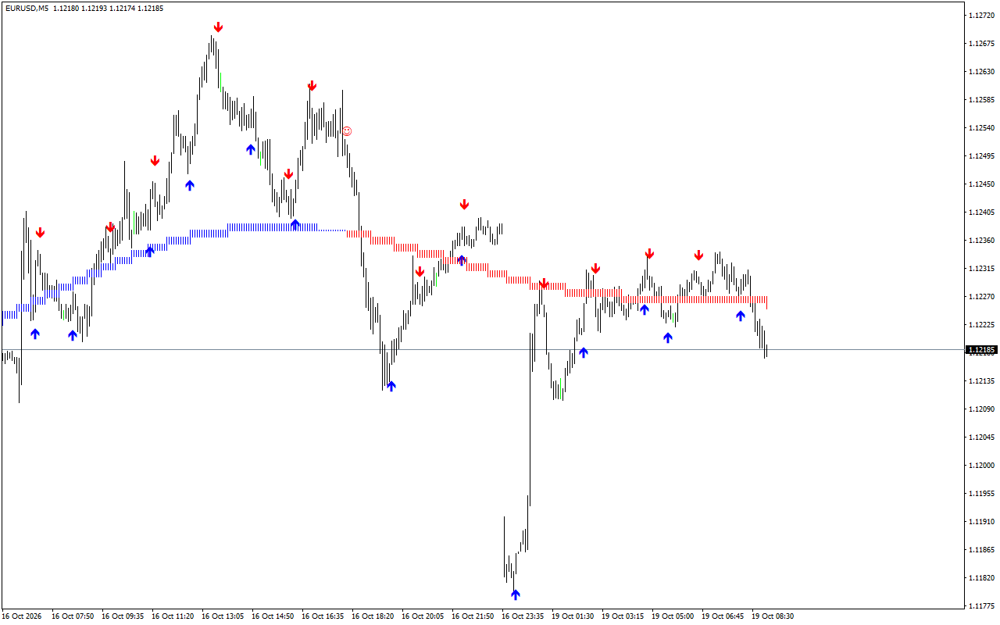
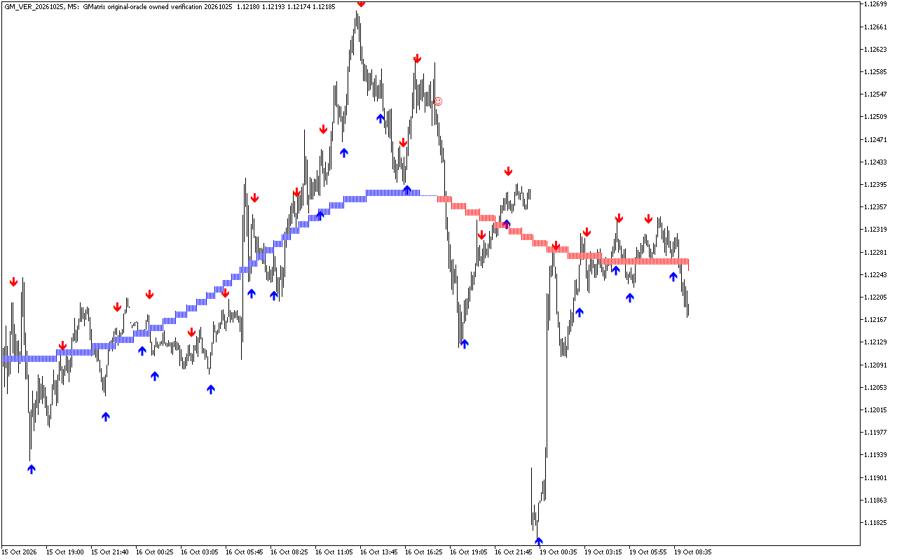

# ⚡ TL G-Matrix Pro

**Original-style blue/red fast arrows and trend band, reconstructed for MT4/MT5. The centered trend repaints.**

     

## 📥 Download

| Platform | File |
|---|---|
| **MT4** | [`TL G-Matrix Pro.ex4`](MT4/TL%20G-Matrix%20Pro.ex4) |
| **MT5** | [`TL G-Matrix Pro.ex5`](MT5/TL%20G-Matrix%20Pro.ex5) |

> Compiled build only — source code is not published.

## Overview

CREATED WITH INDICATORGENIUS.COM — <https://indicatorgenius.com/>

## About This Release

This is an independently written reconstruction of the G-Matrix PRO.ex4 attached by LiveTradesTm to Forex Factory post #353: <https://www.forexfactory.com/thread/post/15972961#post15972961>

The original EX4 contains the copyright credit Oleg Rodin, 2023, and the apollo777 identifier. Its runtime diagnostics identify ForexBreathSystem.mq4. Those original-author credits are acknowledged. This TL reconstruction is not an official release or endorsement by the original author.

The blue/red appearance is retained: blue upward arrows, red downward arrows, a thin blue/red trend band, and small blue/red trend-change markers. There is no dashboard. This indicator does not place or manage orders.

## Important: The Original Trend Repaints

The recovered trend uses a centered, bidirectional LWMA(200). As newer bars arrive, historical trend values and trend-change markers can change. The latest part of the trend is provisional. A past trend marker shown today was not necessarily present at that time in live trading.

The fast arrow engine uses current-bar price data. An arrow on the open bar can also change before that bar closes. Alerts in this edition check the last closed bar once per new bar; this does not make the centered trend non-repainting. Historical arrows filtered by the trend must not be treated as a record of signals that were all available live.

## Installation

- Extract the ZIP.
- MT4: copy TL G-Matrix Pro.ex4 to File > Open Data Folder > MQL4 > Indicators.
- MT5: copy TL G-Matrix Pro.ex5 to File > Open Data Folder > MQL5 > Indicators.
- Refresh Indicators in Navigator, then attach TL G-Matrix Pro to your chart.
- No DLL imports are required. Algo Trading/AutoTrading is not required.

## Package Contents

- MT4/Indicators/TL G-Matrix Pro.ex4 MT5/Indicators/TL G-Matrix Pro.ex5 README_EN.txt

- The release ZIP contains compiled indicators and this README. It contains neither the original third-party EX4 nor source files. Free edition: no account lock and no expiry.

## What The Two Engines Do

FAST ARROWS: Frequency controls the high/low moving-average lookback. The engine tracks running price extremes. A blue BUY arrow requires the bullish state transition and a close above the previous bar's high. A red SELL arrow requires the bearish transition and a close below the previous bar's low.

TREND: a separate, fixed 200-period bidirectional smoother feeds stepped trend lines. Their crossings produce the small trend-change markers. Blue indicates the upward trend state; red indicates the downward state. Frequency changes the fast arrow engine, not this fixed trend period.

The fast arrows use the current ATR(5) as a shared vertical display offset. Historical arrow heights can therefore move as current volatility changes; their plotted price is not a fixed entry, stop or target level.

## Settings

Frequency = 25 by default. Higher values generally produce fewer fast signals; the effect depends on price action. Accepted range: 1 to 10000. UseArrow = true displays the fast BUY/SELL arrows. UseTrend = true displays the trend band and trend-change markers.

There are three independent alert groups:
- AlertsArrow: fast arrow alerts; off by default. ArrowSound controls popup alerts; ArrowEmail controls email; ArrowNotify controls mobile push.
- AlertsTrend: trend-change alerts; off by default. alertsMessage controls popup alerts; alertsNotify controls mobile push.
- AlertTrAr: fast arrows aligned with the calculated trend; on by default. TrArSound, TrArEmail and TrArNotify are all on by default, matching the original input defaults. TrArSound controls popup alerts.

Email and push require the terminal's email/notification settings. To start quietly, set AlertTrAr=false and leave AlertsArrow/AlertsTrend=false. No historical alert burst is sent when attaching the indicator. Refreshes and repeated ticks on the same bar do not generate duplicate closed-bar alerts.

## How To Use It

- Begin with Frequency=25 and both display toggles enabled. Identify the large arrow separately from the small trend-change marker. If using trend alignment, a blue fast arrow with an upward trend is a bullish candidate; a red fast arrow with a downward trend is a bearish candidate. These are chart indications, not automatic trade instructions. Wait for the fast signal bar to close, and remember that its trend context can later repaint.

- Stops, targets, position size and exits are your own decisions. This release has no SL/TP calculation, trade buttons, automatic entries or trade manager.

## Changes From The Supplied Ex4

- Native MT4 and MT5 builds with the recovered calculations and blue/red look.
- Guards for short price arrays and invalid Frequency values.
- Closed-bar, once-per-bar alerts, with no attachment-time history spam.

## Feedback

Include the platform/build, broker symbol including suffix, timeframe, Frequency, display toggles, timestamp and a screenshot. When comparing two charts, use the same broker OHLC history and the same visible test time.

Forex Factory: <https://www.forexfactory.com/thread/1428808-free-eas-indicators-strategies-mt4> YouTube: <https://www.youtube.com/@traderlifestyle> WhatsApp: <https://wa.me/18585003724>

## Created With Indicatorgenius.Com

<https://indicatorgenius.com/>

Risk notice: leveraged trading can result in substantial losses. Test your own decisions on a demo account first. An indicator is not a promise of profit.

## 🖼️ More screenshots

---

**Built by [trader.lifestyle](https://www.youtube.com/@traderlifestyle)** · [Forex Factory thread](https://www.forexfactory.com/thread/1428808-free-eas-indicators-strategies-mt4) · [YouTube](https://www.youtube.com/@traderlifestyle) · [WhatsApp](https://wa.me/18585003724)

### ✨ CREATED WITH [INDICATORGENIUS.COM](https://indicatorgenius.com) ✨

Trading involves substantial risk. This tool is provided free and as-is for education. Test on a demo account first. Past behaviour is no guarantee of future results.

