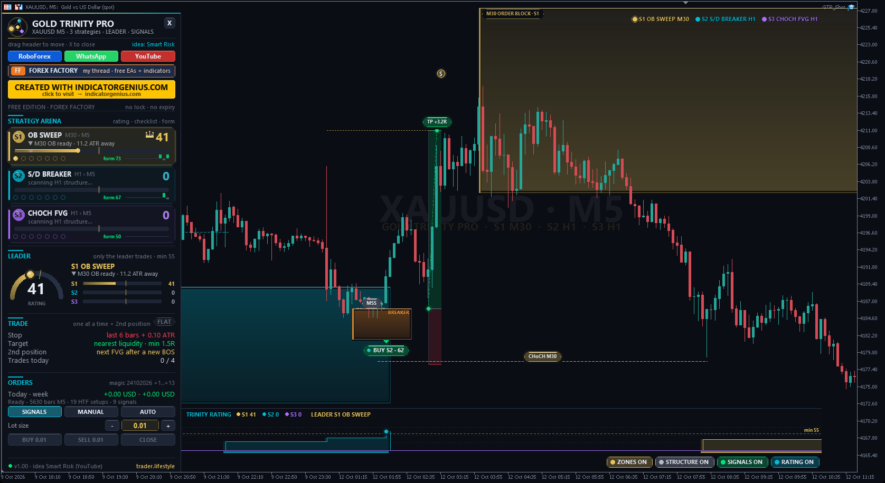
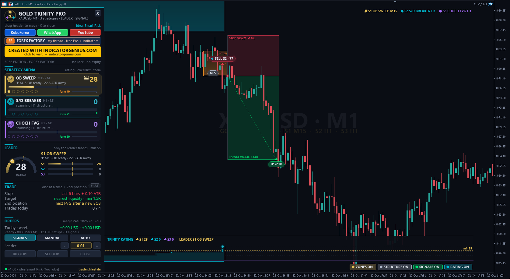
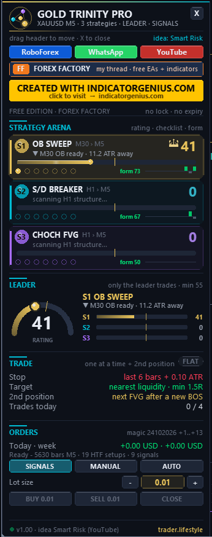

<!-- auto-generated: remove this line after hand-editing so publish keeps your text -->

# ⚡ TL Gold Trinity Pro

**Smart Risk's three gold scalping setups as one EA: S1 sweep + order block + IFVG, S2 supply / demand + breaker, S3 CHoCH + FVG + IFVG. The TRINITY RATING scores every setup live and only the top rated strategy trades. Created with IndicatorGenius.com.**

     

## 📥 Download

| Platform | File |
|---|---|
| **MT4** | [`TL Gold Trinity Pro.ex4`](MT4/TL%20Gold%20Trinity%20Pro.ex4) |
| **MT5** | [`TL Gold Trinity Pro.ex5`](MT5/TL%20Gold%20Trinity%20Pro.ex5) |

> Compiled build only — source code is not published.

## What It Is

One Expert Advisor for MetaTrader 4 and MetaTrader 5 that trades all three gold scalping setups from the YouTube video "3 Best Gold Trading Scalping Strategy" by Smart Risk: <https://www.youtube.com/watch?v=xXy2CBssQQA> Every setup reads a higher timeframe zone first (order block, supply / demand, fair value gap) and enters on the lower chart only after a confirmation - "HTF delivery as the main confirmation criteria". The three strategies run at the same time. The TRINITY RATING scores each of them every bar and only the strategy that is rated highest right now may trade. All credit for the three strategies goes to Smart Risk. I built them into one mechanical EA and added the rating, the risk layer, the dashboard and the chart design.

## The Original Rules (From The Video)

- **S1 OB SWEEP** — HTF 30m -> entry 5m (or 15m -> 1m). On the HTF: a liquidity sweep (price takes out a key low, rejects at once), then a break of structure. The order block that started both moves is the point of interest (last down-close candle(s) before the move up). Wait for price to come back into it. On the entry chart: a violated fair value gap that flips into an inverse FVG (IFVG) = first confirmation; an MSS at the same time = extra confluence. Entry at the next candle open, or a buy limit at the top of the IFVG. Stop below the most recent swing low.

- **S2 S/D BREAKER** — HTF 1H -> entry 5m. Uptrend = at least two bullish BOS in a row. The origin of the last expansion = demand zone (most recent unmitigated one). When price taps it: MSS / CHoCH on 5m = first confirmation, then a bullish breaker block (swing low, swing high, lower low, then the break - the up-close candle(s) between the first swing low and the swing high). Buy limit at the top of the breaker.

- **S3 CHOCH FVG** — HTF 4H / 1H -> entry 15m / 5m. Strong downtrend = at least three bearish BOS, then a bullish CHoCH (close above the last BOS high). The bullish FVG of the CHoCH leg is the zone. On the entry chart: a rejection inside the gap (1st layer), then an IFVG inside or just outside it (2nd layer). Entry at the next open or a buy limit at the top of the IFVG. Extras: 50 % fill of the HTF gap, CISD.

- **All three** — Target = the nearest buy-side liquidity, or a HTF key level for a bigger move. Second position: when the first trade runs in profit and a new BOS forms, a buy limit at the top of the next unmitigated FVG of that leg, stop a few pips below the last swing low. Short trades are the exact mirror.

## How The EA Makes It Mechanical (TL)

The video uses a paid structure indicator. The EA uses these fixed definitions:

- **Swings** — pivot high / low with N bars on each side (HTF 3, entry chart 2).

- **BOS / CHoCH** — a CLOSE beyond the last swing ("breaks and closes above"). The first break against the trend = CHoCH, the next ones = BOS.

- **Sweep** — a wick through the last swing low, close back above it (same bar).

- **Order block /** — the leg from the broken swing to the break: its lowest low + the last demand          down-close candle around it -> zone from that low to the candle high.

- **FVG / IFVG** — low[0] above high[2] (bull gap); an IFVG is a gap of the other direction that a candle closes through.

- **CISD** — first close above the open of the last run of down-close candles.

- **Timing** — a HTF zone is used once its HTF bar has CLOSED. It waits max 48 of its bars for the tap; after the tap the entry model has 36 entry bars.

- **Stop** — below the lowest low of the last 6 bars + 0.1 ATR (0.5 to 4 ATR).

- **Target** — the nearest untaken swing high with at least 1.5 R, else a HTF swing high, else 2 R.

- **Entry** — a limit at the top of the IFVG / breaker for all three (video option 2, "often provides a better risk to reward ratio"); next candle open per input (video option 1).

- **Limit orders** — valid 12 bars, cancelled if price reaches the target first.

All signals are calculated on CLOSED bars - nothing repaints.

## The Trinity Rating (TL)

Every bar each strategy gets a rating from 0 to 100:
- **quality** — the video's checklist for that strategy (sweep / trend, HTF delivery, IFVG / breaker, MSS, V-shape recovery, CISD, rejection, 50 % fill, target at 2 R or more) - grows while the setup develops. form     how its own recent setups played out ("shadow trades": every signal of that strategy followed with the same rules, last 10 results). LEADER mode (default): only the strategy with the highest rating right now may trade, and only from a rating of 55. BEST SIGNAL mode: the best signal of a bar trades. The dashboard and the strip at the bottom of the chart show all three ratings live.

## What I Added (TL)

- All three strategies in one EA for MT4 and MT5 from one source code.
- The TRINITY RATING that decides which strategy trades.
- Exact, testable definitions of swings, BOS / CHoCH, sweeps, order blocks, FVG / IFVG, breaker blocks and CISD, with no look-ahead on the higher timeframes.
- Stop limits in ATR, minimum reward : risk, limit expiry, second position, optional break-even, max trades per day, spread (x ATR), session and Friday filters, risk-% lot sizing.
- The chart: 3D zones per strategy (S1 gold, S2 cyan, S3 violet) with a moving light on the active ones, IFVG and breaker zones, BOS / CHoCH / sweep / MSS labels, entry pills with the rating, position boxes (target / stop) like in the video, exit tags in R, the TRINITY RATING strip, live trade and limit lines.
- The standard TL dashboard: STRATEGY ARENA with three live cards (rating bar, checklist dots, form bars, crown for the leader), LEADER gauge, trade block, SIGNALS / MANUAL / AUTO, lot - / +, BUY / SELL / CLOSE.
- The rules were written a second time in Python and compared with the EA on one year of XAUUSD M5: identical setups, signals, trades and ratings.

## Modes

- **SIGNALS** — zones, ratings, chart marks and alerts - no orders (start mode).

- **MANUAL** — BUY / SELL buttons with stop + target from the rules.

- **AUTO** — the top rated strategy trades automatically (+ the second position).

## Installation

- MT5: copy "TL Gold Trinity Pro.ex5" to File > Open Data Folder > MQL5 > Experts

- MT4: copy "TL Gold Trinity Pro.ex4" to File > Open Data Folder > MQL4 > Experts

- Refresh the Navigator and drag the EA onto an XAUUSD M5 chart (M1 and M15 work too: the higher timeframes follow the chart, see the inputs).

- Tick "Allow DLL imports" - only used to open the link buttons in your browser.

- For MANUAL / AUTO enable Algo Trading (MT5) / AutoTrading (MT4).

## Good To Know

- Built and checked for gold. Other symbols work, the ATR based stops adapt.
- The EA loads the M30 / H1 / H4 history by itself. Until it is there, the higher timeframe bars are built from the chart bars (also in the MT4 tester, which does not deliver other timeframes).
- Magic numbers: S1 +1, S2 +2, S3 +3, second positions +11 to +13 (input + offset).
- One trade at a time (+ its second position). No news filter - stay out of big news yourself or use the session filter.

## Package

- MT4/Experts/TL Gold Trinity Pro.ex4

- MT5/Experts/TL Gold Trinity Pro.ex5

- README_EN.txt

## Credits

- Strategies: Smart Risk - <https://www.youtube.com/watch?v=xXy2CBssQQA>
- EA, TRINITY RATING, risk layer, dashboard and chart design: trader.lifestyle
- Created with IndicatorGenius.com - <https://indicatorgenius.com/>

## Links

- **YouTube** — <https://www.youtube.com/@traderlifestyle>

- **WhatsApp** — <https://wa.me/18585003724>

- **Forex Factory** — <https://www.forexfactory.com/thread/1428808-free-eas-indicators-strategies-mt4>

## Risk Notice

Trading leveraged products carries a high risk of loss. This EA is a tool, not a promise of profit - test it on a demo account first.

## 🖼️ More screenshots

---

**Built by [trader.lifestyle](https://www.youtube.com/@traderlifestyle)** · [Forex Factory thread](https://www.forexfactory.com/thread/1428808-free-eas-indicators-strategies-mt4) · [YouTube](https://www.youtube.com/@traderlifestyle) · [WhatsApp](https://wa.me/18585003724)

### ✨ CREATED WITH [INDICATORGENIUS.COM](https://indicatorgenius.com) ✨

Trading involves substantial risk. This tool is provided free and as-is for education. Test on a demo account first. Past behaviour is no guarantee of future results.

