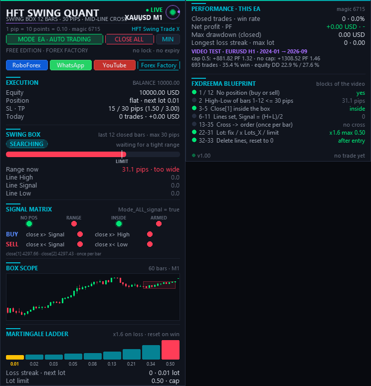

# ⚡ TL HFT Swing Quant

**The fxDreema box-breakout video as an EA: 12-bar / 30-pip box, signal line cross, fixed SL / TP — with quant panel.**

    

## 📥 Download

| Platform | File |
|---|---|
| **MT5** | [`TL HFT Swing Quant.ex5`](MT5/TL%20HFT%20Swing%20Quant.ex5) |

> Compiled build only — source code is not published.

## ✨ Highlights

- **1:1 rebuild of the fxDreema project "HFT Swing Trade X"** (Boxxocode ep546) as a native MT5 EA.
- **Tight-range box detection** — waits for the last 12 closed bars to fit into 30 pips, then draws the box.
- **Signal-line cross entries** — BUY / SELL when the close crosses the box midline (or the box edges).
- **Fixed SL 15 / TP 30 pips**, measured from the closing price just like fxDreema.
- **Optional martingale lot ladder** with a hard lot cap — or plain fixed lots.
- **Quant-style panel** that checks the fxDreema block blueprint live.

## 🧠 Strategy rules

| Step | Rule |
|---|---|
| **Box** | No open position + the last 12 closed bars fit into 30 pips (highest high − lowest low) + the last close is inside that box → **Line High** / **Line Low** are set (once per bar). **Line Signal** = (High + Low) / 2. Three horizontal lines are drawn. |
| **BUY** | The last close crosses above Line Signal (or above Line High when `Mode_ALL_signal = true`). |
| **SELL** | The last close crosses below Line Signal (or below Line Low). |
| **Limit** | Max. one entry per bar. |
| **SL / TP** | SL 15 pips, TP 30 pips, measured from the closing price (like fxDreema). |
| **Reset** | After every entry the lines are deleted and the variables reset to 0. |

**Lot sizing:**

- `Mode_Lots_X = true` → martingale: after a losing position the lot is multiplied by 1.6; after a winner it goes back to `Lot_start`. `Mode_Max_Lots` caps the lot at 0.5.
- `Mode_Lots_X = false` → fixed `Lot_start`.

**Pips:** 1 pip = 10 points on 5 / 3-digit symbols and on gold (0.10). Override with **"Points per pip"**.

## 🖥️ Dashboard & chart

Quant-style panel, collapsible with **Min**:

- execution status
- swing box state + range gauge
- signal matrix
- box scope
- martingale ladder
- performance of this EA
- the fxDreema block blueprint, checked live

English tooltips on everything (can be switched off in the inputs).

## 🛠️ Installation

1. Copy `TL HFT Swing Quant.ex5` to `File → Open Data Folder → MQL5 → Experts`.
2. Refresh the Navigator and drag the EA onto a chart.
3. Allow Algo Trading.
4. Enable **"Allow DLL imports"** only if you want the RoboForex / WhatsApp / YouTube / Forex Factory buttons to open links.

## 🙏 Credits

Rebuilt from the fxDreema project **"HFT Swing Trade X"** shown in **Boxxocode** episode 546.

## ⚠️ Notes

- With martingale mode on, lot sizes grow after every loss and exposure can grow quickly. Keep the lot cap low and test on a demo account first.
- The fixed 15 / 30-pip distances are not universal — other symbols and timeframes need their own distances.
- Not financial advice. No profit is promised.

---

**Built by [trader.lifestyle](https://www.youtube.com/@traderlifestyle)** · [Forex Factory thread](https://www.forexfactory.com/thread/1428808-free-eas-indicators-strategies-mt4) · [YouTube](https://www.youtube.com/@traderlifestyle) · [WhatsApp](https://wa.me/18585003724)

### ✨ CREATED WITH [INDICATORGENIUS.COM](https://indicatorgenius.com) ✨

Trading involves substantial risk. This tool is provided free and as-is for education. Test on a demo account first. Past behaviour is no guarantee of future results.

