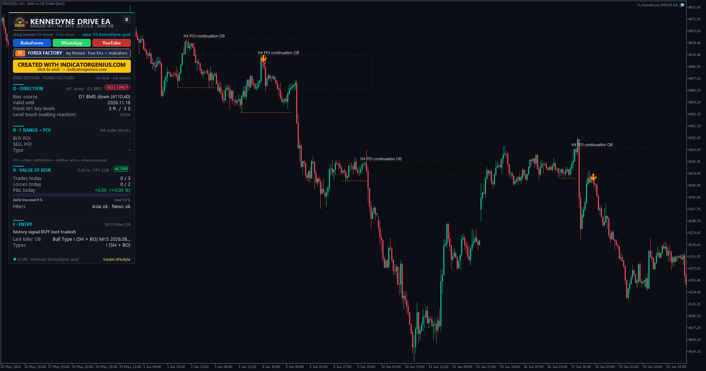

# ⚡ TL KenneDyne DRIVE EA

**The D.R.I.V.E. framework + Engulfing Killer Order Block entry, built from 6,794 channel posts. Made for gold.**

    

## 📥 Download

| Platform | File |
|---|---|
| **MT5** | [`TL KenneDyne DRIVE EA.ex5`](MT5/TL%20KenneDyne%20DRIVE%20EA.ex5) |

> Compiled build only — source code is not published.

## ✨ Highlights

- **A whole channel turned into rules.** Built around the method taught in the Telegram channel "KenneDyne spot" — all 6,794 posts (Jul 2023 – Oct 2026) were read, and the rules come from his own posts (post numbers quoted below).
- **D.R.I.V.E. framework** — Direction, Range, Interest point, Value of risk, Entry — fully automated.
- **Engulfing Killer Order Block entry** at the point of interest, Type I by default.
- **Three timeframe alignments** — Swing/Day, Position and Scalping.
- **Strict risk rules:** 0.5 % risk per trade, minimum 1:3 reward:risk, daily loss / loss-count / trade limits.
- **Made for XAUUSD (gold)**, works on any symbol.

## 🧠 Strategy rules

### Timeframe alignment ("2 timeframes below", post #6047 / #7127)

| Mode | Direction | Breakout + POI | Entry |
|---|---|---|---|
| **Swing/Day** (default) | W1 | H4 | M15 |
| **Position** | MN | D1 | H1 |
| **Scalping** | D1 | H1 | M5 |

### D — Direction (bias)

Key levels are **Malaysian SNR** on the direction timeframe: swing highs / lows measured on candle **bodies**. Only **fresh** levels (never touched again) are used.

- **Reversal:** level touched + the last breakout-TF swing before the touch broken by a candle **close** → bias in the rejection direction.
- **Breakout:** level broken by a breakout-TF close → bias in the breakout direction; the broken level becomes the POI (RBS / SBR retest).
- **Structure confirmation** one timeframe below the direction TF ("Weekly bias: Daily BO = confirmation", post #4139): a D1 close beyond the last D1 swing also sets the bias.

### R / I — Range + Interest Point

- Every breakout-TF structure break (close beyond the last swing) in the bias direction creates a **POI** = the order block at the origin of the impulse leg ("every H4 candle = new entry opportunity on M15", post #5823).
- A POI is dropped when price closes beyond its invalidation, when the bias flips, or after "POI lifetime" bars.

### E — Entry: Engulfing Killer OB on the entry TF, at the POI

- **Type I (Stop Hunt + Body Breakout)** — bullish: candle 1 is bearish, candle 2 sweeps the low of candle 1 and **closes above the high** of candle 1. KenneDyne: *"Type I has high probability, others are 50/50"* (#3916).
- **Type II (Shift in Market Structure + Body BO)** is available, off by default.

### V — Value of Risk

- 0.5 % risk per trade, lot size calculated from the stop distance.
- SL behind the pattern extreme + buffer; setups wider than the max SL are skipped.
- **TP1 = 3R:** 90 % is closed, the runner goes to break-even and runs to the next opposite direction-TF key level (max 600 pips). Minimum reward:risk 1:3.
- **Daily limits:** max 1 % loss, stop after 2 losses, max 3 trades.

### 🚫 Filters

- **Asian window** 00:00–04:00 UTC — engulfings / breakouts there are "often fake" (#3376 / #3497).
- **Late Friday** (weekly close).
- **High-impact USD news** — live, from the MT5 economic calendar.

## 🖥️ Dashboard & chart

The dashboard appears top-left: drag the header to move it, **X** closes it to a small pill (click the pill to reopen), and hovering any block shows an explanation. On start the EA rebuilds the last 30 days (bias, POIs, signals — no trades), so the current state is visible immediately.

## ⚙️ Key inputs

| Input | What it does |
|---|---|
| **Timeframe alignment** | W1 > H4 > M15 (default) · MN > D1 > H1 · D1 > H1 > M5 |
| **Type I / Type II** | Which Killer OB types are traded (default: Type I only) |
| **Entry model** | Confirmation (market at pattern close) · limit at the OB edge |
| **Stop mode** | ATR (default) · fixed pips (30–40 as posted) · pips scaled to price (pips × price / 2000) |
| **TP1 mode** | 3R (default) · 100 pips |
| **Risk per trade** | 0.5 % |
| **Daily limits** | 1 % loss / 2 losses / 3 trades |
| **Filters** | Asia, Friday cutoff, news |
| **Broker GMT offset winter/summer** | For the Strategy Tester (default 2/3 = EET brokers such as RoboForex, IC Markets). Live, the offset is detected automatically. |

## 🛠️ Installation

1. In MT5 open **File → Open Data Folder** and copy `TL KenneDyne DRIVE EA.ex5` to `MQL5 → Experts`.
2. Restart MT5 or right-click **Expert Advisors → Refresh** in the Navigator.
3. Drag the EA onto an **XAUUSD** chart (any timeframe — the EA reads its own timeframes).
4. Enable **"Algo Trading"**. Enable **"Allow DLL imports"** only if you want the panel links (YouTube / RoboForex / WhatsApp / Forex Factory / IndicatorGenius) to open in your browser.

## 🙏 Credits

Trading method by **KenneDyne** — Telegram channel ["KenneDyne spot"](https://t.me/KenneDynespot). The rules were taken from his own posts; post numbers are quoted above.

## ⚠️ Notes

- This EA is an interpretation of the rules posted in the channel, not an official product of the channel's author.
- The news filter uses the live MT5 economic calendar.

---

**Built by [trader.lifestyle](https://www.youtube.com/@traderlifestyle)** · [Forex Factory thread](https://www.forexfactory.com/thread/1428808-free-eas-indicators-strategies-mt4) · [YouTube](https://www.youtube.com/@traderlifestyle) · [WhatsApp](https://wa.me/18585003724)

### ✨ CREATED WITH [INDICATORGENIUS.COM](https://indicatorgenius.com) ✨

Trading involves substantial risk. This tool is provided free and as-is for education. Test on a demo account first. Past behaviour is no guarantee of future results.

