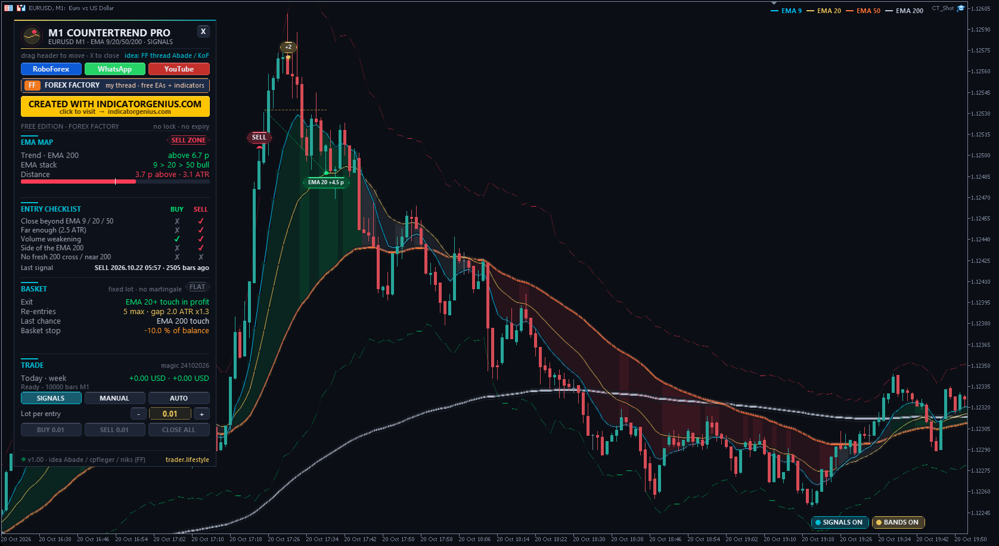
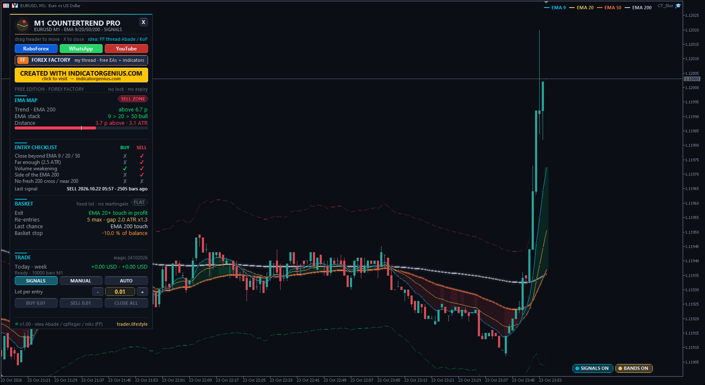

<!-- auto-generated: remove this line after hand-editing so publish keeps your text -->

# ⚡ TL M1 Countertrend Pro

**The M1 Countertrend Scalping Strategy (FF thread 1190104, Abade / King of Forex EMA method) as one EA: fade overextensions beyond the 9/20/50 EMA, 9 EMA re-entries with a fixed lot, exit at the EMA touch, basket stop and SIGNALS / MANUAL / AUTO.**

     

## 📥 Download

| Platform | File |
|---|---|
| **MT4** | [`TL M1 Countertrend Pro.ex4`](MT4/TL%20M1%20Countertrend%20Pro.ex4) |
| **MT5** | [`TL M1 Countertrend Pro.ex5`](MT5/TL%20M1%20Countertrend%20Pro.ex5) |

> Compiled build only — source code is not published.

## Overview

What it is One Expert Advisor for MetaTrader 4 and MetaTrader 5 that trades the "M1 Countertrend Scalping Strategy" from Forex Factory (thread 1190104, started by Abade in November 2022, based on the EMA method of "King of Forex"). The thread has more than 19,000 posts - I read all of them and built the rules of post #1 into a mechanical EA, plus the risk rules the thread worked out over four years. All credit for the strategy goes to Abade, King of Forex, cpfleger, niks and everybody in the thread who shared rules, charts and lessons.

The original rules (post #1, Abade)
- **Chart** — M1 (M5 also used), EURUSD / GBPUSD in the original. EMA 9, 20, 50, 200 on close, volume with a 20 MA. First BUY    the close is BELOW the 9, 20 AND 50 EMA with a "good enough" distance. First SELL   the close is ABOVE the 9, 20 AND 50 EMA with a "good enough" distance. Never trade while price is stuck between the EMAs. Re-entry     if price keeps going against you, add a new order each time the 9 EMA crosses the level of your latest order. Exit         as soon as price touches the nearest EMA that lets you exit in profit - the 20 EMA in a range, the 50 or 200 EMA when you are caught in a breakout. Volume       weakening volume = the safest entries (post #1, point 6a). Abade's later risk rules (posts #808, #2372, #4819): keep lots and the number of entries small, always have an equity stop, the 200 EMA is the last-chance exit, delay entries right after the fast EMAs cross the 200, don't go heavy near the 200, avoid news.

How the EA makes it mechanical
- **"Good enough distance"** — the close must be at least 2.5 x ATR(14) beyond the nearest of the 9 / 20 / 50 EMA, and at least 2 pips (inputs: ATR or fixed pips, measured from the nearest EMA or from the 50 EMA). Volume weakening         the signal bar has less tick volume than the bar before (input: off / below its 20 MA / lower than the bar before). Side of the 200 EMA      BUY only below the 200 EMA, SELL only above it (a rule several thread members used, e.g. niks #10914). Input, default on. No fresh 200 cross       no first entry within 30 bars after EMA 9, 20 or 50 crossed the 200 EMA, and not closer than 1 ATR to the 200 EMA (Abade). One signal per stretch   the signal fires once, on the first closed bar where all checks pass; the next one needs price to come back inside the EMAs first. Re-entry                 the 9 EMA crosses the latest order level (original), the gap to the latest order is at least 2 x ATR and grows x1.3 with every re-entry, max 6 entries. Every entry uses the SAME lot - no martingale (the clear consensus of the thread). Exit                     the basket closes when price touches the 20 EMA (or the 50 / 200 EMA if it reaches those first) with at least 1 pip profit. Input: exit from EMA 9 / 20 / 50 / 200. Last chance              when the 200 EMA lies beyond the 9/20/50 group and price touches it, the basket closes even at a small loss (Abade). Basket stop              floating loss of 10 % of the balance closes the basket, then a 60 minute pause (input, 0 = off). Optional hard stop in ATR. Time                     Friday close at 20:00 server time (input), optional no-overnight hour, optional session filter, max spread 2 pips. All signals are calculated on CLOSED bars - nothing repaints. Exits and the basket stop are checked on every tick.

What I added (TL)
- The whole system as an EA for MT4 and MT5 from one source code, identical rules.
- Measurable versions of the discretionary parts (distance, volume weakening) with the original logic kept, all as inputs.
- The risk layer the thread asked for again and again: fixed lot per entry, max entries, growing re-entry gap, optional "tough trend" guard (no re-entry after N bars without an EMA 9 touch - from the KoF tough-trend notes), basket stop in % of balance with a pause, last-chance exit, Friday close, spread limit, magic number.
- Trading modes on the dashboard: SIGNALS (no orders), MANUAL (BUY / SELL / CLOSE ALL buttons - the EA manages the exit and the basket stop), AUTO. Start mode = input, default SIGNALS.
- Lot size: dashboard - / + (step 0.01 / 0.1 / 1 / 10) or lots per 1,000 of balance (KoF / Abade: 0.01 per 1,000).
- Chart design: glowing EMA ribbons, the 9/20/50 EMA cluster tinted by the EMA stack (green bull, red bear, grey = "stuck"), BUY / SELL distance lines, BUY / SELL pills, re-entry tags (+2, +3 ...), exit tags with the basket path and the pips per entry. Live basket: average line, exit EMA, next re-entry level and the basket-stop level. Dark theme, restored on removal. Hover any mark for an explanation box.
- Standard TL dashboard: EMA map with distance gauge, entry checklist (BUY / SELL), basket, trade block. Drag the header, X folds it to a pill, more columns on low charts, moves away from other TL panels automatically. Works on 2K / 4K screens.
- Chart buttons SIGNALS ON / OFF and BANDS ON / OFF (display only).

Inputs (main groups)
- EMAs          9 / 20 / 50 / 200, volume MA 20 (EMA or SMA), bars to calculate.
- First entry   distance mode + size, minimum pips, volume filter, side of the 200, 200-cross delay, minimum distance to the 200.
- Re-entries    max entries, 9 EMA cross on/off, gap in ATR, gap growth, tough-trend guard.
- Exit & risk   exit EMA, minimum profit, last chance, basket stop %, pause, hard stop.
- Trading       start mode, direction, lot mode, lot, lots per 1,000, max spread, session, no-overnight hour, Friday close, magic, slippage.
- Display       theme, EMA ribbons, bands, marks, chart buttons, colours, animation, size (Auto / 100-300 %), dashboard position, auto-avoid, tooltips.
- Alerts        popup, sound, push.

Good to know
- Made for M1 (M5 also works). Pairs with a low spread; the thread mostly used EURUSD, GBPUSD, USDCAD, EURGBP, later also gold. JPY crosses and news spikes are known as hard for countertrend trading.
- Pips: 5 / 3 digit symbols = 10 points, gold = 0.10, silver = 0.01. For indices or crypto set "Max spread" to 0 or to a value in points.
- Averaging adds risk: in a long trend the basket can grow to the maximum number of entries before price comes back. The basket stop and the last-chance exit limit this, they cannot remove it. Use small lots.
- Netting accounts (MT5): all entries are one position; the EA counts the entries itself.
- News: the EA has no news calendar - stay away from high-impact news yourself or use the session filter.

Installation
- **MT5: copy "TL M1 Countertrend Pro.ex5" to** — File > Open Data Folder > MQL5 > Experts MT4: copy "TL M1 Countertrend Pro.ex4" to  File > Open Data Folder > MQL4 > Experts Refresh the Navigator and drag the EA onto an M1 chart. Tick "Allow DLL imports" - only used to open the link buttons in your browser. For MANUAL / AUTO enable Algo Trading (MT5) / AutoTrading (MT4).

Package MT4/Experts/TL M1 Countertrend Pro.ex4 MT5/Experts/TL M1 Countertrend Pro.ex5 README_EN.txt

Links
- **YouTube** — <https://www.youtube.com/@traderlifestyle> WhatsApp  <https://wa.me/18585003724> My free tools on Forex Factory: <https://www.forexfactory.com/thread/1428808-free-eas-indicators-strategies-mt4> Strategy thread: <https://www.forexfactory.com/thread/1190104-m1-countertrend-scalping-strategy>

Risk notice Trading leveraged products carries a high risk of loss. This EA is a tool, not a promise of profit. Test it on a demo account first.

## 🖼️ More screenshots

---

**Built by [trader.lifestyle](https://www.youtube.com/@traderlifestyle)** · [Forex Factory thread](https://www.forexfactory.com/thread/1428808-free-eas-indicators-strategies-mt4) · [YouTube](https://www.youtube.com/@traderlifestyle) · [WhatsApp](https://wa.me/18585003724)

### ✨ CREATED WITH [INDICATORGENIUS.COM](https://indicatorgenius.com) ✨

Trading involves substantial risk. This tool is provided free and as-is for education. Test on a demo account first. Past behaviour is no guarantee of future results.

