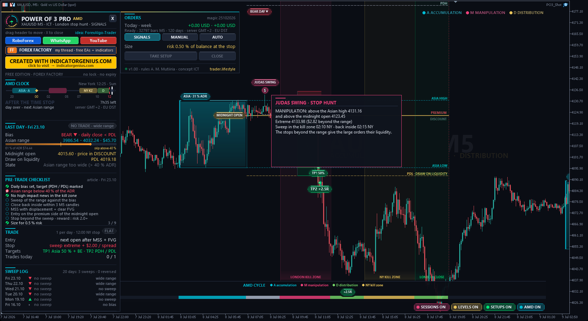
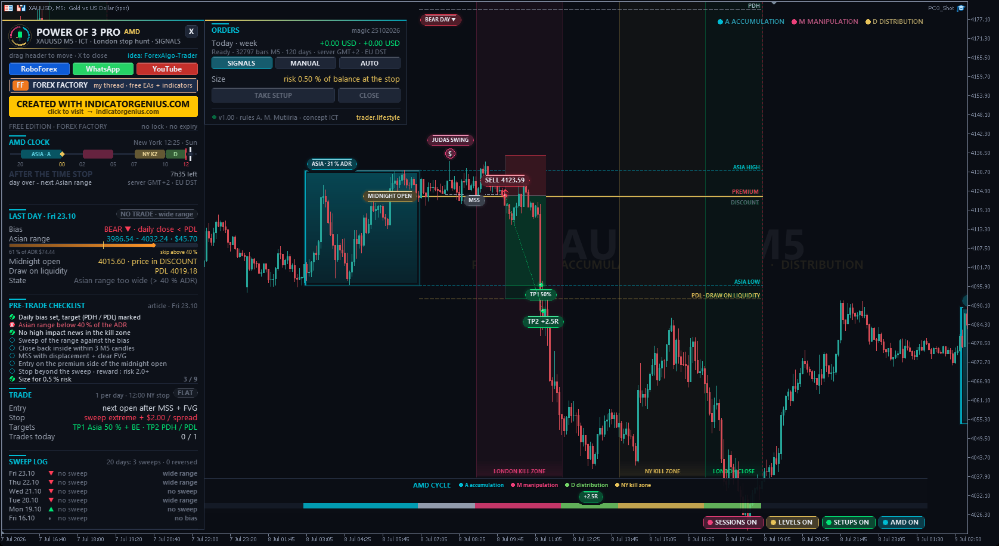
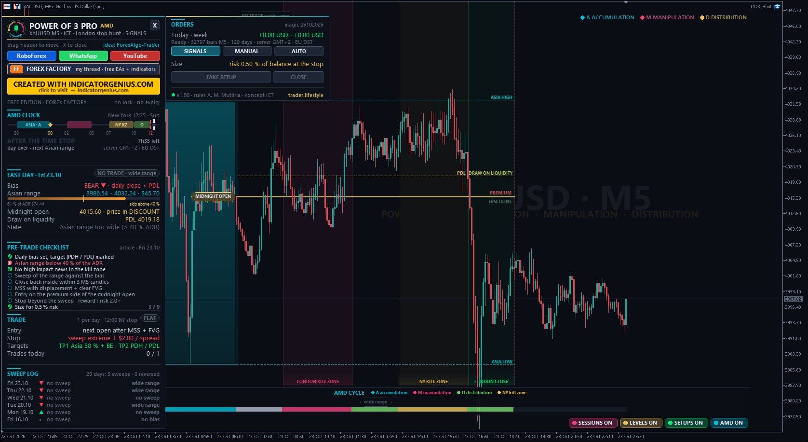

<!-- auto-generated: remove this line after hand-editing so publish keeps your text -->

# ⚡ TL Power of 3 Pro

**ICT Power of 3 (AMD) as one EA after Allan Munene Mutiiria's step-by-step article: Asian range accumulation, the London stop hunt (Judas swing), close back inside + MSS + FVG entry on the discount side of the midnight open, TP1 Asian range + break-even, TP2 previous day high / low, 12:00 New York time stop. New York clock with automatic broker DST detection. Created with IndicatorGenius.com.**

     

## 📥 Download

| Platform | File |
|---|---|
| **MT4** | [`TL Power of 3 Pro.ex4`](MT4/TL%20Power%20of%203%20Pro.ex4) |
| **MT5** | [`TL Power of 3 Pro.ex5`](MT5/TL%20Power%20of%203%20Pro.ex5) |

> Compiled build only — source code is not published.

## What It Is

One Expert Advisor for MetaTrader 4 and MetaTrader 5 that trades the ICT Power of 3 (AMD = Accumulation, Manipulation, Distribution) exactly as described in the article "ICT Power of 3 (AMD) Strategy: Trade the London Stop Hunt Step by Step" by Allan Munene Mutiiria (forexalgo-trader.com): <https://forexalgo-trader.com/resources/314-ict-power-of-3-amd-strategy-trade-the-london-stop-hunt-step-by-step> The concept is by Michael J. Huddleston (ICT). All credit for the rules goes to the author of the article. I built them into one mechanical EA and added the New York clock, the dashboard, the chart design and the improvements listed below.

## The Idea In One Paragraph

A trading day tends to unfold around its opening price: a quiet range (the Asian session = accumulation), a false push in the wrong direction that runs the stops beyond that range (the London stop hunt / "Judas swing" = manipulation), then the real move into the London close (distribution). On a bullish day the best buying prices are BELOW the day's opening price (New York midnight open).

## The Original Rules (Article) - bullish day, the bearish day is the exact mirror

- **Clock** — New York time. Asian range 20:00-00:00, midnight open 00:00, London kill zone 02:00-05:00, New York kill zone 07:00-10:00, London close 10:00-12:00. 1 Bias     Bullish when the last daily candle closed above the previous day's high, or H4 makes higher highs and higher lows. Target = the previous day high (PDH, the draw on liquidity). No clear bias = no trade. 2 Range    Mark the Asian high / low and the midnight open. Skip the day when the Asian range is wider than about 40 % of the 20-day ADR. 3 Sweep    In the London kill zone price trades below the Asian low AND below the midnight open. A wick is enough. 4 MSS      Within 3 M5 candles price closes back above the Asian low. Then an M5 candle closes above the most recent swing high of the drop (fractal, 2 candles each side) with displacement that leaves a bullish fair value gap. 5 Entry    Buy limit inside the FVG, only BELOW the midnight open (discount). Not filled by 05:00 NY -> cancel. 6 Stop     2-3 pips (or the spread, the larger) below the manipulation low. Gold: $1.50 - $2.00. 7 Targets  TP1 = Asian high: close 50 %, stop to break-even. TP2 = PDH. Total reward : risk at least 2 : 1, else skip. 8 Time     Close everything at 12:00 NY. Invalid    Both sides of the Asian range swept before the MSS. The sweep low taken again after the entry -> exit, never average down. High impact news inside 02:00-05:00 NY -> stand aside. One trade per day, risk 0.5 - 1 %.

## What I Added / Changed (every point is an input)

- New York clock from UTC with US daylight saving, plus AUTO detection of the broker server time (GMT+2/+3 with US or EU daylight saving, or fixed) from the weekly close and the live clock. Many brokers switch on EU dates - without this the kill zones are one hour off for three weeks a year.
- Stop below the REAL manipulation low: when price already left the range before 02:00 NY, the extreme since the midnight open is used (input).
- Entry (default): market at the next open after the MSS + FVG. The article's limit inside the FVG is one click away (input "Entry"). In my own tests the limit was filled mostly on days where the reversal failed - the clean reversals often never come back into the gap.
- TP2 = draw on liquidity: if the previous day high / low is already taken, the nearest untaken daily high / low of the last 20 days, else a fixed reward : risk.
- New York kill zone as a second manipulation window (article FAQ), optional.
- Max sweep depth (35 % of ADR, "shallow"), limit cancelled when TP1 trades before the fill, FVG minimum size, entry depth inside the FVG, trading days, max spread.
- MT5 live: economic calendar news filter (high impact, the symbol's currencies, inside the kill zone). Not available in MT4 and in the strategy tester.
- SWEEP LOG - the article asks you to keep a log of every sweep that did and did not reverse. The dashboard keeps it for you (optional CSV export).
- The PRE-TRADE CHECKLIST of the article is ticked live on the dashboard.
- Restart safe: TP1 state is remembered, a still valid limit is placed again.

## Modes

- **SIGNALS** — levels, setups, sweep log and alerts - no orders (start mode) MANUAL   a valid setup is placed with one click: TAKE SETUP AUTO     every valid setup is traded automatically The EA always manages its own open trades (TP1 + break-even, sweep exit, 12:00 stop). Lot: risk % of the balance at the stop (default 0.5 %) or a fixed lot.

## On The Chart

Asian range box (3D, with the range in % of ADR), London / New York kill zone and London close bands, midnight open line with premium / discount, Asian high / low, PDH / PDL (the target side in gold), the Judas swing ($ mark), the MSS line, the FVG, the trade box (stop / TP1 / TP2), entry and exit pills in R, a bias pill per day and the AMD CYCLE strip (every bar coloured by its phase, one result chip per day). Buttons SESSIONS · LEVELS · SETUPS · AMD switch the layers. Hover anything for an explanation. Dark theme, restored when you remove the EA.

## The Dashboard

AMD CLOCK (live New York time on the day's timeline), TODAY (bias, Asian range vs ADR, midnight open, draw on liquidity, state), PRE-TRADE CHECKLIST, TRADE, SWEEP LOG, ORDERS (SIGNALS / MANUAL / AUTO, TAKE SETUP, CLOSE). Drag the header, X folds it to a pill, more columns on small charts, moves away from other TL panels, scales on 2K / 4K screens.

## Good To Know

- The rules run on M5 bars (the article), on any chart from M1 to H1. Best markets per the article: EURUSD, GBPUSD, XAUUSD. JPY pairs are active in Asia.
- Closed bars only - nothing repaints, nothing looks ahead.
- Few trades by design: many days are ranges, two-sided or skipped. "No setup inside the window is a valid outcome" (article).
- The MT4 strategy tester only gives 1000 bars of history at the start; the EA starts once it has enough bars for the ADR.
- Chart results are a model of the rules, not a broker report.

## Installation

- MT5: copy "TL Power of 3 Pro.ex5" to File > Open Data Folder > MQL5 > Experts MT4: copy "TL Power of 3 Pro.ex4" to File > Open Data Folder > MQL4 > Experts Refresh the Navigator, drag the EA onto a EURUSD / GBPUSD / XAUUSD chart (M5). Tick "Allow DLL imports" - only used to open the link buttons in your browser. For MANUAL / AUTO enable Algo Trading (MT5) / AutoTrading (MT4).

## Links

- **YouTube** — <https://www.youtube.com/@traderlifestyle> WhatsApp   <https://wa.me/18585003724> Free tools <https://www.forexfactory.com/thread/1428808-free-eas-indicators-strategies-mt4> Created with IndicatorGenius.com - <https://indicatorgenius.com/>

## Risk Notice

Trading leveraged products carries a high risk of loss. This EA is a tool, not a promise of profit. The article itself says the model is not proven as a complete system - test it on a demo account first.

## 🖼️ More screenshots

---

**Built by [trader.lifestyle](https://www.youtube.com/@traderlifestyle)** · [Forex Factory thread](https://www.forexfactory.com/thread/1428808-free-eas-indicators-strategies-mt4) · [YouTube](https://www.youtube.com/@traderlifestyle) · [WhatsApp](https://wa.me/18585003724)

### ✨ CREATED WITH [INDICATORGENIUS.COM](https://indicatorgenius.com) ✨

Trading involves substantial risk. This tool is provided free and as-is for education. Test on a demo account first. Past behaviour is no guarantee of future results.

