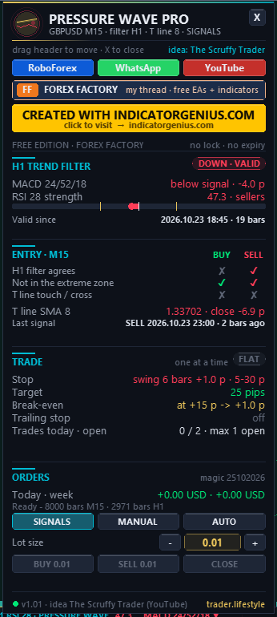

<!-- auto-generated: remove this line after hand-editing so publish keeps your text -->

# ⚡ TL Pressure Wave Pro

**The Scruffy Trader's entry system as one EA: hourly MACD 24/52/18 + RSI 28 trend filter ('pressure wave'), entry on M15 / M5 at the touch or cross of the 8 'T line', 25-pip target, swing stop, break-even. Created with IndicatorGenius.com.**

     

## 📥 Download

| Platform | File |
|---|---|
| **MT4** | [`TL Pressure Wave Pro.ex4`](MT4/TL%20Pressure%20Wave%20Pro.ex4) |
| **MT5** | [`TL Pressure Wave Pro.ex5`](MT5/TL%20Pressure%20Wave%20Pro.ex5) |

> Compiled build only — source code is not published.

## New In V1.01

Thanks to AmaweFX for the ideas (Forex Factory post #349). All new options are inputs; the defaults still trade exactly like v1.00 (the video setup).

- **Break-even in R** — move the stop to entry +1 pip after +N R (R = the first stop distance), or after +N pips as before.

- **Trailing stop** — off / ATR / R. Starts when a bar closes +N R in profit and follows at the bar close (N x ATR or N x R behind the close). It only ever tightens the stop.

- **Trend start** — "Also enter when the hourly filter turns valid": after a trend change the EA can enter right away in the new direction, in addition to the T line touch / cross.

- **Open trades** — max open trades at the same time (1 = one at a time, as in the video). All open trades are in one direction. MT5 netting accounts always use 1.

- **Per day** — "Max new trades per day" = 0 means unlimited.

## What It Is

One Expert Advisor for MetaTrader 4 and MetaTrader 5 that trades the entry system from the YouTube video "Simple Forex Entry Strategy That Actually Makes Sense" by The Scruffy Trader (September 2026): <https://www.youtube.com/watch?v=9bK60tLfRXo> An hourly trend filter (MACD + RSI, both slowed down) decides the direction and the strength - the "pressure wave". The entry comes on M15 or M5 at the touch or cross of the 8 moving average, the "T line". All credit for the strategy goes to The Scruffy Trader (thescruffytrader.com). I built it into a mechanical EA and added a risk layer, the dashboard and the chart design.

## The Original Rules (From The Video)

- **Filter chart** — H1 - "I take my signals from the hourly".

- **Direction** — MACD slowed down to 24 / 52 / 18 (instead of 12 / 26 / 9). MACD line above its signal = up, below = down.

- **Strength** — RSI slowed down to 28 with a line at 50. Above 50 = buyers have the strength, below 50 = sellers.

- **Valid trend** — a MACD cross alone is NOT enough ("it didn't really do anything") - the trend becomes valid when the RSI breaks 50 on the same side.

- **Extreme** — lines at 65 and 35. Once the slow RSI gets there, the move is running out of tempo - no new trade in that direction.

- **Entry chart** — M15 or M5 ("doesn't really matter").

- **Entry** — "enter on the cross of the eight or the touch of the eight" - the 8 MA (the T line) in the direction of the hourly filter.

- **Target** — 20 - 30 pips per trade, 25 marked in the video. Or ride the T line until price comes back underneath.

- **Frequency** — "once, twice a day", and stop when the money target is reached.

- **Without MA** — "you could even just enter it without the moving average and just use the trend filters" - available as an entry option.

The stop was not shown ("it depends on your risk criteria"). The presenter mentions a two-stage stop and a reverse-DCA method but does not explain them - the EA does NOT average down.

## How The EA Makes It Mechanical

- **Hourly values** — at the close of every M15 / M5 bar the EA uses the last CLOSED hourly bar - no look-ahead. MACD = EMA 24 - EMA 52 of the closes, signal = EMA 18 of the MACD (as on TradingView / IG). RSI after Wilder.

- **BUY** — hourly filter UP (MACD above signal AND RSI above 50), RSI below 65, and on the entry chart either cross: the bar before closed at or below the T line, this bar closes above it, or touch: both bars close above the T line and this bar's low touched it. -> entry at the next bar open. SELL is the exact mirror.

- **T line** — simple moving average 8 (input: SMA or EMA).

- **Entry trigger** — touch or cross (video) / cross only / touch only / trend start (enter when the hourly filter turns valid, no T line).

- **Target** — 25 pips (input), or a multiple of the stop (R), or none.

- **Stop (TL)** — below the lowest low of the last 6 bars + 1 pip (above the highest high for a SELL), at least 5 and at most 30 pips. Or ATR, or fixed pips.

- **Break-even (TL)** — at +15 pips (or +N R) the stop moves to entry +1 pip (input, 0 = off).

- **Trailing (TL)** — off by default; ATR or R distance, at the bar close, from +1 R.

- **Exits** — T line exit (a bar closes back through the T line) - option from the video, off by default. Filter-flip exit (TL): close when the hourly filter no longer agrees - on by default.

- **Per day** — max 2 new trades (input, 0 = unlimited), optional daily target and daily loss limit in % - then no new trades until the next day.

One trade at a time by default (input: max open trades). Stop and target are sent with the order (broker side). All signals are calculated on CLOSED bars - nothing repaints.

## What I Added (TL)

- The whole system as an EA for MT4 and MT5 from one source code, identical rules.
- Exact, testable definitions of "touch" and "cross" and of the hourly filter without look-ahead.
- Stop options, break-even step, filter-flip exit, daily target / loss limit, risk-% lot sizing, spread / session / Friday filters.
- The chart: hourly trend zones behind the candles, a mark where the filter turns valid, the glowing T line in the trend colour, the hourly RSI "pressure wave" strip with the 65 / 50 / 35 lines and the MACD direction, BUY / SELL pills with the trigger, stop / target ticks and exit tags (TARGET / STOP / BREAK-EVEN / T LINE / FILTER FLIP).
- The standard TL dashboard: hourly filter with RSI gauge, entry checklist for BUY and SELL, trade block, SIGNALS / MANUAL / AUTO, lot - / +, BUY / SELL / CLOSE.
- The rules were written a second time in Python and compared with the EA on four symbols (M15 and M5) and all entry / stop / exit variants: identical signals and trades.

## Modes

- **SIGNALS** — filter, T line, chart marks and alerts - no orders (start mode).

- **MANUAL** — BUY / SELL buttons with stop + target from the rules; the EA manages break-even and the exits.

- **AUTO** — entries and exits automatically.

## Installation

- MT5: copy "TL Pressure Wave Pro.ex5" to File > Open Data Folder > MQL5 > Experts

- MT4: copy "TL Pressure Wave Pro.ex4" to File > Open Data Folder > MQL4 > Experts

- Refresh the Navigator and drag the EA onto an M15 (or M5) chart.

- Tick "Allow DLL imports" - only used to open the link buttons in your browser.

- For MANUAL / AUTO enable Algo Trading (MT5) / AutoTrading (MT4).

## Good To Know

- Pips: FX 10 points, gold 0.10, indices (price 500+) 1.0 point. The video traded the DAX (25 points). For gold or indices check the stop / target pip inputs, or use the "Pip size override" input.
- The hourly history must be available - the EA loads it by itself; on a fresh chart give it a few seconds.
- No news filter. Stay out of big news yourself or use the session filter.
- Max spread 3 pips by default - set it to 0 for indices / crypto with wide spreads.

## Package

- MT4/Experts/TL Pressure Wave Pro.ex4

- MT5/Experts/TL Pressure Wave Pro.ex5

- README_EN.txt

## Credits

- Strategy: The Scruffy Trader - <https://www.youtube.com/watch?v=9bK60tLfRXo>
- EA, risk layer, dashboard and chart design: trader.lifestyle
- Created with IndicatorGenius.com - <https://indicatorgenius.com/>

## Links

- **YouTube** — <https://www.youtube.com/@traderlifestyle>

- **WhatsApp** — <https://wa.me/18585003724>

- **Forex Factory** — <https://www.forexfactory.com/thread/1428808-free-eas-indicators-strategies-mt4>

## Risk Notice

Trading leveraged products carries a high risk of loss. This EA is a tool, not a promise of profit - test it on a demo account first.

## 🖼️ More screenshots

---

**Built by [trader.lifestyle](https://www.youtube.com/@traderlifestyle)** · [Forex Factory thread](https://www.forexfactory.com/thread/1428808-free-eas-indicators-strategies-mt4) · [YouTube](https://www.youtube.com/@traderlifestyle) · [WhatsApp](https://wa.me/18585003724)

### ✨ CREATED WITH [INDICATORGENIUS.COM](https://indicatorgenius.com) ✨

Trading involves substantial risk. This tool is provided free and as-is for education. Test on a demo account first. Past behaviour is no guarantee of future results.

