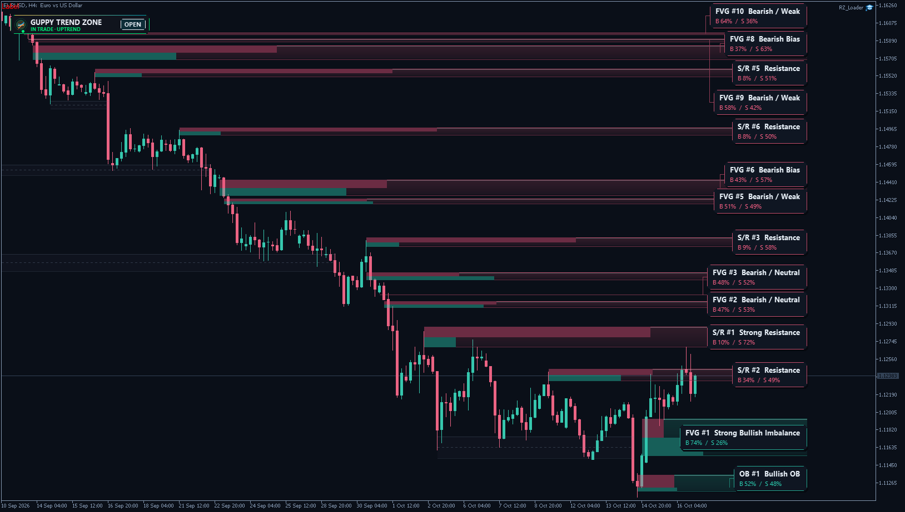

# ⚡ TL Ranked Zones Pro

**Supply & demand zones ranked by strength, based on Zeiierman's ranked-zone algorithms.**

     

## 📥 Download

| Platform | File |
|---|---|
| **MT4** | [`TL Ranked Zones Pro.ex4`](MT4/TL%20Ranked%20Zones%20Pro.ex4) |
| **MT5** | [`TL Ranked Zones Pro.ex5`](MT5/TL%20Ranked%20Zones%20Pro.ex5) |

> Compiled build only — source code is not published.

## ✨ Highlights

- **Three ranked-zone tools in one indicator** — Order Blocks, Fair Value Gaps and Support / Resistance, each with its own ON/OFF button.
- **Zones ranked by quality** — only the strongest zones of each module are drawn, scored by size, volume, trend, touches, mitigation and age.
- **Faithful to the original algorithms** — formulas, thresholds and source behaviours of Zeiierman's scripts are kept, quirks included.
- **Clean dashboard** — draggable, collapsible, multi-column on short charts, with hover help everywhere.
- **Smart alerts** — new zones, touches, leader changes, breaks and S/R mitigation, deduplicated per candle.
- **Analysis only** — no invented BUY/SELL signals, no orders, no DLL.

## 🧠 How it works

### 1. Order Blocks

- A bullish candle after a bearish candle creates a **bullish OB** if the new candle body is at least **1.1 ATR**. The bearish case is mirrored.
- The zone is the **full** high/low range of the previous candle.
- Same-direction overlapping OBs can merge when the overlap reaches 50 % of the smaller zone and the combined size is ≤ 2 ATR.
- Stored: 50; displayed: the strongest 10.
- Original raw-price quality formula: `zone height × 100 + source volume ratio × 10 + trend score × 20 − mitigation × 50 − age in bars × 0.1`.
- The ATR-normalized strength display is a **different** calculation from the ranking.

### 2. Fair Value Gaps

- **Bullish:** current low > high two bars earlier. **Bearish:** current high < low two bars earlier. The exact wick-to-wick gap becomes the zone.
- Stored: 50; displayed: the strongest 10.
- Ranking uses the same original raw-price formula as the OBs, with current-bar volume and candle strength. No FVG merging is added.
- The source's conditional ATR call is represented by a gap-event ATR state; in early warm-up the strength can be unavailable. It is not silently replaced by the global OB/SR ATR.

### 3. Support / Resistance

- Confirmed pivot highs form resistance; confirmed pivot lows form support. Default pivot span: five bars on **each** side.
- A zone is only discovered once the five right-side bars exist; its drawing begins at the pivot time.
- Min adjacent swing quality: 0.15 ATR. Zone total width: 0.40 ATR.
- Same-side zones absorb each other when the midpoint separation is ≤ 0.55 ATR or the overlap is ≥ 35 % of the smaller zone.
- A close beyond the outer edge + 0.12 ATR breaks the zone.
- Stored: 60; displayed: the strongest 8; broken references: the latest 4. S/R zones expire after 450 bars.
- Ranking includes the current ATR-normalized width, stored volume / trend / swing factors, touches, mitigation and age.

### Original behaviour is retained

- Volume SMA 20, trend EMA 50, ATR length 14.
- OB volume comes from its source candle, FVG volume from the formation candle and S/R volume from the pivot. All ratios use the volume baseline at the detection bar.
- OB/FVG trend and strength factors are kept from creation, while the score changes with mitigation and age. S/R strengths are recalculated with the score.
- Mitigation follows the **current** touching bar, so it can decrease after a shallower revisit. Merges reset mitigation.
- OB/FVG zones are removed at full mitigation; S/R uses its separate close-break rule.
- Merged OB bull/bear strength maxima may add up to more than 100 %. S/R strengths are two independent scores and need not add up to 100 %.

### Live candle and history

- The open candle is provisional. Each recalculation starts from the last closed bar's committed state and evaluates the current candle again — like Pine's realtime rollback model.
- Default history budget: 5,000 bars (configurable 100–50,000).
- MT4/MT5 use the broker's **tick volume**. Broker history, start date, tick size and candles affect the result, so a TradingView feed will not necessarily produce the same zones. Identical numbers across platforms need the same input series and initialization history.

## 🖥️ Dashboard & chart

- **ON/OFF buttons** hide a module's zones and mute its notifications; internal tracking continues, so re-enabling restores the current ranked result. Input toggles set the initial state on attach / reinitialization; button states are not saved as input presets.
- Drag the header to move the panel, **X** collapses it to a compact pill, click to reopen. Position and collapse state are remembered per chart and instance ID.
- Short chart windows use multiple panel columns. Hover sections for help.
- Use a different **Instance ID** for an independent second visible dashboard. An extra copy with the same ID calculates without replacing the existing display.
- The panel reports the top stored zone; a global direction display filter can hide that zone on the chart. Top N is selected within each module.
- Zone labels avoid one another; if there is not enough space, a lower-rank label is omitted while its zone stays visible. Thin zones stay thin.
- Dark chart styling, shaded zones, light edges and floating cards are visual additions only — they do not change the zone boundaries. Theme and chart settings are restored when the indicator is removed.
- The RF / WhatsApp / YouTube / FF / IndicatorGenius buttons show the destination URL in a dialog to open in your browser — no DLL or browser-launch trick.

## 🔔 Alerts

- Popup and push alerts are **OFF** by default — enable the matching inputs. Push needs MetaTrader's own notification setup.
- Events: new zones, touches, leader changes, removals / breaks and S/R 75 % mitigation.
- Events are grouped by module and deduplicated within the candle. Initial loading does not replay historical alerts. An intrabar alert can become invalid before the candle closes.
- No e-mail alerts, sound files or trade execution.
- Three hidden data buffers expose the current active zone counts (OB / FVG / SR).

## 🎯 How to use the levels

- The video discusses zones as context for retests, entries, stops and targets.
- A bearish OB/FVG or resistance can serve as a potential resistance reference; a bullish OB/FVG or support as a potential support reference. A retest is **not** an automatic buy or sell instruction.
- The video does not specify entry confirmation, fixed RR, position sizing or mechanical exit rules — so this indicator adds no BUY/SELL signals, SL/TP orders, partials, trailing stops or statistics.

## 🛠️ Installation

1. In MetaTrader open **File → Open Data Folder**.
2. **MT4:** copy `TL Ranked Zones Pro.ex4` into `MQL4 → Indicators`. **MT5:** copy `TL Ranked Zones Pro.ex5` into `MQL5 → Indicators`.
3. Refresh **Navigator → Indicators** and drag the indicator onto your chart.
4. DLL imports and AutoTrading are **not** required. No account lock, no expiry.
5. For upgrades, remove and re-add the indicator; use **Inputs → Reset** for defaults.

## ⚠️ Notes

- Zones and ranking can change **intrabar** — this is not a closed-bar-only or non-repainting indicator.
- Scores describe the model, not future trade outcomes. Trading involves risk.

## 🙏 Credits

- Original algorithms: **Zeiierman**, licensed [CC BY-NC-SA 4.0](https://creativecommons.org/licenses/by-nc-sa/4.0/). The MQL adaptation is supplied under the same license: attribution required, non-commercial use, share adaptations under the same terms. No author endorsement.
  - [Ranked Order Block Zones (Zeiierman)](https://www.tradingview.com/script/Ce4kPpHV-Ranked-Order-Block-Zones-Zeiierman/)
  - [Ranked FVG Imbalance Zones (Zeiierman)](https://www.tradingview.com/script/Z4h7vDqN-Ranked-FVG-Imbalance-Zones-Zeiierman/)
  - [Ranked Support & Resistance Zones (Zeiierman)](https://www.tradingview.com/script/jTQU8WBS-Ranked-Support-Resistance-Zones-Zeiierman/)
- The three tools as introduced by **Soheil PKO**: [video](https://www.youtube.com/watch?v=k0-dCuI2gaE)
- MetaTrader port and FF interface: trader.lifestyle

## 🖼️ More screenshots

---

**Built by [trader.lifestyle](https://www.youtube.com/@traderlifestyle)** · [Forex Factory thread](https://www.forexfactory.com/thread/1428808-free-eas-indicators-strategies-mt4) · [YouTube](https://www.youtube.com/@traderlifestyle) · [WhatsApp](https://wa.me/18585003724)

### ✨ CREATED WITH [INDICATORGENIUS.COM](https://indicatorgenius.com) ✨

Trading involves substantial risk. This tool is provided free and as-is for education. Test on a demo account first. Past behaviour is no guarantee of future results.

