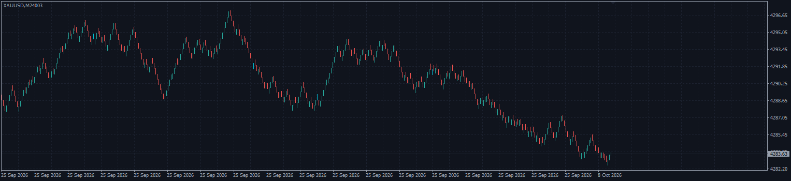
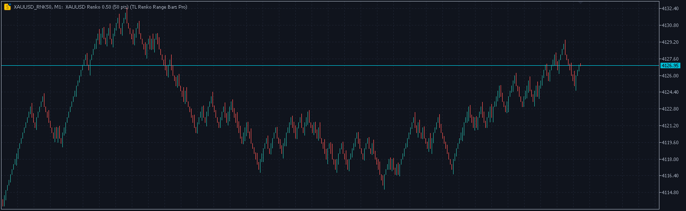
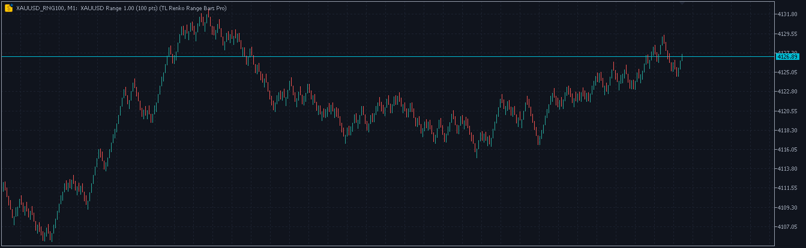

# ⚡ TL Renko Range Bars Pro

**Real Renko and range-bar charts for MT4 and MT5, rebuilt from history automatically.**

     

## 📥 Download

| Platform | File |
|---|---|
| **MT4** | [`TL Renko Range Bars Pro.ex4`](MT4/TL%20Renko%20Range%20Bars%20Pro.ex4) |
| **MT5** | [`TL Renko Range Bars Pro.ex5`](MT5/TL%20Renko%20Range%20Bars%20Pro.ex5) |

> Compiled build only — source code is not published.

## ✨ Highlights

- **Real Renko and Range bar charts** — built from real price data and fed live with every tick.
- **Normal charts** — indicators, drawing tools and EAs work on them.
- **One-click opening** — panel buttons such as R100 (Renko 100 points) or RB500 (Range bars 500 points) open the chart instantly.
- **Auto-rebuilt from history** — real ticks or M1 bars on MT5, M1 history on MT4.
- **Classic rules** — uniform Renko bricks on a fixed grid with configurable reversal, gap-free range bars.
- **Renko colour alerts** — popup, sound or push when the brick colour changes.

## 🧠 How it works

### Renko

- Uniform bricks on a fixed price grid (multiples of the box size).
- A new brick in the same direction needs 1 box. A reversal needs *Reversal* boxes from the last close (2 = classic Renko). The first reversal brick opens one box away from the last close.
- **Wicks** (on / off): the furthest price went against the brick while it was forming.
- Optional alert when the Renko colour changes (popup / sound / push).

### Range bars

- Every bar spans exactly the set size from high to low.
- A bar closes at its high or low as soon as price moves one tick beyond the range.
- The next bar opens at that close — no gaps between bars.

### Under the hood

- **MT5:** every chart is a custom symbol (e.g. `XAUUSD_RNK100` = Renko 100 points, `XAUUSD_RNG500` = Range 500). Each bar is one M1 bar of that symbol on a synthetic minute clock starting 1990.01.01, so standard indicators, drawings and EAs (OnTick) run on it. The date scale is hidden because these dates are not real times. The forming bar receives every live tick.
- **MT4:** every chart is an offline chart (symbol, M24001, M24002 …) written as a `.hst` file and refreshed live. EAs on the offline charts receive ticks. The period number of each Renko / Range size is kept by the EA, so the same size always opens the same offline chart.

## 🖥️ Dashboard & chart

- Renko and Range buttons — a green dot means the chart is open.
- Status of every chart (live / building / bars), current settings and ticks per second.
- **X** closes the panel to a small pill; click the pill to open it again, drag the header to move it.
- The panel moves out of the way of other TL panels on the chart.

## ⚙️ Key inputs

| Input | What it does |
|---|---|
| Renko box sizes | List, e.g. `100,200,500` (up to 12 buttons) |
| Range bar sizes | List, e.g. `200,500,1000` |
| Size unit | Points / Pips / Price (e.g. Price 1.0 = 1 dollar on gold) |
| Reversal | Renko reversal in boxes (2 = classic) |
| Wicks | Renko wicks on / off |
| Open on start | Charts that open automatically, e.g. `R100,RB500` |
| History days | How far back the chart is built (default 5 days) |
| History source | MT5: real ticks (exact) or M1 bars (faster, longer history). MT4 always uses M1 |
| Max bars | Bars kept per chart (default 20,000) |
| Price | Bid / Ask / Mid / Last |
| Colors | Dark quant, classic, or your terminal colours |
| Alerts | Renko colour change: popup, sound, push |

## 🛠️ Installation

1. Choose **File → Open Data Folder**.
2. Copy the file for your platform:
   - **MT4:** `TL Renko Range Bars Pro.ex4` → **MQL4 → Experts**
   - **MT5:** `TL Renko Range Bars Pro.ex5` → **MQL5 → Experts**
3. In the Navigator, right-click → **Refresh** (no terminal restart needed).
4. Drag **TL Renko Range Bars Pro** onto any chart of the symbol (any timeframe).
5. Tick **Allow DLL imports** — used by the link buttons, and on MT4 also needed for the live refresh of the offline charts.
6. Click a button in the panel to open a chart. Keep the EA running on its chart — it feeds all Renko / Range charts of that symbol.

## ⚠️ Notes

- An EA running on an MT5 Renko chart sees the custom symbol (`XAUUSD_RNK100`). To trade, it must send its orders to the real symbol (`XAUUSD`).
- The charts are rebuilt from history every time the EA starts. Drawings on the Renko / Range charts are not moved with the bars after a rebuild.
- Custom symbols / offline files stay after removing the EA. To delete them: MT5 **Symbols** window → **Custom** → **TL Renko Range**; MT4 history folder files `<symbol>24xxx.hst`.
- Renko and Range charts are a different view of price — they are not a trading signal by themselves.

## 🖼️ More screenshots

---

**Built by [trader.lifestyle](https://www.youtube.com/@traderlifestyle)** · [Forex Factory thread](https://www.forexfactory.com/thread/1428808-free-eas-indicators-strategies-mt4) · [YouTube](https://www.youtube.com/@traderlifestyle) · [WhatsApp](https://wa.me/18585003724)

### ✨ CREATED WITH [INDICATORGENIUS.COM](https://indicatorgenius.com) ✨

Trading involves substantial risk. This tool is provided free and as-is for education. Test on a demo account first. Past behaviour is no guarantee of future results.

