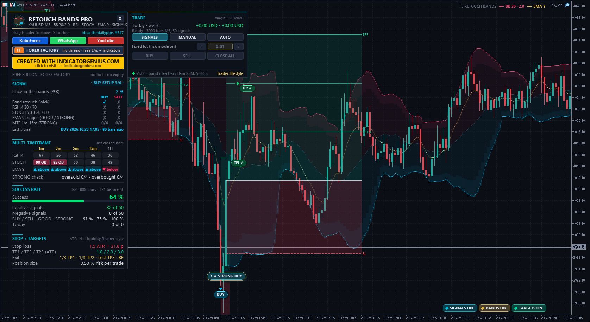
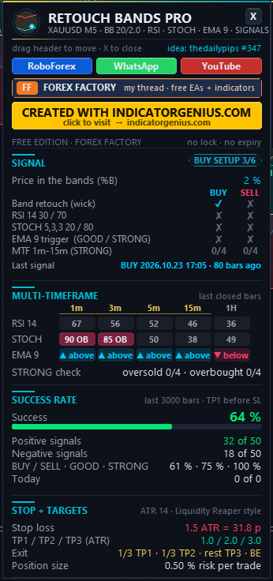

<!-- auto-generated: remove this line after hand-editing so publish keeps your text -->

# ⚡ TL Retouch Bands Pro

**Band retouch counter-trend signals for gold and BTC (idea: Dark Bands by Marco Solito, request by thedailypips on FF): RSI, Stochastic and EMA confirmations, BUY / GOOD / STRONG grades with a 1m-15m matrix, success-rate window and Liquidity Reaper style SL / TP boxes. EA + indicator. Created with IndicatorGenius.com.**

     

## 📥 Download

| Platform | File |
|---|---|
| **MT4** | [`TL Retouch Bands Pro.ex4`](MT4/TL%20Retouch%20Bands%20Pro.ex4) |
| **MT4** | [`TL Retouch Bands Signals.ex4`](MT4/TL%20Retouch%20Bands%20Signals.ex4) |
| **MT5** | [`TL Retouch Bands Pro.ex5`](MT5/TL%20Retouch%20Bands%20Pro.ex5) |
| **MT5** | [`TL Retouch Bands Signals.ex5`](MT5/TL%20Retouch%20Bands%20Signals.ex5) |

> Compiled build only — source code is not published.

## Overview

Created with IndicatorGenius.com  ->  <https://indicatorgenius.com/>

What it is Counter-trend band signals for MetaTrader 4 and MetaTrader 5: a BUY when price retouches the lower band, a SELL when it retouches the upper band - confirmed by RSI, Stochastic and an EMA trigger, graded BUY / SELL, GOOD and STRONG, with SL / TP boxes on the chart and a success-rate window. Built for gold and bitcoin (XAUUSD, BTCUSD), works on every symbol.

Two programs from one source code:
- **TL Retouch Bands Pro** — Expert Advisor - SIGNALS / MANUAL / AUTO trading TL Retouch Bands Signals  Indicator - the same signals, chart and dashboard, no orders (use it next to any other EA; buffers for your own EA)

Request by thedailypips in my Forex Factory thread (post #347). The band idea comes from "Dark Bands" by Marco Solito (free on the MQL5 Market). Dark Bands is closed source, so this is NOT a copy of its code: I rebuilt the idea (retouch arrows, TP / SL lines in volatility units, success window) with open, documented formulas. All credit for the original idea goes to Marco Solito.

The signal, step by step
- Setup      price RETOUCHES a band on a closed bar: the low reaches the lower band (BUY) or the high reaches the upper band (SELL). A fresh touch only - while price rides along the band no new setup starts. Inputs: touch rule wick (default), close beyond the band, or rejection (wick beyond, close back inside).
- Window     the confirmations may arrive on the touch bar or in the next bars (default: 6 bars incl. the touch bar). RSI / STOCH also count on the bar right before the touch.
- Confirmations (each on / off) RSI 14       oversold <= 30 (BUY) / overbought >= 70 (SELL) STOCH 5,3,3  %K <= 20 (BUY) / >= 80 (SELL) EMA 9 trigger  a candle CLOSES beyond the EMA (above for BUY, below for SELL) and is an engulfing candle, a strong candle (body >= 60 % of the range and >= 0.5 ATR), or comes after a star pattern (BUY: hammer / morning star, SELL: shooting star / evening star)
- Grades BUY / SELL   band + every ENABLED confirmation (default RSI + STOCH) GOOD         band + RSI + STOCH + EMA trigger STRONG       GOOD + RSI AND STOCH oversold (BUY) / overbought (SELL) on the 1m, 3m, 5m and 15m chart at the same time
- One setup = max one arrow, then it may UPGRADE once (e.g. SELL first, GOOD SELL a few bars later when the EMA trigger comes). Upgrades show a small arrow in the label. Everything is calculated on CLOSED bars - nothing repaints, old signals never change.

Example (SELL): gold spikes into the upper band (setup), RSI is 74 and STOCH 88 -> SELL. Two bars later a strong red candle closes below the EMA 9 -> GOOD SELL. If 1m, 3m, 5m and 15m were all overbought during the setup it is a STRONG SELL.

Stop and targets (Liquidity Reaper style) Measured from the close of the signal bar with the ATR(14) of that bar:
- **Stop loss** — 1.5 ATR      TP1 1.0 ATR      TP2 2.0 ATR      TP3 3.0 ATR   (all inputs) The chart draws a red risk box (entry -> SL) and a teal reward box (entry -> TP3) with the level lines, the prices of the latest signal and a result tag where the trade was decided (TP reached / SL). TP2 and TP3 are levels - in the EA the exit input decides what is closed where.

Success rate window (like the original) Every signal of the calculated history (input "Maximum bars", default 3000): POSITIVE when price reached TP1 before the stop, NEGATIVE when the stop came first (both inside one bar = negative). Shown: success %, positive x of n, negative y of n, the rate per grade (BUY/SELL, GOOD, STRONG) and today. Open signals are not counted. It describes the past on this chart - no promise for the future.

Dashboard (indicator and EA)
- **SIGNAL** — state pill (setup, signal, near a band), price in the bands (%B), BUY / SELL checklist: band retouch, RSI, STOCH, EMA trigger, MTF x/4, last signal. MULTI-TIMEFRAME RSI, STOCH and EMA (above / below) on 1m, 3m, 5m, 15m and 1H (last closed bars), OB / OS cells coloured; the four gold columns decide STRONG. MT4 has no 3m chart - the EA builds it from 1m bars. Timeframes = inputs. SUCCESS RATE    see above. STOP + TARGETS  SL / TP in ATR and in pips (gold) or price units (crypto), exit mode. TRADE (EA)      SIGNALS / MANUAL / AUTO, lot - / +, BUY / SELL / CLOSE ALL, today / week. Standard TL panel: drag the header, X folds it to a pill, more columns on low charts, moves away from other TL panels, 2K / 4K screens (UI size input), English hover boxes.

Trading (EA only)
- **SIGNALS** — marks, boxes and alerts - no orders (start mode, default). MANUAL    BUY / SELL buttons open a trade with the ATR stop and targets of the last closed bar; the EA manages scale-out and break-even. AUTO      trades signals from the chosen grade (default GOOD and STRONG). Exit      scale out (default): 1/3 at TP1, 1/3 at TP2, the rest at TP3 (broker-side TP); or a full close at TP1, TP2 or TP3. Stop to break-even after TP1 (input). Broker-side SL and TP on every order - if the EA stops, the trade stays protected. Size      risk % of the balance at the stop (default 0.5 %) or a fixed lot. Filters   max open trades (1), max trades per day, direction, close on opposite signal, session hours, spread limit (gold / forex in pips, crypto / indices as a share of the stop distance), magic number.

Indicator buffers (for your own EA, iCustom)
- **0 upper band** — 1 middle line   2 lower band   3 EMA 4 BUY grade (1 BUY, 2 GOOD, 3 STRONG)   5 SELL grade (1 SELL, 2 GOOD, 3 STRONG) Signals sit on the closed signal bar and never change afterwards.

Inputs (main groups)
- Bands          maximum bars, model (Bollinger: MA +- mult x std dev, or volatility envelope: MA +- mult x ATR), period 20, multiplier 2.0, shift, MA method, price, volatility (ATR) period, touch rule, setup window.
- Confirmations  RSI on/off + period + levels, STOCH on/off + 5,3,3 + levels, EMA trigger for the basic grade on/off, EMA period, engulfing / strong / pattern triggers, strong-candle size.
- Multi-timeframe  the five matrix timeframes (first four = STRONG), history per timeframe.
- Stop + targets SL, TP1, TP2, TP3 in ATR, success-rate horizon.
- Trading (EA)   mode, AUTO grade, direction, exit, break-even, lot mode, lot, risk %, max open, max per day, opposite close, spread limits, session, magic.
- Display        theme Dark / Light / Off, bands (thin lines) + soft fill, EMA line, marks, SL / TP boxes (off / latest / all), minimum grade on the chart, chart buttons, colours, animation, size, position, auto-avoid, tooltips.
- Alerts         from grade, popup, sound, push, e-mail.

Good to know
- Made for intraday charts (1m - 15m, also H1). For gold and BTC use a low spread account.
- Counter-trend: in a strong trend price can ride a band for a long time. The fresh-touch rule, the confirmations and the STRONG grade filter many of these, they cannot remove them. Watch the higher timeframes and the news.
- The "RSI 14,3,3" of the request: RSI has one period (14); the 3,3 belongs to the Stochastic. The STOCH here is 5,3,3 as requested.
- Bollinger is the default model (the requester calls the bands "BB"). The ATR envelope is closer to a volatility-band style; both use the same inputs.

Installation
- **EA** — MT5: "TL Retouch Bands Pro.ex5" to  File > Open Data Folder > MQL5 > Experts MT4: "TL Retouch Bands Pro.ex4" to  File > Open Data Folder > MQL4 > Experts Indicator MT5: "TL Retouch Bands Signals.ex5" to  MQL5 > Indicators MT4: "TL Retouch Bands Signals.ex4" to  MQL4 > Indicators Refresh the Navigator and drag it onto a chart. Tick "Allow DLL imports" - only used to open the link buttons in your browser. For MANUAL / AUTO enable Algo Trading (MT5) / AutoTrading (MT4). Use either the EA or the indicator on one chart, not both.

Package MT4/Experts/TL Retouch Bands Pro.ex4 MT4/Indicators/TL Retouch Bands Signals.ex4 MT5/Experts/TL Retouch Bands Pro.ex5 MT5/Indicators/TL Retouch Bands Signals.ex5 README_EN.txt

Credits Band idea: "Dark Bands" by Marco Solito (MQL5 Market) - <https://www.mql5.com/en/market/product/66774> Request and confirmation rules: thedailypips (Forex Factory, thread 1428808, post #347) EA, indicator, grades, dashboard and chart design: trader.lifestyle Created with IndicatorGenius.com - <https://indicatorgenius.com/>

Links
- **YouTube** — <https://www.youtube.com/@traderlifestyle> WhatsApp  <https://wa.me/18585003724> My free tools on Forex Factory: <https://www.forexfactory.com/thread/1428808-free-eas-indicators-strategies-mt4>

Risk notice Trading leveraged products carries a high risk of loss. Counter-trend trading against a strong move can lose several times in a row. This is a tool, not a promise of profit. Test it on a demo account first.

## 🖼️ More screenshots

---

**Built by [trader.lifestyle](https://www.youtube.com/@traderlifestyle)** · [Forex Factory thread](https://www.forexfactory.com/thread/1428808-free-eas-indicators-strategies-mt4) · [YouTube](https://www.youtube.com/@traderlifestyle) · [WhatsApp](https://wa.me/18585003724)

### ✨ CREATED WITH [INDICATORGENIUS.COM](https://indicatorgenius.com) ✨

Trading involves substantial risk. This tool is provided free and as-is for education. Test on a demo account first. Past behaviour is no guarantee of future results.

