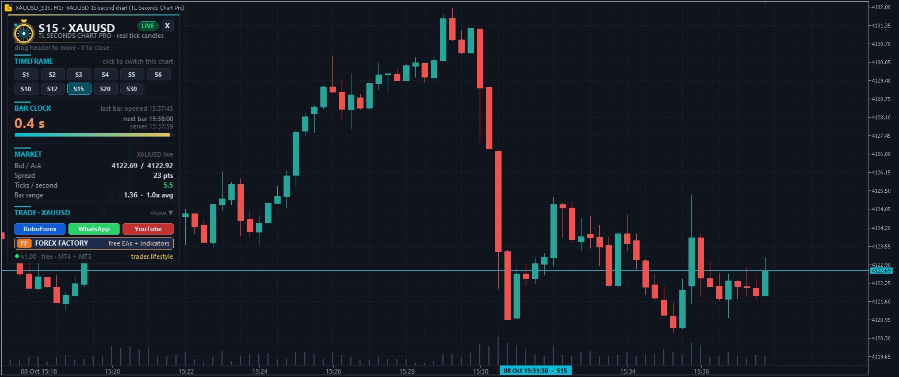

# ⚡ TL Seconds Chart Pro

**Real seconds charts (S5, S15, S30 …) for MT4 and MT5, built from live ticks.**

     

## 📥 Download

| Platform | File |
|---|---|
| **MT4** | [`TL Seconds Chart Pro Overlay.ex4`](MT4/TL%20Seconds%20Chart%20Pro%20Overlay.ex4) |
| **MT4** | [`TL Seconds Chart Pro.ex4`](MT4/TL%20Seconds%20Chart%20Pro.ex4) |
| **MT5** | [`TL Seconds Chart Pro Overlay.ex5`](MT5/TL%20Seconds%20Chart%20Pro%20Overlay.ex5) |
| **MT5** | [`TL Seconds Chart Pro.ex5`](MT5/TL%20Seconds%20Chart%20Pro.ex5) |

> Compiled build only — source code is not published.

## Overview

Real candle charts from S1 to S3600 (any list of seconds), built from real ticks and fed live. Indicators, drawing tools and EAs work on them like on any normal chart.

## Files

- **MT5:** — Experts\TL Seconds Chart Pro.ex5              (the hub - feeds the seconds charts, executes trades) Indicators\TL Seconds Chart Pro Overlay.ex5   (panel on every seconds chart - attached automatically) MT4:  Experts\TL Seconds Chart Pro.ex4 Indicators\TL Seconds Chart Pro Overlay.ex4

## Install

- File -> Open Data Folder -> MQL5 (MQL4). Copy the EA into Experts, the overlay into Indicators (both files, both folders - keep the overlay file name unchanged).
- Navigator -> right click -> Refresh (no terminal restart needed).
- Drag "TL Seconds Chart Pro" onto any chart of the symbol (any timeframe). Tick "Allow DLL imports" (link buttons; MT4 also needs it for the live refresh of the offline charts) and "Allow Algo Trading" if you want to trade from the seconds charts.
- Click a timeframe button (S1 ... S30) in the panel -> the seconds chart opens. Keep the EA running on its chart - it feeds all seconds charts of that symbol.

## What You Get On Every Seconds Chart

- Timeframe buttons: switch the chart to another seconds timeframe (your indicators stay on it)
- Real time axis with seconds + crosshair time tag (exact open time of every candle)
- Bar clock: countdown to the candle close on the broker server clock
- Market box: bid / ask, spread, ticks per second, candle range vs. average
- One-click trade panel: lots or risk-% sizing, SL / TP in points, BUY / SELL, close all / winners / losers, breakeven. Orders go to the real symbol through the hub EA.
- Position, pending order, SL and TP lines of the real symbol on the seconds chart. Select an SL or TP line and drag it -> the order is modified.
- Spike alert: candle range = x times the average range (popup / sound / push) + arrow on the chart
- Panels: X closes to a pill, click the pill to reopen, drag the header to move (position is saved)

## Hub Panel (chart with the EA)

- Open / focus seconds charts, status of every chart (live, building, dormant), ticks per second
- MT5: tick history loader - downloads the broker tick history of the last N days with progress
- MT4: 1-second database - MT4 keeps no ticks, so the EA records every second to disk (MQL4\Files\TLSC\<symbol>\). History grows while the EA runs and survives terminal restarts.

## Inputs (EA)

Seconds timeframes ........ list of seconds 1-3600, e.g. "1,2,3,5,10,15,30,45,60,90" Open on start ............. seconds charts to open automatically, e.g. "5,15" History bars / max days ... depth of every seconds chart (default 5,000 bars, max 10 days of ticks) From date / To date ....... From only = live chart starting at that date. From + To = static chart of exactly that period (news review, own trades) Price ..................... Bid / Ask / Mid / Last Colors .................... dark quant, classic, or keep your terminal colors Trading ................... lots, risk %, SL, TP, magic, slippage, confirm every trade Alerts .................... spike factor, popup, sound, push

## How It Works

MT5: every seconds timeframe is a custom symbol (e.g. XAUUSD_S5) that receives the real ticks. Each seconds candle is one M1 candle of that symbol on a synthetic minute clock - that is why standard indicators, drawings and EAs (OnTick) run on it, and you can even backtest an EA on the seconds candles in the Strategy Tester. The synthetic clock is stable: your drawings stay in place after a restart. The overlay replaces the date scale with the real time axis. MT4: every seconds timeframe is an offline chart (symbol,M20005 = S5) with real timestamps, refreshed live. EAs on these charts receive ticks and trade the real symbol directly.

## Strategy Tester (MT5)

Select the custom symbol (e.g. XAUUSD_S5), timeframe M1, model "Every tick based on real ticks" and the synthetic date range shown in the hub panel tooltip of that chart (around 1990.01.01). Tested: Moving Average example EA on XAUUSD_S5 -> 122,740 real ticks, 4,365 seconds candles, trades executed.

## Notes

- An EA running on an MT5 seconds chart sees the custom symbol (XAUUSD_S5). To trade from it the EA must send its orders to the real symbol, or use the trade panel of the overlay.
- Custom symbols / offline files stay after removing the EA, so the charts reopen instantly. To delete them: MT5 Symbols window -> Custom -> TL Seconds Chart; MT4 history folder files *2xxxx.hst.
- Seconds with no tick produce no candle (like every tick-built chart).

Free tool by trader.lifestyle - YouTube @traderlifestyle - Forex Factory thread: <https://www.forexfactory.com/thread/1428808-free-eas-indicators-strategies-mt4>

## 🖼️ More screenshots

---

**Built by [trader.lifestyle](https://www.youtube.com/@traderlifestyle)** · [Forex Factory thread](https://www.forexfactory.com/thread/1428808-free-eas-indicators-strategies-mt4) · [YouTube](https://www.youtube.com/@traderlifestyle) · [WhatsApp](https://wa.me/18585003724)

### ✨ CREATED WITH [INDICATORGENIUS.COM](https://indicatorgenius.com) ✨

Trading involves substantial risk. This tool is provided free and as-is for education. Test on a demo account first. Past behaviour is no guarantee of future results.

