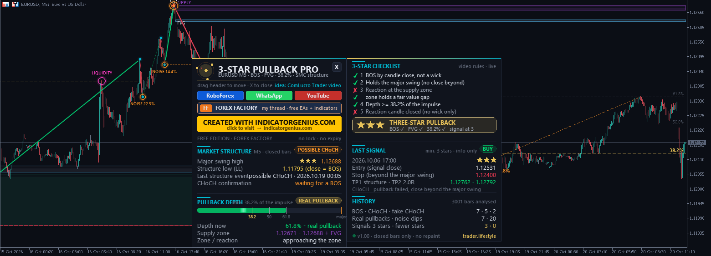
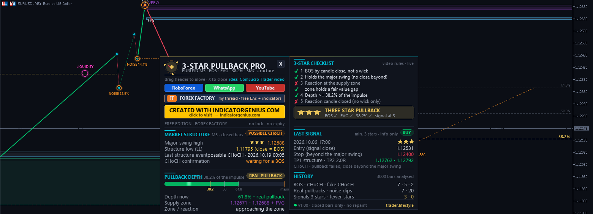

<!-- auto-generated: remove this line after hand-editing so publish keeps your text -->

# ⚡ TL Three Star Pullback Pro

**Smart-money pullbacks from the ComLucro Trader video: BOS by close, FVG and 38.2 % depth rated with 1-3 stars, NOISE vs REAL PULLBACK on the chart and a structure-only view. Indicator only.**

     

## 📥 Download

| Platform | File |
|---|---|
| **MT4** | [`TL Three Star Pullback Pro.ex4`](MT4/TL%20Three%20Star%20Pullback%20Pro.ex4) |
| **MT5** | [`TL Three Star Pullback Pro.ex5`](MT5/TL%20Three%20Star%20Pullback%20Pro.ex5) |

> Compiled build only — source code is not published.

## Overview

What it is A signal indicator for Smart Money Concepts pullbacks. It turns the rules of the video "Pullback Trading Explained: 3 Rules for High Probability Entries" by Com Lucro Trader (YouTube, SMC course - chapter "Pullbacks") <https://www.youtube.com/watch?v=ltQGlYbR5h4> into clear, automatic rules and draws the market structure the way the video shows it. Credit for the pullback framework goes to Com Lucro Trader. This is an independent MetaTrader implementation, not an official product of the channel.

The rules from the video
- A pullback only exists after a confirmed BREAK OF STRUCTURE (BOS): a candle must CLOSE beyond the level. A wick beyond it is liquidity being taken, not a break.
- The pullback retraces towards the most recent higher low (uptrend) / lower high (downtrend) WITHOUT closing beyond it.
- It reacts at the demand / supply zone that started the impulse - ideally a zone that contains a FAIR VALUE GAP (FVG).
- It is deep enough: at least 38.2 % Fibonacci of the prior impulse. A shallower dip is NOISE: the next push belongs to the same impulse and no new swing is formed.
- Only wicks, liquidity grabs or a close beyond the structure = NOT a pullback. A close beyond the major swing = CHANGE OF CHARACTER (CHoCH) - the pullback failed. Major swing = the swing that started the impulse which broke structure. Only a close beyond it changes the trend. Breaks of minor (internal) swings are noise. (less probability), 0-1 = minor / weak. A CHoCH is only confirmed when a BOS in the new direction follows (input). A close back beyond its origin before that turns it into a FAKE CHoCH.

How the indicator reads the structure (closed bars only - no repaint)
- The impulse runs from the major swing to its extreme. Each retracement is measured in % of that impulse (Fibonacci style, wick to wick).
- Below 38.2 %: NOISE (orange ring with the depth). The swing is minor (cyan dot).
- From 38.2 %: REAL PULLBACK. The extreme becomes the structure high / low (HH / LL).
- Close beyond that level: BOS (yellow dashed line). The deepest point of the pullback is the new major swing (orange target ring) and gets its stars (green "REAL PULLBACK" ring).
- Wick beyond the structure level without a close: LIQUIDITY (magenta ring).
- Wick beyond the major swing without a close: FAKE CHoCH (orange ring).
- Close beyond the major swing: CHoCH / POSSIBLE CHoCH (pill + line).
- Close beyond a minor swing only: "minor break - noise". The first trend starts when price closes beyond the high / low of the last 20 bars.

The signal (my addition - the video defines no entry, stop or target) BUY (SELL = mirror):
- uptrend (and the CHoCH confirmed, if that option is on)
  - the pullback reached 38.2 %
  - price touched the demand zone of the major low or its fair value gap (option: reaching 38.2 % is enough)
  - no close below the major low
  - within 5 bars after the touch a bullish candle closes above the previous bar's high (option: closes back above the zone / FVG)
  - the stars reach your minimum (default: three-star pullbacks only) One signal per pullback. Stop: beyond the major swing / pullback extreme + 0.10 ATR. TP1: the structure high / low (the liquidity the pullback came from). TP2: 2R. Stop and targets are shown on the chart only - the indicator never opens trades.

On the chart
- Structure line through all swings (green up legs, red down legs, thin lines for minor swings) with HH / HL / LH / LL labels - like the line diagrams in the video.
- Chart type input: candles, line chart + structure, or STRUCTURE ONLY (price hidden, only the structure line, exactly like the video diagrams). Your chart type and colours come back when you remove the indicator.
- Major swings (orange target ring), minor swings (cyan dots), BOS and CHoCH lines, NOISE vs REAL PULLBACK markers, LIQUIDITY and FAKE CHoCH rings.
- Demand zones (green), supply zones (purple), fair value gaps (grey with a blue edge).
- Fibonacci 38.2 (gold) / 50 / 61.8 of the active impulse and the live pullback depth.
- BUY / SELL pills with 1-3 stars, stop and target bands.
- Animated (pulsing rings on the newest marks) - can be switched off.
- Hover any mark for an explanation box. Everything follows scrolling and zooming.

Dashboard
- **MARKET STRUCTURE** — trend, major swing + stars, structure level, last event, CHoCH state PULLBACK DEPTH     animated depth gauge with the 38.2 / 50 / 61.8 marks, NOISE or REAL PULLBACK, demand / supply zone + FVG, zone touch / reaction 3-STAR CHECKLIST   the 5 rules of the video ticked live + the star rating of the setup LAST SIGNAL        time, stars, entry, stop, TP1 / TP2 HISTORY            BOS / CHoCH / fake CHoCH / real pullbacks / noise / signals counted Drag the header to move it, X folds it to a small pill (click to reopen). Several columns when the chart is low. It moves away from other trader.lifestyle panels on the chart.

Buffers (iCustom)
- **0 BUY signal (entry price)** — 1 SELL signal (entry price) 2 trend (+1 up, -1 down)     3 stars of the signal Values on closed bars only; empty = EMPTY_VALUE.

Differences to the video
- The video is discretionary. The indicator uses the 38.2 % rule to separate impulse legs, so it may label a swing differently than you would by eye.
- "Higher timeframe key levels" and the counter-trend iFVG trade idea of the video are not part of the signal (the video itself calls them higher risk). The building blocks (minor CHoCH, FVG, target = major swing) are visible on the chart.
- "Several wicks beyond the level" is mentioned in the video as a possible CHoCH; the indicator only accepts a candle CLOSE (the video's own example of wicks was a fake).
- Entry, stop and targets are my addition.

Installation MT5: MT5\Indicators\TL Three Star Pullback Pro.ex5 -> File > Open Data Folder > MQL5\Indicators MT4: MT4\Indicators\TL Three Star Pullback Pro.ex4 -> File > Open Data Folder > MQL4\Indicators Refresh the Navigator and drag the indicator onto a chart. "Allow DLL imports" is only needed for the YouTube / RoboForex / WhatsApp / Forex Factory buttons (they open your browser via the Windows shell32.dll). The indicator works without it.

Main inputs Structure: min. depth (38.2 %), noise marking from (10 %), CHoCH confirmation, first trend bars. Signal: min. stars (3 / 2 / 1), zone or 38.2 % touch, reaction candle, bars for the reaction, min. zone height, ATR period. Stop & targets: stop buffer in ATR, TP2 in R. Display: chart type, dark theme, structure, zones, FVG, Fibonacci, noise, liquidity, signals, animation, bars to analyse, dashboard, auto-avoid, tooltips. Alerts: popup / sound / push on signals, optional on CHoCH.

Risk warning: no profit promise - trading involves high risk. Test on a demo account first.

trader.lifestyle - free tools thread on Forex Factory: <https://www.forexfactory.com/thread/1428808-free-eas-indicators-strategies-mt4>

## 🖼️ More screenshots

---

**Built by [trader.lifestyle](https://www.youtube.com/@traderlifestyle)** · [Forex Factory thread](https://www.forexfactory.com/thread/1428808-free-eas-indicators-strategies-mt4) · [YouTube](https://www.youtube.com/@traderlifestyle) · [WhatsApp](https://wa.me/18585003724)

### ✨ CREATED WITH [INDICATORGENIUS.COM](https://indicatorgenius.com) ✨

Trading involves substantial risk. This tool is provided free and as-is for education. Test on a demo account first. Past behaviour is no guarantee of future results.

