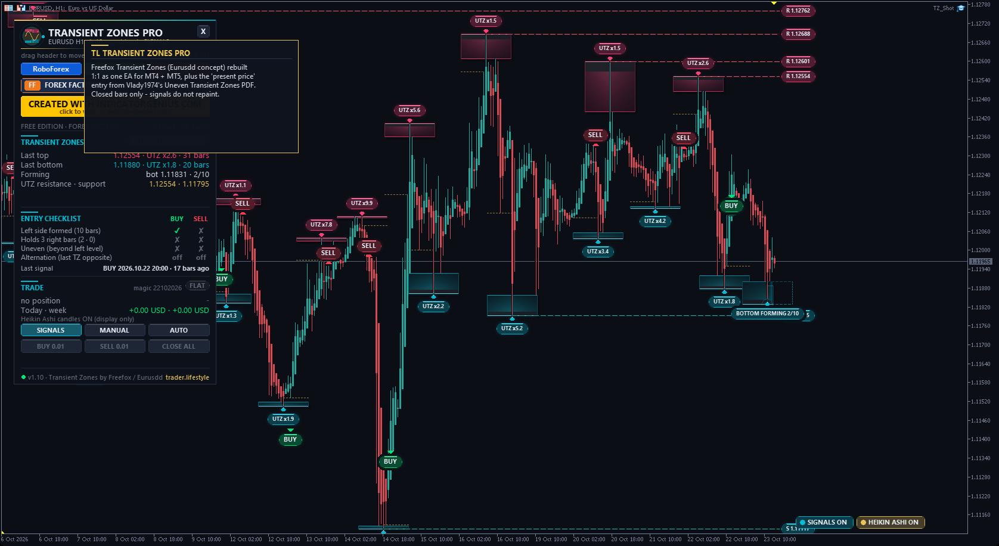
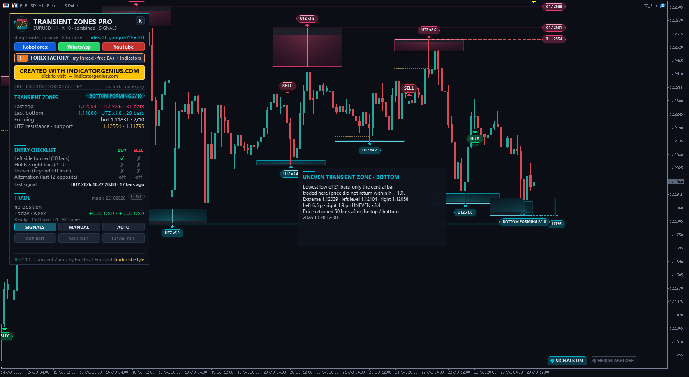
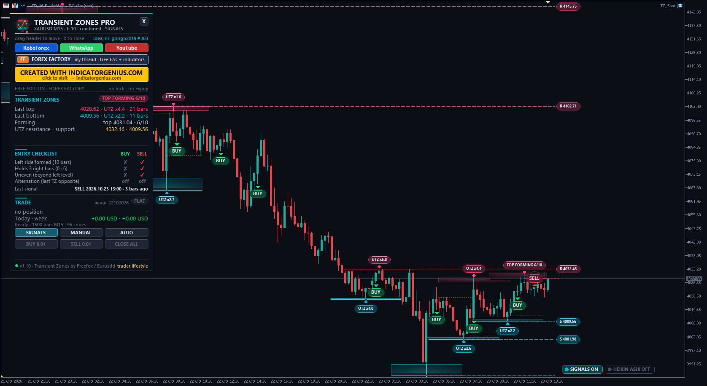
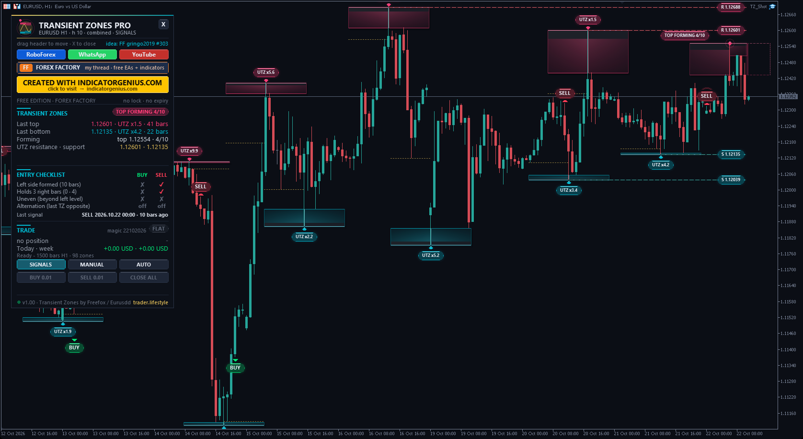

<!-- auto-generated: remove this line after hand-editing so publish keeps your text -->

# ⚡ TL Transient Zones Pro

**Freefox's Transient Zones rebuilt 1:1 plus Vlady1974's Uneven Transient Zones 'present price' entry as one EA: 3D zones with UTZ ratio, live forming zone, UTZ support / resistance and SIGNALS / MANUAL / AUTO.**

     

## 📥 Download

| Platform | File |
|---|---|
| **MT4** | [`TL Transient Zones Pro.ex4`](MT4/TL%20Transient%20Zones%20Pro.ex4) |
| **MT5** | [`TL Transient Zones Pro.ex5`](MT5/TL%20Transient%20Zones%20Pro.ex5) |

> Compiled build only — source code is not published.

## Overview

What it is One Expert Advisor for MetaTrader 4 and MetaTrader 5 that draws and trades "Transient Zones":
- Transient_Zones indicator by Freefox (2014, forexphilosopher.com), built on the transient / recurrent price propositions by Eurusdd
  - "Uneven Transient Zones 1.0" PDF by Vlady1974 (23 September 2014) Requested by gringo2019 on Forex Factory (thread "Free EAs, Indicators & Strategies", posts #303 and #305, October 2026), who shared the PDF and the original EX4. All credit for the concept and the indicator goes to Eurusdd, Freefox and Vlady1974.

The original definition (unchanged, h = 10)
- **Top TZ** — the High of a bar is above every high of the h bars before it and not below any high of the h bars after it. Bottom TZ    the mirror with the lows. Zone         the price range only that central bar traded - price did not come back to it within h bars before or after (transient = not recurrent). Top: from the High down to the highest high of the other bars. Bottom: from the Low up to the lowest low of the other bars. Combine zones = true (default): one level from both sides. Combine zones = false: left box (h bars before) and right box (h bars after), each with its own level. UNEVEN (UTZ) the left and the right box have a different height. The PDF observes that uneven zones mark tops and bottoms more often than even zones, and that the next zone usually forms on the other side (bottom, then top, ...). The zones of the EA match the arrows of the original EX4 bar for bar (checked in the MT4 tester on EURUSD H1 / M15, XAUUSD H1, GBPUSD M5: 0 differences).

The entry rule ("present price" section of the PDF) The PDF suggests waiting until the LEFT side of a top is formed (the top is the highest high of the last h bars) and then watching the bars on the right: if they make lower highs, the zone is turning uneven -> short trade. The EA turns this into a fixed rule:
- **SELL** — 1. a top with its left side formed (highest high of the h bars before it)
  - the next N closed bars (default 3) stay at or below the top
  - uneven filter (default on): these N bars also stay below the left-side level, so the right box is already larger than the left one -> SELL at the close of bar N, the EA enters at the next open. BUY   the exact mirror at a bottom. Optional: alternation filter (SELL only after a bottom TZ, BUY only after a top TZ) and a minimum zone height in ATR. Closed bars only - signals do not repaint. The exact entry and exit rules are my interpretation of the PDF (it gives no fixed stop or target). They are kept separate from the original zone definition.

What I added (TL)
- The whole system as an EA for MT4 and MT5 (one source, identical rules).
- Clean zone drawing: every zone is calculated and drawn from scratch on each bar. (In my MT4 tester runs some rectangles of the original were left at bars that are not the zone extreme; its arrows were always correct.)
- Forming zone live: the left box of the newest top / bottom and the growing right box with a bar counter (e.g. TOP FORMING 3/10).
- UTZ ratio on every zone (x = larger box / smaller box), even zones drawn dashed and dimmer. In combined mode the own level of each side is shown as a thin gold line.
- Untouched uneven zones extended to the right as support / resistance lines (PDF: "extend the price of the zone to the right") until price trades back to them.
- Trading modes on the dashboard: SIGNALS (no orders), MANUAL (BUY / SELL / CLOSE ALL buttons), AUTO (automatic entries). Start mode = input, default SIGNALS.
- Risk: fixed lots or % of equity, max lots, stop beyond the zone extreme + ATR buffer, skip if the stop is wider than N ATR, target in R or at the last opposite zone, break-even, ATR trailing, close on the opposite signal, spread limit, session filter, direction filter, magic number. Only its own trades (symbol + magic).
- Chart design: 3D zones lit from the central bar, rims, shadows, glowing extremes, BUY / SELL pills, dark theme (restored on removal). Hover any zone or pill for an explanation box.
- Standard TL dashboard: drag the header, X folds it to a pill, more columns on low charts, moves away from other TL panels automatically.

New in v1.10
- High-DPI screens (2K / 4K laptops with Windows scaling 125-300 %): dashboard, hover boxes and chart marks now scale with the screen, text always fits. Input "Size of dashboard + chart marks": Auto (default) or a fixed 100-300 %.
- Chart buttons (bottom right): SIGNALS ON / OFF shows or hides the BUY / SELL pills, HEIKIN ASHI ON / OFF switches Heikin Ashi candles (display only - zones and signals always use the real candles). Start states are inputs, the last state is remembered.
- S/R lines end at the current bar (or N bars after the zone, input) instead of running to the price scale; the price tag sits at the end of the line.
- Chart colours as inputs: line graph None, grid and ask line yellow, volume blue, stop levels red (defaults).

Dashboard
- **Header** — links, idea link to the Forex Factory post Transient zones  state (TOP / BOTTOM FORMING n/h, signal), last top and bottom with UTZ ratio and age, forming zones, nearest UTZ resistance / support Entry checklist  left side formed, N right bars held, uneven, alternation - BUY / SELL Trade            position, today / week, SIGNALS / MANUAL / AUTO, BUY / SELL / CLOSE ALL

Inputs (most important) h 10, combine zones true, bars 1500 Right-side bars 3, uneven filter on, alternation off, min zone 0 ATR Start mode SIGNALS, lots 0.01 (or risk %), stop = zone extreme + 0.2 ATR (max 4 ATR), target 2R, break-even at 1R, close on opposite signal, max spread 0.5 ATR Zones, S/R lines (6 nearest, length), signals, Heikin Ashi, chart buttons, chart colours, UI size (Auto / 100-300 %), animation, panel position, tooltips

Installation
- **MT5: copy "TL Transient Zones Pro.ex5" to** — <data folder>\MQL5\Experts\ MT4: copy "TL Transient Zones Pro.ex4" to  <data folder>\MQL4\Experts\ (File -> Open Data Folder). Refresh the Navigator, drag the EA onto a chart. Tick "Allow DLL imports" - only used to open the link buttons in your browser. For MANUAL / AUTO enable Algo Trading (MT5) / AutoTrading (MT4).

Package MT4/Experts/TL Transient Zones Pro.ex4 MT5/Experts/TL Transient Zones Pro.ex5 README_EN.txt

Risk notice Trading leveraged products carries a high risk of loss. This EA is a tool, not a promise of profit. Test it on a demo account first.

trader.lifestyle - YouTube <https://www.youtube.com/@traderlifestyle> Forex Factory thread <https://www.forexfactory.com/thread/1428808-free-eas-indicators-strategies-mt4>

## 🖼️ More screenshots

---

**Built by [trader.lifestyle](https://www.youtube.com/@traderlifestyle)** · [Forex Factory thread](https://www.forexfactory.com/thread/1428808-free-eas-indicators-strategies-mt4) · [YouTube](https://www.youtube.com/@traderlifestyle) · [WhatsApp](https://wa.me/18585003724)

### ✨ CREATED WITH [INDICATORGENIUS.COM](https://indicatorgenius.com) ✨

Trading involves substantial risk. This tool is provided free and as-is for education. Test on a demo account first. Past behaviour is no guarantee of future results.

