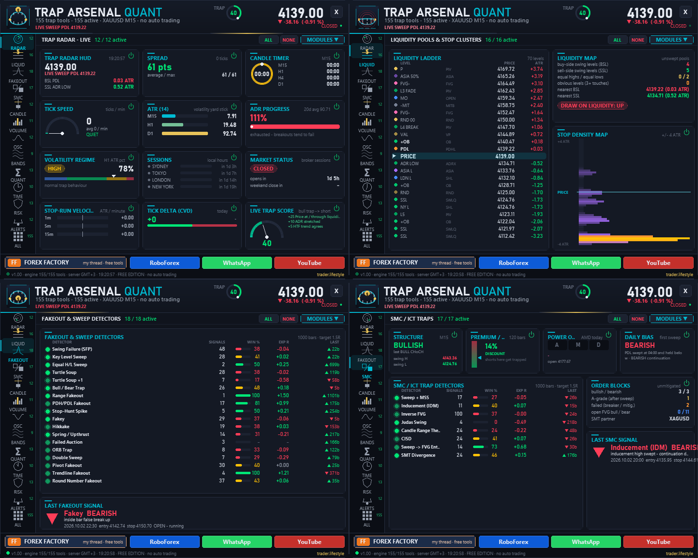

# ⚡ TL Trap Arsenal Quant

**156 trap trading tools in ONE animated quant dashboard — every tool can be switched on and off.**

     

## 📥 Download

| Platform | File |
|---|---|
| **MT4** | [`TL Trap Arsenal Quant.ex4`](MT4/TL%20Trap%20Arsenal%20Quant.ex4) |
| **MT5** | [`TL Trap Arsenal Quant.ex5`](MT5/TL%20Trap%20Arsenal%20Quant.ex5) |

> Compiled build only — source code is not published.

## Overview

(inputs + live switches in the panel). Free edition by trader.lifestyle.

## What It Does

- Liquidity: equal highs/lows ($$$ pools), unswept swing liquidity (BSL/SSL), PDH/PDL, PWH/PWL, PMH/PML, round numbers, Asian range, session highs/lows, opening range, opens, pivots/Camarilla, 3-touch trendlines, stop cluster zones, liquidity heatmap, liquidity voids, obvious triple tops/bottoms.
- 58 trap detectors on closed candles (no repaint): SFP, key level sweeps, equal H/L raids, turtle soup (+1), bull/bear traps, range fakeouts, PDH/PDL fakeouts, stop-hunt spikes, fakey, hikkake, Wyckoff spring/upthrust, failed auction (80 % rule), ORB trap, double sweep, pivot fakeout, trendline + round number fakeouts, sweep + MSS, inducement, inverse FVG, Judas swing, candle range theory, CISD, sweep->FVG, SMT divergence, pin bar / engulfing after sweep, outside + two/three bar reversals, trapped traders (Brooks), H2/L2, gap & trap, absorption, effort vs result, VSA, low-volume breakouts, delta / OBV divergence, RSI / hidden / MACD / stochastic divergence, failure swings, CCI false breaks, MACD zero fakeouts, divergence traps, Bollinger head fake, band re-entry, Keltner fakeout, z-score stretch, ATR spike reversal, news spike traps.
- TRAP EDGE LAB: every detector is back-tested on the loaded history (stop beyond the trap extreme,
- Scanner: MTF trap matrix M5..D1, multi-symbol trap scanner, session sweep statistics, stop-hunt heatmap, breakout quality, crowding, fear/greed proxy, retail sentiment (manual), trap confluence.
- Risk: anti stop-hunt stop calculator, position size, stop placement check for open trades, anti-trap checklist, trap time lock, prop guard, account + journal, trade panel (2-click), trade manager, hidden stop.
- Alerts: trap alerts, liquidity approach, level cross, line alerts, spread, Telegram, screenshots.

## Auto Trader - Trend Trap (default On, needs "Algo Trading")

Default mode TREND TRAP: liquidity sweep traps (SFP, key level sweep, equal H/L raid, stop-hunt spike, turtle soup, round number fakeout) are traded ONLY in the direction of the trend (close + EMA50 vs EMA200 of the chart timeframe): a bear trap in an uptrend = long, a bull trap in a downtrend = short. Initial stop behind the trap (at least 2.5 ATR), chandelier trailing stop 6 ATR, no fixed target, one position at a time, 0.5 % risk per trade. Only gold, only M15 or higher (inputs). MT5 strategy tester (RoboForex history, 10,000 USD, 0.5 % risk): Small accounts: with 0.5 % risk the lot is below 0.01 on accounts under ~4,000 USD. Then the EA trades the minimum lot (0.01) as long as that risks at most 2.5 % (inputs "Small account"), otherwise it skips the signal. Every skipped signal is written to the Experts log with the reason. Honest notes: most of the edge is gold trend following (random entries in the trend direction also make money); longs carry the result, shorts are around zero; it loses on EURUSD / GBPUSD / USDJPY and on M5. The edge depends on low trading costs. Switch the auto trader off in the inputs if you only want the analysis tools. Past results are no promise for the future.

## Install

- MT5: copy "TL Trap Arsenal Quant.ex5" to MQL5\Experts, MT4: the .ex4 to MQL4\Experts. Restart / refresh the navigator, drag it on a chart. Allow DLL imports (only for the link buttons) and Algo Trading only if you use the trade panel or the auto trader.

- The panel: click a category on the left, MODULES opens the switches, X closes it to a pill, drag the header to move it. Hover anything for an explanation (tooltips can be switched off).

- Forex Factory thread: <https://www.forexfactory.com/thread/1428808-free-eas-indicators-strategies-mt4> Trading involves risk. Statistics shown are historical and no promise of future results.

---

**Built by [trader.lifestyle](https://www.youtube.com/@traderlifestyle)** · [Forex Factory thread](https://www.forexfactory.com/thread/1428808-free-eas-indicators-strategies-mt4) · [YouTube](https://www.youtube.com/@traderlifestyle) · [WhatsApp](https://wa.me/18585003724)

### ✨ CREATED WITH [INDICATORGENIUS.COM](https://indicatorgenius.com) ✨

Trading involves substantial risk. This tool is provided free and as-is for education. Test on a demo account first. Past behaviour is no guarantee of future results.

