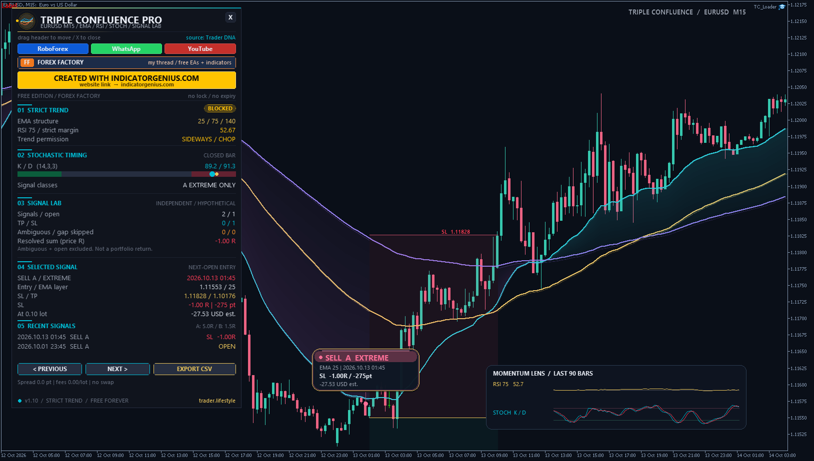
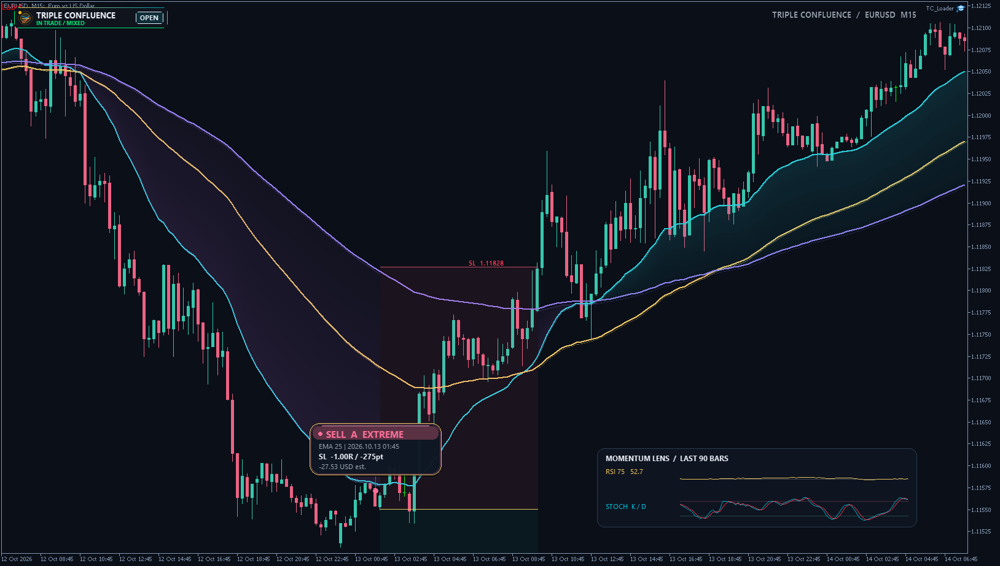

# ⚡ TL Triple Confluence Pro

**EMA / RSI / Stochastic confluence indicator with a large canvas dashboard, sculpted EMA ribbon and BUY / SELL pills. Never trades.**

     

## 📥 Download

| Platform | File |
|---|---|
| **MT4** | [`TL Triple Confluence Pro.ex4`](MT4/TL%20Triple%20Confluence%20Pro.ex4) |
| **MT5** | [`TL Triple Confluence Pro.ex5`](MT5/TL%20Triple%20Confluence%20Pro.ex5) |

> Compiled build only — source code is not published.

## ✨ Highlights

- **EMA + RSI + stochastic confluence** — the three-indicator trend-pullback setup from a Trader DNA video, implemented with explicit rules.
- **Strict trend engine** — EMA order, slope, ribbon width, signed efficiency and RSI, rechecked on every completed candle.
- **Graded signals** — A / EXTREME (stochastic from the extreme zone) by default, optional B / STANDARD.
- **Large Canvas dashboard** — sculpted EMA ribbon, BUY / SELL pills, stochastic gauge, signal totals and momentum lenses.
- **Browse every historical signal** — PREVIOUS / NEXT jumps the chart to it with entry, stop, target and status.
- **Never trades** — it never places, modifies or closes orders. No account lock, no expiry, no DLL.

## 🎓 What the video teaches

- **EMA calibration is discretionary.** The introductory examples discuss 20, 34, 50, 75, 100, 150 and 200, a single EMA 100, then 50 / 110 / 250 — illustrations of choosing periods for a market / timeframe, not additional filters in the later three-indicator setup.
- The combined example uses **EMA 25 / 75 / 140, RSI 75 and stochastic 14 / 3 / 3**.
- Establish a trend from ordered, sloping EMAs with price on the trend side.
- A pullback can reach the fast, middle or slow EMA. Breaking the fast EMA alone does not invalidate the underlying trend.
- RSI above 50 confirms bullish conditions; below 50 confirms bearish ones.
- A stochastic turn from the oversold / overbought area provides the stronger entry. The explicit SELL example crosses downward after a deeper EMA test.
- Weaker entries that never reach an extreme zone are discussed too, with a smaller target such as 1.5R or 2R — or skipping them.
- The detailed SELL example puts the stop above the slow EMA and holds through a later fast-EMA pullback while RSI remains bearish.

## 🧠 Strategy rules

All decisions use **completed candles**. Entry is the **next bar's open** — the pill is attached to the decision candle, but its entry price belongs to the next bar.

### Strict trend (v1.10 — requested extra filters, not original video rules)

| Gate | Rule |
|---|---|
| Recheck | ALL conditions on EVERY completed candle; no retained trend permission |
| EMA order | BUY: fast > middle > slow. SELL: the mirror |
| Slope | Each EMA moves ≥ 0.12 ATR in the trend direction over 8 bars |
| Ribbon width | Fast-to-slow ≥ 0.50 ATR |
| Signed efficiency (30 bars) | ≥ 0.20 in the EMA direction |
| RSI | BUY > 53, SELL < 47 |
| Price | Close beyond the slow EMA on the trend side |
| Persistence | 3 consecutive qualifying bars before an entry |
| Spacing | ≥ 20 bars between decision candles, including opposite directions |
| Entry candle | Closes beyond the FAST EMA in the trend direction with a matching bullish / bearish body |

- Signed efficiency = `direction × (close − close[30]) / sum(abs(close changes), 30 bars)` — this rejects both low net movement / chop and price moving against EMA order.
- Any failed trend gate immediately blocks entries and clears the EMA touch. No entry during an unrecovered pullback.
- Long quiet periods are expected with these strict defaults. These are mechanical classifications; they cannot predict future reversals.

### EMA touch

A candle's high-low range must overlap an EMA, allowing the configured ATR tolerance. The deepest touched layer is tracked. A touch stays armed for the configured number of bars; further touches refresh the window.

### Entry signals

> **BUY:** bullish regime, recent EMA touch, close above the touched EMA and above the previous close, stochastic K crossing above D.
>
> **SELL:** bearish regime, recent EMA touch, close below the touched EMA and below the previous close, K crossing below D.

- **A / EXTREME:** both K and D ≤ 20 for BUY, or ≥ 80 for SELL, on the cross candle or the candle just before it.
- **B / STANDARD:** the same setup and cross without the extreme-zone qualification.
- Only **A / EXTREME** is enabled by default. `ALL_SETUPS` optionally adds B entries — all strict trend and spacing filters still apply.
- After an entry signal its touch is consumed; another touch is needed to re-arm.

### Implementation choices (not fully specified by the video)

The video does not give a complete algorithm for slope, near-touch distance, touch expiry, candle-close timing, all stop locations or final TP placement. These choices are explicit additions, not hidden claims of exact replication:

| Choice | Default |
|---|---|
| Slope span | 8 completed bars, each EMA ≥ 0.12 ATR |
| EMA touch tolerance | 0.10 × simple ATR(14) |
| Touch validity | 5 bars, including the touch candle |
| Rejection confirmation | Close beyond fast AND touched EMA + body + momentum |
| Entry execution | Next bar open |
| Stop | Slow EMA at signal ± 0.15 ATR, minimum 1 point |
| Strong / A target | 5R (configurable; not a complete video exit rule) |
| Standard / B target | 1.5R (configurable; video example) |
| Default history | 5,000 bars, plus calculation warm-up |
| Hypothetical position size | 0.10 lot |
| Fixed simulated spread | 0 points |
| Round-turn commission | 0 account-currency units per lot |

- BUY stop sits below the slow EMA, SELL stop above it. Stops and targets are fixed at entry — no partial exits, trailing stop, break-even or forced RSI exit in this version.
- RSI invalidation prevents new setups; it does not close an existing simulated signal.
- If the next open is already beyond the stop, the signal is marked **GAP SKIP** instead of being assigned an invalid target.
- All parameters can be changed in Inputs. Periods must satisfy fast < middle < slow. RSI is configured separately — changing the middle EMA does not silently change RSI. Manual EMA calibration is not automatic optimization.

## 🖥️ Dashboard & chart

- Large dark / cyan / gold Canvas dashboard with animated emblem, drag header, X-to-pill collapse, reopen, hover explanations and responsive columns.
- Trend engine, stochastic gauge, signal totals, selected-signal prices / results, recent signals and two momentum lenses.
- **PREVIOUS / NEXT** selects a historical signal and moves the chart to it. The selected signal has a gold border; its entry, stop and target are drawn where they fall within the visible price range (a target far outside the view remains in the dashboard).
- **Pills** show direction, grade, EMA layer, decision time, status, points, R and estimated money. Dense charts show smaller dots where a full pill cannot fit — zoom in, add chart space or collapse the panel to see more.
- The EMA ribbon, candles, wicks and scales share a coordinated theme; removing the indicator restores your saved chart settings.
- Multiple instances on one chart need different **Instance IDs**; use only one theme-owning instance.
- The RF / WA / YT / FF / source / IndicatorGenius buttons display their URL in a dialog — no DLL imports, no automatic browser launch.

## 📤 CSV export

**EXPORT CSV** writes the current simulated signal ledger into the terminal's `MQL4/Files` or `MQL5/Files` folder; `InpExportCSV` enables an update after each new bar.

- Filename: `TL_Triple_Confluence_SYMBOL_TIMEFRAME_INSTANCE.csv`
- The file is overwritten with the currently loaded history, not appended forever.
- Columns include decision / entry time, side, grade, EMA layer, prices, status, exit-bar time, points, R, money estimate and cost assumptions.
- Nothing is uploaded.

## 🔢 Buffer map (same on MT4 and MT5)

| Buffer | Content |
|---|---|
| 0 / 1 / 2 | Fast / middle / slow EMA |
| 3 / 4 | BUY / SELL next-open entry |
| 5 | Signal SL |
| 6 | Signal TP |
| 7 | Outcome status: 0 OPEN, 1 TP, 2 SL, 3 AMBIGUOUS, 4 GAP SKIP |

Non-signals use `EMPTY_VALUE` in buffers 3–7. Status is retrospective and changes as later bars resolve a signal — do not use that future outcome as an entry filter. Decision buffers appear after the decision candle closes. The current-bar EMA display is sampled on recalculation; it is not an intrabar trading trigger.

## 🛠️ Installation

1. Copy the file for your platform:
   - **MT5:** `TL Triple Confluence Pro.ex5` → **File → Open Data Folder → MQL5 → Indicators** (or a `TripleConfluence` subfolder)
   - **MT4:** `TL Triple Confluence Pro.ex4` → **File → Open Data Folder → MQL4 → Indicators** (compile-only, see Notes)
2. Refresh the Navigator and attach the indicator to a chart.
3. Allow enough history: the defaults need at least 843 bars to finish warm-up.
4. On a chart that ran an older version, remove / re-add the indicator and use **Inputs → Reset** to load the v1.10 defaults (saved v1.00 templates may keep older shared settings).

No other indicator, DLL or internet service is required. Alerts and push notifications are **OFF** by default; push uses the terminal's own notification service, and attaching the indicator does not alert old signals.

## ⚠️ Notes

- **Validation status:** the MT5 build was compiled and run in MetaTrader (calculation, UI and visual checks). The **MT4 build compiled successfully but is not runtime-verified** — the isolated MT4 terminal stalled during startup before loading the indicator.
- The video's claim that losses are impossible is **not** adopted or verified. Trading involves losses; a working implementation is not evidence of future profit.
- This is an independent implementation, not an original Trader DNA product.

## 🙏 Credits

- Strategy explanation: [Trader DNA — video wf6s7HHUP_8 (37:18)](https://www.youtube.com/watch?v=wf6s7HHUP_8)
- [trader.lifestyle](https://trader.lifestyle)

## 🖼️ More screenshots

---

**Built by [trader.lifestyle](https://www.youtube.com/@traderlifestyle)** · [Forex Factory thread](https://www.forexfactory.com/thread/1428808-free-eas-indicators-strategies-mt4) · [YouTube](https://www.youtube.com/@traderlifestyle) · [WhatsApp](https://wa.me/18585003724)

### ✨ CREATED WITH [INDICATORGENIUS.COM](https://indicatorgenius.com) ✨

Trading involves substantial risk. This tool is provided free and as-is for education. Test on a demo account first. Past behaviour is no guarantee of future results.

