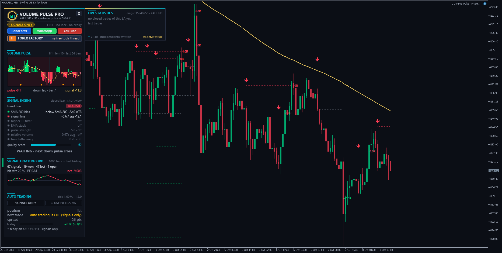

<!-- auto-generated: remove this line after hand-editing so publish keeps your text -->

# ⚡ TL Volume Pulse Pro

**Own volume-pulse oscillator EA: SMA 200 bias, entry on the second closed pulse bar after a zero cross.**

     

## 📥 Download

| Platform | File |
|---|---|
| **MT4** | [`TL Volume Pulse Pro.ex4`](MT4/TL%20Volume%20Pulse%20Pro.ex4) |
| **MT5** | [`TL Volume Pulse Pro.ex5`](MT5/TL%20Volume%20Pulse%20Pro.ex5) |

> Compiled build only — source code is not published.

## Independently Written

This EA was written from scratch by trader.lifestyle - own code, own formulas, based on our own ideas. It is not a copy, port or decompile of anybody's indicator or product and uses no third-party code.

WHAT'S NEW IN v1.10 (rules after user feedback)
- Trend bias / histogram background = SMA 200 (price above = buys only, below = sells only). The v1.00 EMA-slope bias is still available.
- Entry only after the SECOND closed pulse bar of a zero cross, and only when the pulse direction matches the SMA 200 bias.
- Signal line of the pulse (EMA 9) is part of the entry: pulse beyond its signal line (or: + signal line pointing the same way / signal line beyond zero - input "Signal line condition").
- Optional higher-timeframe filter (ON / OFF): HTF pulse beyond its signal line, HTF signal line beyond zero, or HTF pulse beyond zero.
- Score / volume / anti-chop / EMA stack filters are now optional extras (all OFF by default).
- No order traffic during the broker's daily break (gold 00:00-01:05).

## 1. Volume Pulse (own engine)

Every candle's tick volume is signed by WHERE the candle closes inside its range (close at the high = full buying, close at the low = full selling). Signed volume and volume are smoothed, pulse = 100 x signed / total, so it always runs from -100 to +100. Gold line = its signal line.

## 2. Entry (defaults)

- pulse crosses the zero line
  - after the 2nd closed pulse bar: pulse direction = SMA 200 bias
  - pulse beyond its signal line
  - (optional) higher timeframe agrees Entry at the close of that bar, one entry per pulse leg.

## 3. Stop / Target / Management

Stop behind the swing of the last N bars + ATR buffer (min/max in ATR - a stop that would be too wide = no trade). Target 1:2 (input). Optional: break even, partial close, ATR or EMA trailing, exit on the opposite signal.

## 4. Risk

Risk % per trade (or fixed lots), max lots, max spread, max trades per day, daily loss limit (optionally closes the EA trades), session hours, Friday stop, long/short only.

## The Panel

- Volume Pulse histogram (64 bars) + signal line, SMA 200 bias as background, signal markers
- Signal engine: every condition as a traffic light (bias, signal line, higher TF, optional extras) + quality score
- Signal track record: all signals of the rules on your chart history, replayed bar by bar (stop or target, stop first if one bar hits both, NO costs) - an honest quick check, not a full backtest
- Auto trading ON / signals only, close EA trades (2 clicks), open trade with progress in R, daily guard, live statistics of the EA (magic number)
- X folds the panel to a pill, drag the header to move it, it avoids other trader.lifestyle panels on the same chart
- Chart: SMA 200, signal arrows, R result tags, live SL/TP lines

## Install

- MT5: copy "TL Volume Pulse Pro.ex5" to  File > Open Data Folder > MQL5\Experts
- MT4: copy "TL Volume Pulse Pro.ex4" to  File > Open Data Folder > MQL4\Experts Refresh the Navigator, drag the EA on a chart, allow Algo Trading.
- "Allow DLL imports" is only needed for the link buttons in the panel.

## Important

No performance promises. Trading is risky - test on a demo account first. The track record in the panel shows how the rules did on YOUR chart.

Forex Factory: <https://www.forexfactory.com/thread/1428808-free-eas-indicators-strategies-mt4> YouTube: <https://www.youtube.com/@traderlifestyle>

## 🖼️ More screenshots

---

**Built by [trader.lifestyle](https://www.youtube.com/@traderlifestyle)** · [Forex Factory thread](https://www.forexfactory.com/thread/1428808-free-eas-indicators-strategies-mt4) · [YouTube](https://www.youtube.com/@traderlifestyle) · [WhatsApp](https://wa.me/18585003724)

### ✨ CREATED WITH [INDICATORGENIUS.COM](https://indicatorgenius.com) ✨

Trading involves substantial risk. This tool is provided free and as-is for education. Test on a demo account first. Past behaviour is no guarantee of future results.

