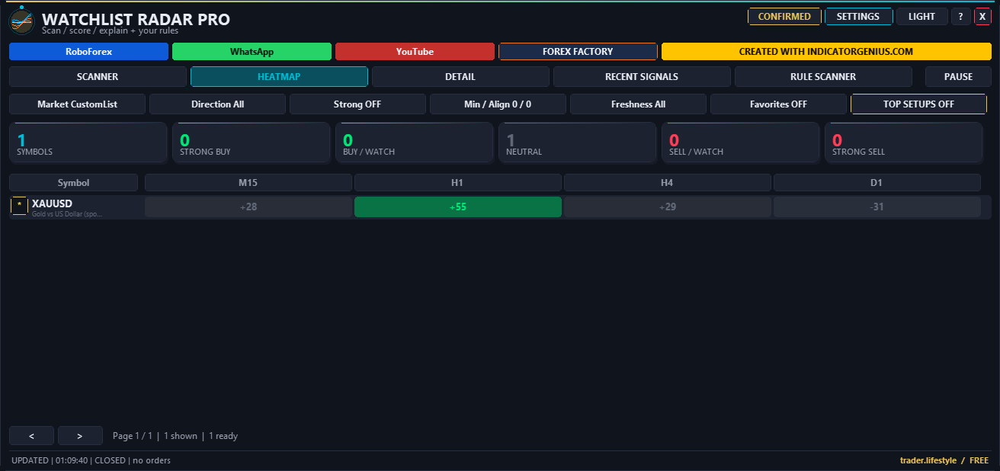
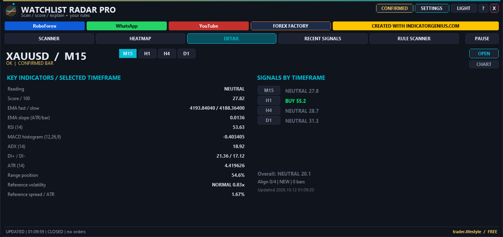
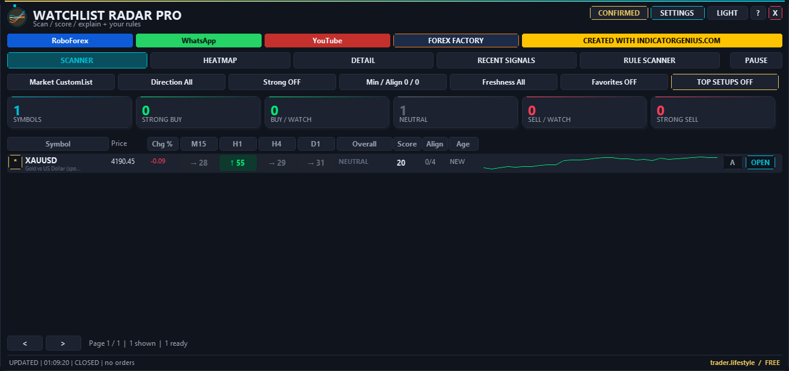

# ⚡ TL Watchlist Radar Pro

**Multi-symbol watchlist radar: scanner, heatmap, metrics and rules — scanner only, no trading.**

     

## 📥 Download

| Platform | File |
|---|---|
| **MT4** | [`TL_Watchlist_Radar_Pro.ex4`](MT4/TL_Watchlist_Radar_Pro.ex4) |
| **MT5** | [`TL_Watchlist_Radar_Pro.ex5`](MT5/TL_Watchlist_Radar_Pro.ex5) |

> Compiled build only — source code is not published.

## ✨ Highlights

- **Scan up to 200 symbols** across any mix of timeframes — Market Watch, a custom list or your favorites.
- **Seven rule families:** daily reference, daily open, session VWAP, timeframe open, candle pivot, moving average and consecutive candles.
- **Transparent scoring:** a fully documented trend / momentum / structure / DMI score per symbol and timeframe.
- **Six views:** scanner, heatmap, detail, recent signals, rule scanner and a ten-page settings panel.
- **Smart alerts** on transitions only, with cooldowns, gates and per-symbol muting.
- **Scanner only — it never opens, modifies or closes orders.** No DLL, no WebRequest, no lock, no expiry.

## 🧠 How it works

### Universes & timeframes

- Up to **200 symbols**. Market Watch additions / removals are checked every 30 seconds. Custom / Favorites lists use commas.
- Exact broker names are preferred; suffix resolution is accepted only when unique. Ambiguous / missing names are reported.
- Changing the universe rebuilds the scan and starts signal-age tracking again.
- **MT5 timeframes:** M1, M2, M3, M4, M5, M6, M10, M12, M15, M20, M30, H1, H2, H3, H4, H6, H8, H12, D1, W1, MN1.
- The same enabled rules run independently on every selected timeframe. The **reference timeframe** governs sparkline, spread / ATR, volatility and overall age. Equal or custom non-negative weights combine the timeframe scores (one weight per selected timeframe when custom weighting is on).

### Seven rule families

| Rule | Reference |
|---|---|
| **Daily reference** | Previous broker D1 close, open, high, low, HLC3 or HL2 |
| **Daily open** | Opening price of the evaluated candle's broker D1 session |
| **Session VWAP** | M1 typical price (H+L+C)/3 weighted by tick or real volume, accumulated from the broker D1 open. A bar-volume approximation, not exchange tick-by-tick VWAP. Real volume must come from the broker — no silent tick fallback. |
| **Timeframe open** | Open of the evaluated candle on each selected timeframe |
| **Candle pivot** | HLC3, HL2 or OHLC4 of the evaluated or preceding candle — a candle average, not a swing-pivot detector |
| **Moving average** | Period 1..2000; SMA, EMA, SMMA or LWMA; close / open / high / low / median / typical / weighted price. Native platform MA on each TF. |
| **Consecutive candles** | 1..100 bullish, bearish or either; At Least or Exactly N. Only completed candles count (also in LIVE mode). Doji and candles with a body not greater than the minimum-body setting break the sequence. Counts are capped by the requested lookback (N+2 closed candles). |

- Rules 1–6 each have their own **Disabled / Above / Below** choice and a non-negative point offset.
- **ALL / ANY** combines the enabled rule families. No enabled rules = no rule match. Missing data in any enabled rule blocks a match, including in ANY mode.
- **Any timeframe / ALL timeframes** is a separate symbol-level match requirement. The upper scoring filters also apply if you explicitly enable them.
- **Above** means strictly price > reference + N × the symbol's broker point; **Below** means strictly price < reference − N × point. Equality fails (a tiny tolerance rejects floating-point noise).

> **Points are not pips:** on a five-decimal EURUSD quote, 20 points = 0.00020; on a symbol with point size 0.01, 20 points = 0.20.

### Confirmed vs. Live

- **CONFIRMED** compares the most recently closed candle's close with references anchored to that candle. A Friday candle stays anchored to Friday across a weekend.
- **LIVE** compares the current bid and may change until the candle closes; the LIVE score includes the forming bar. Stale live quotes do not match.
- Closed-bar rule results can remain valid while the market is closed; the health label and alert gate separately show market closure or stale quotes.

### Scoring formula (independent — not the original's numbers)

The score describes strength — it is **not a probability or an instruction to trade**. Four signed components, each bounded to [−1, 1], use weights **30 / 25 / 25 / 20** by default, normalized to 100:

| Component | Formula |
|---|---|
| **Trend** | 0.65 × clip((EMAfast − EMAslow) / ATR) + 0.35 × clip(4 × EMAfastSlope / ATR) |
| **Momentum** | 0.6 × clip((RSI14 − 50) / 30) + 0.4 × clip(5 × MACDhist / ATR) |
| **Structure** | 0.4 × (2 × rangePosition − 1) + 0.3 × mean(highDirection, lowDirection) + 0.3 × breakoutDirection |
| **DMI strength** | clip(2 × (DI+ − DI−) / max(1, DI+ + DI−)) × clip01(ADX14 / 40) |

- Range uses the previous 20 bars; high / low direction compares with a 20-bar range shifted back 10 bars; breakout compares the evaluated close with that prior range.
- EMA defaults 20 / 50, MACD 12 / 26 / signal 9. Wilder-smoothed ATR / RSI / DMI / ADX use period 14 with zero-seeded smoothing over max(350, 6 × slowEMA) bars where available, requiring max(100, 3 × slowEMA) bars. EMA starts from the first available close; EMA slope is a one-bar change. This seed convention is explicit and may differ from other indicators.
- **Classification:** magnitude < 40 neutral · ≥ 40 watch · ≥ 55 buy / sell · ≥ 75 strong. The sign gives the direction.
- **Overall** = weighted signed mean of the selected TF scores. **Alignment** counts non-neutral timeframe signals with the same sign as the overall classification. All selected TF scores and reference TF data must be available for an overall status.
- **Volatility** = ATR14 / mean of the previous 50 ATR14 values: < 0.7 low, < 1.3 normal, < 2 high, otherwise extreme.
- **Overall age** = bars since the observed classification change on the reference timeframe (no backfill before attachment).
- Presets: Default / Trend / Swing / Intraday (non-default values are independent choices, not recovered original values). Fast / Normal / Low CPU / Custom modes control refresh and bounded scan batches.

## 🖥️ Dashboard & chart

| View | What you get |
|---|---|
| **SCANNER** | One row per symbol: price / change, individual TF scores, overall score, alignment, age, trend sparkline, favorite, mute and chart-open actions. Click a column to sort; **TOP SETUPS** ranks strength, alignment, then freshness. Page / TF arrows for lists and columns that don't fit. Click a score for Detail. |
| **HEATMAP** | Signed directional strength across symbols and timeframes |
| **DETAIL** | Candle / tick-volume chart and the four score contributions; **METRICS** opens the full indicator list and signals by timeframe |
| **RECENT SIGNALS** | Confirmed transitions, newest first (retention 5..100 rows) |
| **RULE SCANNER** | Pass / fail and distance in broker points for every enabled rule |
| **SETTINGS** | Ten pages; numeric / text values open an editor, enums cycle on click. Enter / APPLY saves, Esc / CANCEL cancels. Changes autosave locally per chart ID. |

- The star edits Favorites, **A/M** toggles per-symbol alert muting, **OPEN** opens that symbol at the reference timeframe (or the selected detail timeframe).
- **X** collapses the panel to a draggable pill (click to reopen); drag the header to reposition.
- Dark / light theme, animated logo, hover explanations and scale 1..2.
- Community buttons show the destination URL in a dialog — open it in your browser.

### 🔔 Filters & alerts

- **Filters** (SETTINGS): direction, strong-only, minimum score / alignment, freshness, favorites, category, volatility, spread quality and symbol search. Market categories use broker paths / name heuristics — unusual names may land in "Other". Spread / ATR can be ignored, warned about or filtered. Missing history is shown.
- **Alerts default OFF.** Popup and sound channels default ON but stay inactive until *Enable alerts* is ON. Push / email need the terminal's own notification setup.
- **Events:** new Buy / Sell, Strong Buy / Sell, score crossing, direction reversal, new Watch, alignment reached and new rule match.
- Alerts need a **transition**, not every tick. Default cooldown: 900 seconds per symbol / timeframe / event.
- Independent gates: minimum score / alignment, confirmed-only, fresh-only and broker-time active hours (overnight supported; equal hours = all day).
- Muted symbols, stale / closed-market health and configured spread exclusions suppress notifications. In the Strategy Tester, notifications are logged, never sent. On first initialization, existing states do not trigger transition alerts.

## 🚀 Quick start — the requested 20-point example

1. **SETTINGS → SCAN:** choose Market Watch, Custom List or Favorites.
2. **SETTINGS → TIMEFRAMES:** enter `M15,H4` (or your preferred comma-separated periods).
3. **SETTINGS → PRICE RULES:** Daily open: side = **Above**; Day Open Points = **20**.
4. Enable **Only show rule matches** to reduce the list to matches.
5. Use **RULE SCANNER** to inspect each symbol / timeframe and each enabled condition.

## 🛠️ Installation

1. In your terminal open **File → Open Data Folder**.
2. **MT4:** copy `TL_Watchlist_Radar_Pro.ex4` to `MQL4 → Experts`. **MT5:** copy `TL_Watchlist_Radar_Pro.ex5` to `MQL5 → Experts`.
3. Refresh **Navigator → Expert Advisors** and attach the matching EA to one chart.
4. Open **SETTINGS** in the dashboard — all configuration lives in the panel; the standard EA Inputs tab intentionally has no scanner parameters.
5. Select the scan universe, timeframes and filters, then wait for history to load.

## 📋 Requirements

- The platform must allow the EA to run and fetch history. Trading permission is not needed — no orders are ever opened, modified or closed.
- No DLL imports, no WebRequest permission, no account lock or expiry.
- Minimum practical chart area: about **784 × 532 pixels**. Enlarge the chart if controls are clipped; the panel scale is capped to the available space.

## 🙏 Credits

- Original concept: [Multi Market Scanner MT4](https://www.mql5.com/en/market/product/198327) by **Eduardo Cumplido / Cloud Portfolios**.
- Demonstration: [YouTube video](https://www.youtube.com/watch?v=n0kDJ0xZeaM).
- Independent extensions and FF edition: **trader.lifestyle**.

## ⚠️ Notes

- **Independent reconstruction.** This rebuilds publicly demonstrated scanner functions, with the requested price / VWAP / MA / candle-series extensions. It is not the original Multi Market Scanner, is not endorsed by its author and does not reproduce any proprietary source code. Identical scores, preset values and hidden behaviour cannot be established from screenshots and a demonstration video.
- **Feature basis:** the original's six MQL5 screenshots, 80 sampled video frames and the video transcript. Hidden menu behaviour and the original maths remain unverified.
- **Layout differences:** pagination replaces the original scrolling / TF-chip layout; there is no separate ellipsis action menu or distinct minimize / close pair. Market Watch reconciliation is periodic, and the scheduler uses sequential bounded batches.
- **Languages:** English is the complete primary interface. Spanish, Italian and French cover navigation and many setting labels; help, rule descriptions and some status / value strings remain English.
- In the MT4 Strategy Tester only the selected test symbol can be scanned — use a demo terminal to check multi-symbol behaviour. Exhaustive mouse / DPI / language checks are not claimed; review the build on your own demo installation.
- Scanner conditions are information, not guaranteed outcomes.

## 🖼️ More screenshots

---

**Built by [trader.lifestyle](https://www.youtube.com/@traderlifestyle)** · [Forex Factory thread](https://www.forexfactory.com/thread/1428808-free-eas-indicators-strategies-mt4) · [YouTube](https://www.youtube.com/@traderlifestyle) · [WhatsApp](https://wa.me/18585003724)

### ✨ CREATED WITH [INDICATORGENIUS.COM](https://indicatorgenius.com) ✨

Trading involves substantial risk. This tool is provided free and as-is for education. Test on a demo account first. Past behaviour is no guarantee of future results.

